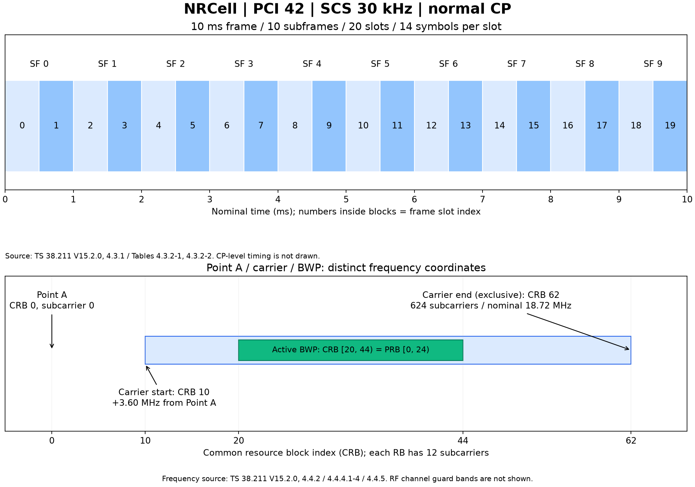

# NR-GPT：NR Release 15 Python 物理层仿真

以 3GPP R15 为基线的链路级仿真平台。当前已实现 **NRCell、NRGrid、SRS收发、PUCCH F0时域收发、OFDM/逐符号相位、TA/噪声/CFO、公共序列、上行RI/TPMI码本及日志诊断**。

## 快速开始

```powershell
python -m venv .venv
.venv\Scripts\python -m pip install -e ".[dev,plots]"
.venv\Scripts\python examples/cell/NRCell_demo.py
.venv\Scripts\python -m pytest --require-matlab --cov=cell --cov=grid --cov=diagnostics --cov=srs --cov=common --cov=channel --cov-branch --cov-report=term-missing --cov-fail-under=100
.venv\Scripts\python examples/cell/plot_NRCell.py
.venv\Scripts\python examples/cell/plot_NRCell_timing.py
.venv\Scripts\python examples/grid/NRGrid_demo.py
.venv\Scripts\python examples/grid/plot_NRGrid_channel_colors.py
.venv\Scripts\python -X utf8 examples/srs/NRSRS_demo.py
.venv\Scripts\python -X utf8 examples/srs/compare_NRSRS_reference.py
.venv\Scripts\python -X utf8 examples/srs/NRSRSReceiver_demo.py
.venv\Scripts\python -X utf8 examples/srs/compare_NRSRSReceiver_reference.py
.venv\Scripts\python -X utf8 examples/common/NROFDM_demo.py
.venv\Scripts\python -X utf8 examples/channel/NRChannel_demo.py
```

`--require-matlab` 要求仓库中存在实际 MATLAB 生成的参考向量；测试本身不需要 MATLAB 许可证。重新生成向量需要本机 MATLAB 5G Toolbox。

```python
from cell import NRCell

cell = NRCell(n_cell_id=42, subcarrier_spacing_khz=30,
              n_start_grid=10, bwp_start=20, bwp_size=24,
              duplex_mode="TDD", n_tx_antennas=4, n_rx_antennas=2)
print(cell.slots_per_frame)   # 20
print(cell.prb_to_crb(0))     # 20，BWP 起点相对 CRB 0
print(cell.n_fft, cell.sample_rate_hz, cell.tc_per_sample)  # 1024、30720000、64
print(cell.symbol_timing(0))  # 当前时隙首符号的 CP/有效/总长度：Tc 与采样点
```

## 目录

```text
documentation/
  protocols/             协议原文、协议译文
  planning/              开发计划
  validation/            验证结果说明
src/cell/
  __init__.py            模块导出
  NRCell.py              小区类源码
  NRCell.md              对应类的详细说明
examples/cell/
  NRCell_demo.py         小区示例，输出 NRCell_config.json
  plot_NRCell.py         绘图脚本，输出同级 PNG/SVG
  plot_NRCell_timing.py  FFT、CP、精确时隙时序图
  export_NRCell_reference.m  MATLAB 参考生成脚本
  NRCell_reference.json  MATLAB 实测参考数据
  NRCell_timing.json     子帧时序与当前时隙明细
  NRCell_timing.csv      当前时隙逐符号 Tc / 采样点数
tests/unit/              每个类的单元测试
tests/matlab/            MATLAB 独立参考对比测试
src/diagnostics/         ExampleLogger.py 与同级类说明：日志、调用路径和变量快照
src/grid/                NRGrid.py 与同级类说明：单时隙端口域网格
examples/grid/           网格演示、NPZ/JSON、图片及 MATLAB 独立参考
src/srs/                 NRSRS.py、NRSRS.md 与固定 R15 原表常量
src/common/              公共Gold/低PAPR/u/v、上行码本、NROFDM、NRPhaseRotation及同级文档
src/pucch/               PUCCH F0资源/发射机/接收机及同级类文档
examples/common/         序列/OFDM/相位示例、JSON/NPZ/图片及真实MATLAB参考
src/channel/             NRChannel.py / NRChannel.md：TA、AWGN、CFO
examples/channel/        SRS时域信道链路、波形/测量/图片及MATLAB参考
examples/srs/            SRS 序列/网格/梳齿/跳频图、频率CSV、MATLAB 实测与比较
```

- [公式变量阅读指南：含义、范围、单位、维度与协议章节](documentation/formula_reference.md)
- [NRCell：变量、方法、公式与示例](src/cell/NRCell.md)
- [NRGrid：坐标、映射、预留和冲突策略](src/grid/NRGrid.md)
- [NRSRS：字段、序列、跳频和映射公式](src/srs/NRSRS.md)
- [NRCommon：Gold伪随机序列、SRS的u/v获取](src/common/NRCommon.md)
- [NRSRSReceiver：信道、噪声、用户时延、上行RI/TPMI](src/srs/NRSRSReceiver.md)
- [NRUplinkCodebook：R15标准矩阵与上行选择策略](src/common/NRUplinkCodebook.md)
- [SRS接收端独立验证](documentation/validation/NRSRSReceiver_validation.md)
- [NROFDM：调制、解调、CP和缩放](src/common/NROFDM.md)
- [NRPhaseRotation：每符号载波/FFT窗口/定时相位](src/common/NRPhaseRotation.md)
- [NRChannel：TA、AWGN和连续CFO](src/channel/NRChannel.md)
- [时域SRS链路示例](examples/channel/README.md)
- [SRS 演示与 MATLAB 独立比对](examples/srs/README.md)
- [SRS 实测验证报告](documentation/validation/NRSRS_validation.md)
- [NRGrid 示例与独立验证](examples/grid/README.md)
- [物理信道颜色与显示接口](src/grid/channel_colors.md)
- [示例、生成文件及 MATLAB 数据格式](examples/cell/README.md)
- [工程架构与命名约定](documentation/architecture.md)
- [开发计划](documentation/planning/NR_R15_物理层仿真平台开发计划.md)
- [规范基线与校验值](documentation/spec_manifest.md)
- [测试与 MATLAB 对比](documentation/validation/NRCell_validation.md)
- [后续模块进度](documentation/feature_matrix.md)
- [本次一致性检查记录](documentation/validation/project_audit.md)
- [日志类、参数和使用方法](src/diagnostics/ExampleLogger.md)



`pip install -e .` 会生成 `src/nr_r15_phy.egg-info/`，用于记录包名、版本、依赖及安装文件清单。它不是源码，已被 Git 忽略，安装后可以删除；再次安装可能重新生成。类说明随源码存放，示例的配置中间文件、MATLAB 输出和图片都与示例脚本同级。

## 当前边界

NRCell 表示单方向、单 numerology 载波和一个活动 BWP 的配置切片。没有实现完整 gNB、RF 频段组合、TDD 时隙格式、多 BWP 切换或物理信道收发。240 kHz 作为 R15 numerology 可表示，不代表所有数据信道支持该 SCS。

支持 TDD/FDD 模式元数据、物理收发天线数、固定 Tc/Ts、逐符号 CP 与精确采样时序。FFT 根据每符号频域 RE 数（子载波数）取能容纳它的最小 2 的幂，并以 128 为下限；它是平台约定，不是协议强制值。Tc/Ts 固定，实际采样间隔由 FFT×SCS 决定，三者不能混用。

NRGrid 采用 `[端口,符号,子载波]` 数组和独立标签记录资源占用；零值映射及预留均算已占用。它通过显式端口数管理局部逻辑端口，不把物理天线数量直接当作端口数量。数据固定 complex128，返回数组副本，当前仅承载一个时隙，不执行 OFDM 或具体物理信道算法。

规范表、公式和代码均标明来源；新类需同时提供说明和单元测试，具体物理信道需增加 MATLAB 比对。当前 MATLAB 验证载波尺寸、FFT、采样率、完整子帧及当前时隙的逐符号时序；BWP 坐标、双工/天线元数据和状态转换由独立单元测试检查。

## 许可证

本项目原创代码采用[个人非商业使用许可与商业授权条款](LICENSE)：个人以自身学习、研究和兴趣为目的的非商业使用免费；商业使用须提前取得书面授权，并按双方约定付费。企业内部研发、评估、培训、客户项目、产品集成和收费服务均属于商业使用，不以是否已经盈利为前提。商业授权请联系仓库所有者，价格与授权范围另行约定。

这是自定义的源码可见许可，包含商业使用限制，不属于 [OSI 开源定义](https://opensource.org/osd)下的开源许可证。协议文档和第三方材料保留各自版权与许可；新条款不追溯撤销已合法取得的旧版本授权。

`.coverage` 是 pytest-cov/coverage.py 运行时生成的覆盖率数据库，记录被测试执行的代码行与分支，不是仿真数据或源码。可以删除，下一次使用 `--cov` 测试时会重新生成；Git 已忽略此文件。

## 示例日志

直接运行三个 Python 示例会在 `examples/cell/` 同级生成 `NRCell_demo.log`、`plot_NRCell.log`、`plot_NRCell_timing.log`，记录函数调用路径、参数、出口值、耗时和完整 NRCell 变量快照（12 字段、8 常量、35 属性）。终端默认显示 INFO 摘要与变量，文件包含 DEBUG 调用详情；设置 `$env:NR_LOG_LEVEL = "DEBUG"` 可在终端同时查看调用链。日志 UTF-8、时间戳 UTC、每次运行覆盖，已被 Git 忽略。详见[日志类文档](src/diagnostics/ExampleLogger.md)。

NRGrid 示例同样生成 `examples/grid/NRGrid_demo.log`，完整打印该演示网格的字段、常量和属性，数值数组另存 NPZ；目录说明见 [examples/grid/README.md](examples/grid/README.md)。


2026-10-26测量接口更新：NRChannel仅通过`snr_db`添加噪声；NRSRSReceiver输出每UE的SNR、RSSI和SRS-RSRP（项目工程指标，归一化功率与dB）。[信道参数](src/channel/NRChannel.md)、[接收指标口径](src/srs/NRSRSReceiver.md)。


PUCCH Format 0已实现HARQ-ACK/SR→OFDM→时域TA/CFO/SNR信道→相关接收与DTX，运行入口[examples/pucch](examples/pucch/README.md)。[资源](src/pucch/NRPUCCH0.md)、[发射机](src/pucch/NRPUCCH0Transmitter.md)、[接收机](src/pucch/NRPUCCH0Receiver.md)；960组序列/坐标及40组时域用例已与真实MATLAB独立比对。扩展CP的固定R15寻址适配见[验证报告](documentation/validation/NRPUCCH0_validation.md)，其余PUCCH格式尚未实现。


PUCCH阶段绘图使用[NRPlotConfig](src/diagnostics/NRPlotConfig.md)的enabled/stages字段，默认示例直接显示case0全部28阶段、5个分页图窗；不保存图片。发送序列、OFDM内部、时域信道、接收补偿及候选判决均可按阶段名筛选，详见[运行与显示说明](examples/pucch/README.md)。

PUCCH F0新增[三UE循环移位复用示例](examples/pucch/NRPUCCH0_multiuser_demo.py)：共用时频资源，经独立增益、时域叠加和SNR噪声后逐用户接收；含UE静默DTX案例。[分配说明](examples/pucch/README.md#三用户循环移位复用)与[实际MATLAB验证](documentation/validation/NRPUCCH0_multiuser_validation.md)。

PUCCH Format 1已增加[完整时域收发示例](examples/pucch/NRPUCCH1_demo.py)及[验证报告](documentation/validation/NRPUCCH1_validation.md)，支持1/2bit、DMRS、时域OCC、slot内跳频和DMRS辅助接收。

PUCCH F2首版支持3～11位UCI小块编码、速率匹配、加扰QPSK、DMRS、1/2符号、连续1～16RB及slot内跳频。见[时域示例](examples/pucch/NRPUCCH2_demo.py)和[MATLAB验证](documentation/validation/NRPUCCH2_validation.md)。12位以上Polar尚未实现，接口明确拒绝。

Common新增[Polar母码](src/common/NRPolarCode.md)、[NR LDPC码块](src/common/NRLDPCCode.md)、[经典RM](src/common/NRRMCode.md)及对应解码；CRC和完整信道速率匹配边界见类文档。

当前PUCCH2/3均接入[公共UCI编码链](src/common/NRUCICode.md)，包含小块码与Polar CRC/PC/速率匹配/分段；新增[F3示例](examples/pucch/NRPUCCH3_demo.py)和[F2长UCI示例](examples/pucch/NRPUCCH2_Polar_demo.py)。当前验证见[报告](documentation/validation/NRPUCCH3_validation.md)。早期“F2仅3～11位”的限制已解除，实际长度仍受资源和码率约束。

PUCCH Format4已实现：固定1RB，SF2/4全部OCC、QPSK/π/2-BPSK、完整时域收发、小块/Polar及CRC。见[示例](examples/pucch/NRPUCCH4_demo.py)、[资源文档](src/pucch/NRPUCCH4.md)、[MATLAB验证](documentation/validation/NRPUCCH4_validation.md)。

PUSCH支持1～4层CP-OFDM、QPSK至256QAM、Type-A DMRS Type1/2单/双符号及附加位置；接收端联合DMRS信道估计、ZF均衡和单码块UL-SCH解码。见[4层时域示例](examples/pusch/NRPUSCH_mimo_demo.py)、[资源文档](src/pusch/NRPUSCH.md)、[MATLAB验证报告](documentation/validation/NRPUSCH_mimo_validation.md)。多码块、DFT-s-OFDM、动态TPMI预编码、UCI/PTRS及HARQ合并待扩展。

PDSCH首版已实现单层CP-OFDM、QPSK至256QAM、Type-A/Type-1单符号DMRS，以及单码块DL-SCH CRC/LDPC/RV0～3有限缓冲速率匹配。见[示例](examples/pdsch/NRPDSCH_demo.py)、[类文档](src/pdsch/NRPDSCH.md)、[独立验证](documentation/validation/NRPDSCH_validation.md)。多层/多码块、预留RE、PTRS及自动调度仍待扩展。

PDSCH现支持1～4层单码字、DMRS Type1/2单/双符号及附加位置，端口频域/时域OCC联合估计后ZF均衡。[4层MIMO示例](examples/pdsch/NRPDSCH_mimo_demo.py)、[独立验证](documentation/validation/NRPDSCH_mimo_validation.md)。

PRACH已支持R15长/短13种格式、非受限集合64前导、根/循环移位分配和独立PRACH时域收发。接收端输出前导编号及采样点时延，支持多Rx和不同移位多用户。见[三UE示例](examples/prach/NRPRACH_demo.py)、[资源文档](src/prach/NRPRACH.md)、[MATLAB验证](documentation/validation/NRPRACH_validation.md)。发送RO显式给定；受限集合及ConfigurationIndex调度、RAR/Msg3待扩展。

当前全仓语句/分支覆盖率门限为100%；本轮1101项测试通过，3286条语句、982个分支全部覆盖。补齐内容、不可达逻辑依据及复现命令见[覆盖率验证](documentation/validation/coverage_validation.md)。

PDCCH已实现CORESET/显式候选、聚合等级1/2/4/8/16、REG交织/非交织、CRC24C/RNTI及Polar、DMRS辅助时域收发。见[示例](examples/pdcch/NRPDCCH_demo.py)和[验证报告](documentation/validation/NRPDCCH_validation.md)。全仓1141项通过，覆盖率100%。

全部已实现信道的100MHz/30kHz用例（273PRB、4096FFT、122.88MS/s）见[用例矩阵与运行入口](documentation/validation/NR100MHz_30kHz_validation.md)，包含10组带噪时域链路及真实MATLAB独立参考。

SSB首版已实现PSS/SSS/PBCH/DMRS、BCH载荷/CRC/Polar及完整时域收发；已知时频窗口内搜索PCI、SSB索引及Lmax4半帧位，恢复24位广播载荷和完整SFN。见[示例](examples/ssb/README.md)、[100MHz示例](examples/ssb/NRSSB_100MHz_30kHz_demo.py)及[验证报告](documentation/validation/NRSSB_validation.md)。实际MATLAB25例通过，全仓1276项/100%覆盖率。盲时间/CFO捕获、突发集调度和MIB字段打包待扩展。

新手阅读入口：[物理信道新手阅读指南](documentation/channel_walkthrough.md)，包含各信道的信号生成、时频位置、配置对照与接收流程。

参考信号首版：[NRCSIRS](src/csirs/NRCSIRS.md)（单端口Row1/2）、[NRUplinkPTRS](src/ptrs/NRUplinkPTRS.md)、[NRDownlinkPTRS](src/ptrs/NRDownlinkPTRS.md)（单层CP-OFDM资源与CPE测量）；[实际MATLAB验证及未覆盖项](documentation/validation/NRReferenceSignals_validation.md)。
