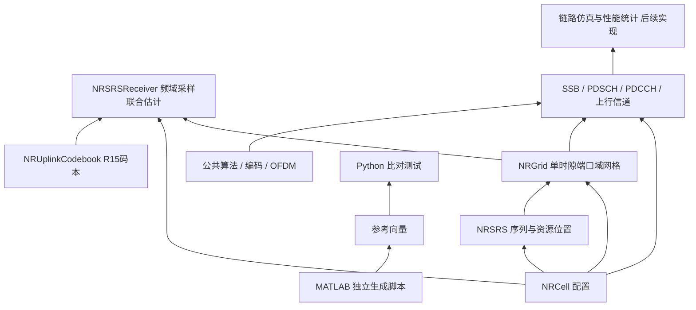

# 工程架构

## 当前模块

模块直接置于 `src/` 下，通过 `from cell import NRCell` 导入。核心配置类位于 `src/cell/NRCell.py`，当前不依赖第三方数值库。`NRCell` 采用不可变 dataclass，封装单方向、单 numerology、单活动 BWP 的小区配置切片，并记录 TDD/FDD 与物理收发分支数。

`examples/` 仅组织演示和绘图，不承载核心算法。`tests/unit/` 检查每个类，`tests/matlab/` 消费 MATLAB 独立结果，`examples/cell/` 保存可重现 MATLAB 脚本和实际输出。

NRGrid 位于 `src/grid/NRGrid.py`，依赖 NumPy 与 NRCell，单时隙数组为 `[port,symbol,subcarrier]`。复数数据和 U64 占用标签分离，外部数组通过副本返回，写入前统一检查边界、重复、数值和冲突。类说明与源码同级，示例及 MATLAB 参考位于 `examples/grid/`。

NRSRS 位于 `src/srs/NRSRS.py`，以不可变 NRCell 为输入，负责固定 R15 的参考信号序列、候选时隙和频域 RE 坐标，通过 map_to_grid 调用 NRGrid 原子映射。generate 给出未缩放原始序列，映射时施加 beta/√P。外部调度、半持续激活、非周期触发与 TDD 许可由 enabled 输入；功控、天线预编码、波形和信道估计留在后续模块。Gold生成和SRS的u/v获取已移到src/common/NRCommon.py，由SRS调用；低PAPR基序列和带宽表仍放在srs内；同级类文档与 `examples/srs/` 保存全部接口说明、图片及832组真实MATLAB参考。

## 命名与入口

接收端位于 `src/srs/NRSRSReceiver.py`：使用NRGrid生成已知参考，联合拟合频域采样到有限因果FIR，输出多用户信道/噪声/时延。接收输入轴为[Rx,L,K]，与发送端[P,L,K]的物理含义分开。`src/common/NRUplinkCodebook.py`提供固定R15 PUSCH矩阵与RI/TPMI搜索；接收算法保持独立，不把调度/CFO/时域OFDM放入NRCell。详细边界、噪声mask、时延窗口和归一化均在对应同级类文档说明。

以下是工程命名约定表，不是协议原表。类、类文件和与该类相关的文件均保留准确类名及大小写；模块目录、变量和方法使用小写或 snake_case。

| 用途 | 当前路径或名称 |
|---|---|
| 类 / 模块 | `NRCell` / `cell` |
| 源码 / 类说明 | `src/cell/NRCell.py` / `src/cell/NRCell.md` |
| 包导出 | `from cell import NRCell`，由 `src/cell/__init__.py` 导出 |
| 直接导入 | `from cell.NRCell import NRCell` |
| 示例 / 绘图 | `examples/cell/NRCell_demo.py` / `plot_NRCell.py` |
| MATLAB 函数及同名文件 | `export_NRCell_reference` / `export_NRCell_reference.m` |
| 产物 | `NRCell_config.json`、`NRCell_reference.json`、`NRCell_overview.png/.svg` |
| 单元测试 / MATLAB 测试 | `tests/unit/test_NRCell.py` / `tests/matlab/test_NRCell_matlab.py` |

发行包名称 `nr-r15-phy` 是安装元数据名称，不是导入路径；使用 `pip install -e .` 后导入 `cell`。`*.egg-info`、`.coverage` 和 `__pycache__` 是工具生成的数据，不属于仿真产物，也不提交 Git。

## 文档组织

- `documentation/protocols/`：协议原文和译文。
- `documentation/planning/`：实施计划。
- `src/<模块>/<类名>.md`：与源码同目录的类说明，解释字段、属性、方法、示例及规范出处。
- `examples/<模块>/`：与源码模块对应的示例脚本，以及该模块产生的中间文件、MATLAB 参考 JSON 和 PNG/SVG。输出路径根据脚本自身位置确定，不随工作目录改变。
- `documentation/validation/`：实际验证结果及验证边界。
- `documentation/spec_manifest.md`：基线与协议文件哈希。
- `documentation/feature_matrix.md`：模块完成状态。

## 依赖方向与扩展

后续公共算法、编码与 OFDM 作为底层函数，具体物理信道依赖这些函数及 NRCell/NRGrid。仿真调度和结果汇总位于上层，不将所有信道算法堆放在 NRCell 中。



NRCell 只管理资源坐标与帧时隙，不负责网格内存、天线预编码或波形。当前类使用 CRB 0 作为载波/BWP 起点的共同参考；网格局部子载波索引与 BWP PRB 索引各自独立。

NRCell 根据载波频域 RE 数选择至少 128 的最小 2 的幂 FFT，并计算每个天线分支的采样率、固定 Tc/Ts 与精确 CP 时间轴。时序计算不分配实际波形内存，也不把天线分支数乘入 FFT 点数。TDD/FDD 当前只作为元数据，不代替 TDD 符号调度或 FDD 频率配置。MATLAB 对比显式传入同一 FFT，参考 `nrOFDMInfo` 的逐符号输出。

## 新类的交付要求

诊断系统位于 `src/diagnostics/ExampleLogger.py`，类说明与源码同级，单元测试为 `tests/unit/test_ExampleLogger.py`。十三个 Python 示例/比较入口（cell 三个、grid 两个、srs 四个、common 三个、channel 一个）使用 with 作用域启用当前线程的项目调用跟踪，在同级 `.log` 文件中保存 DEBUG 详情；小区/网格/SRS示例另通过 dump_state 输出具名对象状态，色卡示例输出颜色表。诊断层依赖标准库，不改变物理层算法，也不把 logger 写入不可变配置。日志属于运行中间文件，由 `*.log` 忽略。

信道配色集中于 `src/grid/channel_colors.py`，通过只读色表、channel_color 和 encode_owners 统一显示。颜色是项目可视化规则，不属于 3GPP 协议参数；不影响网格数据和占用状态，不意味着尚未实现的物理信道已可运行。

每个新类同时提交实现、单元测试与独立 Markdown 文档，说明每个字段/属性/方法并提供示例。每个协议参数表标原文章节与原表号；每个公式标版本和章节，推导式注明推导来源。具体物理信道还必须提交 MATLAB 生成脚本、带环境信息的独立输出及 Python 对比测试。

NRCommon的两个静态公共接口分别负责通用31bit Gold序列/片段和专用SRS u/v规则。公共层不依赖具体信号类；SRS保留alpha、带宽/跳频、RE映射。类文档与源码同级，示例和真实nrPRBS参考位于examples/common/。

时域边界：src/common/NROFDM.py提供单slot CP-OFDM；NRPhaseRotation.py负责§5.4逐符号载频补偿与FFT窗口/时移相位；src/channel/NRChannel.py负责TA、复AWGN和连续CFO。波形轴为[分支,样点]，与MATLAB[样点,分支]转置；SRS接收机仍接收已解调网格，由examples/channel/NRChannel_demo.py串联完整已知CFO校正链路。所有对应类MD/测试/示例和实际参考同时提供。


## Markdown公式排版约定

项目开发文档的块级公式统一使用独占行的`$$`作为开始和结束，公式块前后留空行；不使用`\[`、`\]`作为Markdown公式分隔符。后者在部分预览器中会被处理成普通方括号，导致LaTeX命令直接显示。公式不能放在代码围栏中，否则将按源码展示。

示例（M1是本文自编号排版示例，不是协议原公式号）：

```markdown
$$
F_s = N_{\mathrm{FFT}}\Delta f. \tag{M1}
$$
```

公式仍须按项目要求标明规范版本、章节或说明是工程推导。2026-10-26已扫描全项目文档，9份类文档统一块级分隔符，并补齐协议译文6处公式块后的空行。使用KaTeX 0.16.22检查全部282个块级公式及3085个行内公式，均通过语法解析。译文SHA256随排版修改同步更新。此次只修改排版，无需重新生成MATLAB数值参考。查看时请使用支持数学公式的Markdown预览器。


2026-10-27变量说明约定：每个公式须给出符号的含义、协议/代码范围、单位和维度，并注明求和/平均的轴。上方排版示例中Fs是采样率（sample/s，正实标量）、Nfft是FFT长度（sample，正整数标量）、Delta_f是SCS（Hz，正实标量）；当前代码范围Nfft128..4096且2的幂、SCS为15000/30000/60000/120000/240000。新建[公式变量阅读指南](formula_reference.md)说明全部公共约定，具体类文档就近列出变量表，协议译文用显式辅助注释跳转到同版R15分组表。


## PUCCH Format 0时域收发（2026-10-27）

src/pucch下NRPUCCH0保存单slot、单RB资源和标准UCI移位映射；NRPUCCH0Transmitter组合NRGrid和公共NROFDM生成[1,T]单端口波形；空间映射与NRChannel在时域作用后，NRPUCCH0Receiver接收[Rx,T]，按显式已知同步参数补偿、OFDM解调，再对合法UCI序列做逐Rx/符号非相干相关和DTX。原始网格只用于发送和演示，接收不旁路信道。

Gold与PUCCH参数在NRCommon，12点相位表移到common/_low_papr_tables.py，SRS保留原导入别名，数值未变。每种未来PUCCH格式使用独立类，复用共用算法与时域信道；当前不添加声称支持其他格式的空实现。DTX背景噪声按活动参考的SNR生成，不提供直接噪声功率接口。详细边界、矩阵轴与R15/Toolbox适配见[模块示例](../examples/pucch/README.md)。


## 可关闭的阶段可视化

NRPlotConfig与NRStagePlotter放在src/diagnostics，图片直接显示，不提供图像文件输出路径。收发类通过plot_config字段或共享plotter控制显示；NROFDM的可选plotter只读取实际变换中间结果，关闭时不收集额外快照。完整示例对时域TA、空间映射、传播、CFO及噪声逐步记录，与发送/接收阶段统一分页显示；labels和轴注明采样点、slot符号、FFT数组号、归一化功率或rad。绘图不能改变数组、候选或判决，数组快照只供显示。数值JSON/NPZ与旧有图片产物独立，原有图片不删除，新绘图不更新或新建图片文件。

PUCCH F0多用户演示：各NRPUCCH0Transmitter独立产生波形，经各自复增益后在时域叠加，NRChannel按混合信号SNR加噪；同一接收波形进入多个NRPUCCH0Receiver。发送前validate_cyclic_shift_group检查全部UCI候选移位互斥；接收机逐用户相关，非联合估计。资源、同步与检测边界见[案例说明](../examples/pucch/README.md#三用户循环移位复用)。

PUCCH F1使用独立NRPUCCH1资源及收发类，复用现有Common序列、NROFDM和NRChannel；DMRS与数据相对符号交替，按跳和类型分别OCC。接收假设每跳平坦且近似不随时间变化，先DMRS估计再MRC。接口详见[src文档](../src/pucch/NRPUCCH1.md)。

PUCCH F2复用NRSmallBlockCode（3～11位）、Gold、NRGrid、NROFDM及NRChannel；每RB每符号4DMRS/8数据RE，接收按每符号每RB估计平坦增益，MRC后形成解扰软分数并ML译码。类接口见[资源文档](../src/pucch/NRPUCCH2.md)。

PUCCH2/3共享NRUCICode编码链，NRSmallBlockCode处理A≤11，NRPolarCode.transform与UCI外层处理A≥12。LDPC仍独立服务后续数据信道。F3数据按每符号单位化DFT预编码；接收在频域MRC后单位化IDFT，再调制软解映射及公共译码。detected表示信号检测，crc_ok单独表示CRC状态。

F4新增独立资源/收发类，复用F3单RB几何和DMRS基础序列，共享NRUCICode/NROFDM/NRChannel。调制数据每符号仅12/SF点，先OCC块复制成12点再DFT；接收在IDFT后共轭OCC分块平均。DMRS按OCC索引配置独立循环移位，不能与数据OCC混用。

PUSCH的pusch模块提供1～4层资源/收发类，公共NRULSCHCode负责单码块TB CRC、BG/Z/填充、LDPC和RV全缓冲速率匹配/恢复。码字符号轮流映射各层；Type1/2单/双符号DMRS保留频域/时域OCC。外部有效MIMO信道在时域叠加各层波形，每RB联合LS估计[Rx,Layer]信道，检查秩/条件数后ZF及逆层映射恢复码字。detected、equalizer_ok、converged、crc_ok分别表示参考检测、均衡可解、LDPC收敛和TB CRC状态。信道假设每RB整个分配时间内近似恒定，附加DMRS不代表时变插值。

新增pdsch模块资源/收发类，NRDLSCHCode继承共享CRC/BG/Z/LDPC数值算子并实现下行有限缓冲选择；common/_qam.py提供Gray标记QAM。首版单层端口1000，DMRS估计/MRC后max-log解映射，DL-SCH反速率匹配/LDPC/CRC恢复TB；复用NRGrid、NROFDM、NRChannel。Nref由上层显式给定，None是Nref=N特例；不宣称自动执行UE能力到TBS_LBRM的推导。

PDSCH更新为1～4层单码字：QAM码字符号轮流映射各层，NRGrid/OFDM按层输出逻辑端口波形，外部有效MIMO矩阵映射/叠加到Rx。Type1/2端口DMRS保留频域/时域OCC，Rx每RB联合LS估计[Rx,Layer]信道，检查条件数/秩后ZF，逆层映射恢复单码字。每RB/整段时间假设近似恒定，附加DMRS不等于已实现时变插值。

PRACH采用src/prach独立模块，NRCell提供BWP、Fs及Rx数量，NRPRACH维护固定R15表和一次显式RO；RA间隔独立于UL间隔，不能用普通NRGrid/NROFDM替代。NRPRACHTransmitter生成ZC→DFT→独立PRACH IFFT→CP/重复，外部NRChannel施加样点TA/CFO/SNR噪声后，NRPRACHReceiver平均有效周期并按64前导相关检测。time_origin_samples与数组内occasion_start_samples分别表示物理时间原点和捕获偏移，共同决定短格式CP边界，避免FR2子slot的CP误加。

PDCCH模块src/pdcch维护CORESET与单个显式候选，common/NRDCICode独立提供CRC24C/RNTI、输入交织Polar和速率匹配/SC译码。资源类负责REG/CCE、Gold/QPSK/DMRS，收发类复用NRGrid/NROFDM及NRChannel。每REG以3点参考估计[Rx,REG]平坦信道，MRC恢复9点QPSK及码字，不把SearchSpace调度隐式放入NRCell。

SSB模块src/ssb复用NRCell/NRGrid/NROFDM及common/NRBCHCode；资源分离PSS、SSS、PBCH与DMRS，保留完整240×4含零RE。发送24位载荷经BCH时序追加/载荷加扰/CRC/Polar后物理加扰映射；接收已知时频窗口内搜索PCI/DMRS索引，按符号LS/MRC及SC还原载荷。SSB间隔须与载波一致；突发集/Case A～E/SSB raster和MIB语义不由NRCell隐式推导。

面向初学者的逐信道讲解入口：[物理信道新手阅读指南](channel_walkthrough.md)，统一说明RE/RB、时频坐标、采样点长度和收发链路，并链接各资源/收发类教程。
