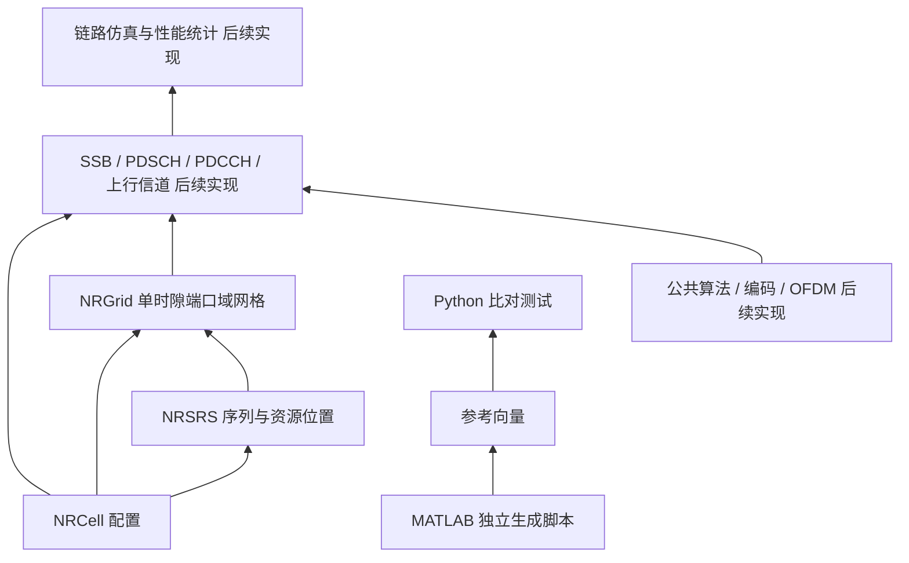

# 工程架构

## 当前模块

模块直接置于 `src/` 下，通过 `from cell import NRCell` 导入。核心配置类位于 `src/cell/NRCell.py`，当前不依赖第三方数值库。`NRCell` 采用不可变 dataclass，封装单方向、单 numerology、单活动 BWP 的小区配置切片，并记录 TDD/FDD 与物理收发分支数。

`examples/` 仅组织演示和绘图，不承载核心算法。`tests/unit/` 检查每个类，`tests/matlab/` 消费 MATLAB 独立结果，`examples/cell/` 保存可重现 MATLAB 脚本和实际输出。

NRGrid 位于 `src/grid/NRGrid.py`，依赖 NumPy 与 NRCell，单时隙数组为 `[port,symbol,subcarrier]`。复数数据和 U64 占用标签分离，外部数组通过副本返回，写入前统一检查边界、重复、数值和冲突。类说明与源码同级，示例及 MATLAB 参考位于 `examples/grid/`。

NRSRS 位于 `src/srs/NRSRS.py`，以不可变 NRCell 为输入，负责固定 R15 的参考信号序列、候选时隙和频域 RE 坐标，通过 map_to_grid 调用 NRGrid 原子映射。generate 给出未缩放原始序列，映射时施加 beta/√P。外部调度、半持续激活、非周期触发与 TDD 许可由 enabled 输入；功控、天线预编码、波形和信道估计留在后续模块。Gold生成和SRS的u/v获取已移到src/common/NRCommon.py，由SRS调用；低PAPR基序列和带宽表仍放在srs内；同级类文档与 `examples/srs/` 保存全部接口说明、图片及832组真实MATLAB参考。

## 命名与入口

以下是工程命名约定表，不是协议原表。类、类文件和与该类相关的文件均保留准确类名及大小写；模块目录、变量和方法使用小写或 snake_case。

| 用途 | 当前路径或名称 |
|---|---|
| 类 / 模块 | `NRCell` / `cell` |
| 源码 / 类说明 | `src/cell/NRCell.py` / `src/cell/NRCell.md` |
| 包导出 | `from cell import NRCell`，由 `src/cell/__init__.py` 导出 |
| 直接导入 | `from cell.NRCell import NRCell` |
| 示例 / 绘图 | `examples/cell/NRCell_demo.py` / `plot_NRCell.py` |
| MATLAB 函数及同名文件 | `export_NRCell_reference` / `export_NRCell_reference.m` |
| 产物 | `NRCell_config.json`、`NRCell_reference.json`、`NRCell_overview.png/.svg` |
| 单元测试 / MATLAB 测试 | `tests/unit/test_NRCell.py` / `tests/matlab/test_NRCell_matlab.py` |

发行包名称 `nr-r15-phy` 是安装元数据名称，不是导入路径；使用 `pip install -e .` 后导入 `cell`。`*.egg-info`、`.coverage` 和 `__pycache__` 是工具生成的数据，不属于仿真产物，也不提交 Git。

## 文档组织

- `documentation/protocols/`：协议原文和译文。
- `documentation/planning/`：实施计划。
- `src/<模块>/<类名>.md`：与源码同目录的类说明，解释字段、属性、方法、示例及规范出处。
- `examples/<模块>/`：与源码模块对应的示例脚本，以及该模块产生的中间文件、MATLAB 参考 JSON 和 PNG/SVG。输出路径根据脚本自身位置确定，不随工作目录改变。
- `documentation/validation/`：实际验证结果及验证边界。
- `documentation/spec_manifest.md`：基线与协议文件哈希。
- `documentation/feature_matrix.md`：模块完成状态。

## 依赖方向与扩展

后续公共算法、编码与 OFDM 作为底层函数，具体物理信道依赖这些函数及 NRCell/NRGrid。仿真调度和结果汇总位于上层，不将所有信道算法堆放在 NRCell 中。

NRCell 只管理资源坐标与帧时隙，不负责网格内存、天线预编码或波形。当前类使用 CRB 0 作为载波/BWP 起点的共同参考；网格局部子载波索引与 BWP PRB 索引各自独立。

NRCell 根据载波频域 RE 数选择至少 128 的最小 2 的幂 FFT，并计算每个天线分支的采样率、固定 Tc/Ts 与精确 CP 时间轴。时序计算不分配实际波形内存，也不把天线分支数乘入 FFT 点数。TDD/FDD 当前只作为元数据，不代替 TDD 符号调度或 FDD 频率配置。MATLAB 对比显式传入同一 FFT，参考 `nrOFDMInfo` 的逐符号输出。

## 新类的交付要求

诊断系统位于 `src/diagnostics/ExampleLogger.py`，类说明与源码同级，单元测试为 `tests/unit/test_ExampleLogger.py`。八个 Python 示例/比较入口（cell 三个、grid 两个、srs 两个、common 一个）使用 with 作用域启用当前线程的项目调用跟踪，在同级 `.log` 文件中保存 DEBUG 详情；小区/网格/SRS示例另通过 dump_state 输出具名对象状态，色卡示例输出颜色表。诊断层依赖标准库，不改变物理层算法，也不把 logger 写入不可变配置。日志属于运行中间文件，由 `*.log` 忽略。

信道配色集中于 `src/grid/channel_colors.py`，通过只读色表、channel_color 和 encode_owners 统一显示。颜色是项目可视化规则，不属于 3GPP 协议参数；不影响网格数据和占用状态，不意味着尚未实现的物理信道已可运行。

每个新类同时提交实现、单元测试与独立 Markdown 文档，说明每个字段/属性/方法并提供示例。每个协议参数表标原文章节与原表号；每个公式标版本和章节，推导式注明推导来源。具体物理信道还必须提交 MATLAB 生成脚本、带环境信息的独立输出及 Python 对比测试。

NRCommon的两个静态公共接口分别负责通用31bit Gold序列/片段和专用SRS u/v规则。公共层不依赖具体信号类；SRS保留alpha、带宽/跳频、RE映射。类文档与源码同级，示例和真实nrPRBS参考位于examples/common/。
