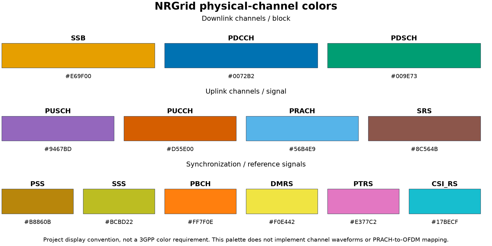
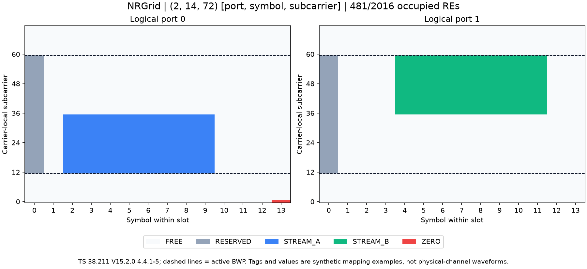

# NRGrid 示例、数据与图

类源码和完整 API 说明：[NRGrid.md](../../src/grid/NRGrid.md)。安装依赖：`python -m pip install -e ".[dev,plots]"`。这里的 STREAM_A/STREAM_B 等标签是通用资源映射演示，不是已实现的物理信道。

## 入口与文件

这是项目文件登记表，不是协议原表。所有默认输出均与脚本同目录，不依赖终端工作目录。

| 文件 | 用途 |
|---|---|
| [NRGrid_demo.py](NRGrid_demo.py) | 创建 2 端口、6 RB、normal CP、载波 CRB 10/BWP CRB 11 起点的网格，演示预留、映射、零值占用和冲突保护 |
| [NRGrid_summary.json](NRGrid_summary.json) | NRGrid.summary 输出：小区配置、轴顺序、shape、dtype、总/占用/空闲 RE 数 |
| [NRGrid_data.npz](NRGrid_data.npz) | 完整 complex128 数据、Unicode 标签和各映射选择坐标；可以不启用 pickle 读取 |
| [NRGrid_overview.png](NRGrid_overview.png) / [SVG](NRGrid_overview.svg) | 按端口显示资源标签；虚线为活动 BWP 边界 |
| `NRGrid_demo.log` | 函数调用链、参数、出口值、耗时、NRCell/NRGrid 完整状态；运行生成，Git 忽略 |
| [export_NRGrid_reference.m](export_NRGrid_reference.m) | MATLAB 5G Toolbox 独立参考生成入口 |
| [NRGrid_reference.json](NRGrid_reference.json) | 实际 MATLAB 版本、时间与 18 组参考结果 |
| [plot_NRGrid_channel_colors.py](plot_NRGrid_channel_colors.py) | 生成不同物理信道、同步/参考信号的固定配色图；不生成信道波形 |
| [NRGrid_channel_colors.png](NRGrid_channel_colors.png) / [SVG](NRGrid_channel_colors.svg) | DL、UL、同步/参考信号分组色卡 |
| [NRGrid_channel_colors.json](NRGrid_channel_colors.json) | 18 个已知绘图类别到 HEX 的映射 |

```powershell
.venv\Scripts\python examples/grid/NRGrid_demo.py
.venv\Scripts\python examples/grid/plot_NRGrid_channel_colors.py
matlab -batch "addpath('examples/grid'); export_NRGrid_reference;"
.venv\Scripts\python -m pytest --require-matlab --cov=cell --cov=grid --cov=diagnostics --cov-branch --cov-report=term-missing --cov-fail-under=100
```

Linux/macOS 将虚拟环境解释器替换为 `.venv/bin/python`。只有重新生成 MATLAB 参考时需要 MATLAB/5G Toolbox。日志默认终端 INFO、文件 DEBUG；需要终端显示调用链可设置 `NR_LOG_LEVEL=DEBUG`，希望减少终端状态输出可设为 WARNING，文件仍保存完整详情。变量数组完整输出，日志量会比 NRCell 标量参数更大。

## 物理信道颜色

SSB、PDSCH、PDCCH、PUSCH、PUCCH、PRACH、SRS 使用固定且不同的颜色。DM-RS/PT-RS/CSI-RS 等也提供独立颜色；来源是项目配色表，不是协议强制颜色。现有网格图按 owner 动态生成图例，不再只识别演示流标签。`PDSCH:UE0` 和 `PDSCH:UE1` 同色，未知标签灰色。

详见[颜色表及接口说明](../../src/grid/channel_colors.md)。配色图不把 PRACH 错画成普通 OFDM 信道，也不声称任何尚未实现的物理信道已经可运行。



## 摘要与 NPZ 格式

演示形状为 `(2,14,72)`，总 RE 数 2016。RESERVED 预留 96 个，STREAM_A 和 STREAM_B 各映射 192 个，ZERO 映射 1 个零值 RE；共占用 481 个，空闲 1535 个。物理发送天线数为 4，逻辑网格端口数为 2，两者没有直接等同。

以下是软件文件结构表，不是协议原表；RE 和 BWP 坐标依据 TS 38.211 V15.2.0 §4.4.2–§4.4.5。

| NPZ 键 | 形状与含义 |
|---|---|
| `data` | complex128，`[port,symbol,subcarrier]`，完整网格复数值 |
| `owners` | Unicode U64，同形状；空字符串空闲，非空占用，包括零值与预留 |
| `reserved_indices` | `(96,3)`，当前时隙符号 0、BWP 4 个 PRB 的两个端口 |
| `stream_a_indices` | `(192,3)`，端口 0、符号 2..9、BWP PRB 0/1 |
| `stream_b_indices` | `(192,3)`，端口 1、符号 4..11、BWP PRB 2/3 |

```python
from pathlib import Path
import json
import numpy as np

# 从项目根目录运行。
folder = Path("examples/grid")
summary = json.loads((folder / "NRGrid_summary.json").read_text(encoding="utf-8"))
with np.load(folder / "NRGrid_data.npz", allow_pickle=False) as saved:
    assert saved["data"].shape == tuple(summary["shape"]) == (2, 14, 72)
    assert np.count_nonzero(saved["owners"] != "") == 481
    assert saved["data"][0, 13, 0] == 0
    assert saved["owners"][0, 13, 0] == "ZERO"
```

## MATLAB JSON

下面为参考文件格式说明表，不是标准原表。参数及索引规范出处见[验证报告](../../documentation/validation/NRGrid_validation.md)。

| 字段 | 含义 |
|---|---|
| `matlab_version` / `toolbox` | MATLAB R2024a 与实际 5G Toolbox 版本 |
| `generated_at` | 实际 UTC 生成时间 |
| `spec_baseline` / `axis_note` | R15 基线、Python 与 MATLAB 的轴顺序约定 |
| `cases` | 6 组 SCS/CP × 3 组宽度/端口，共 18 组 |
| `cases[].input` | NRCell 使用的 SCS、CP、载波/BWP 宽度和起点 |
| `cases[].selection` | n_ports，以及 PRB、符号、局部端口选择；MATLAB 单元素向量可能编码为标量 |
| `expected.python_shape` / `matlab_shape` | 本项目 `[p,l,k]` 与 MATLAB `[k,l,p]` 尺寸 |
| `expected.indices` / `linear_indices_1based` | 按选择生成的零基三元组与 MATLAB sub2ind 结果 |
| `expected.values_real` / `values_imag` | MATLAB 映射后提取的精确复数分量；第一个 RE 为 0，仍有占用 |
| `expected.reserve_index` | 预留的零基 `[p,l,k]`，与映射坐标不重叠 |
| `expected.occupied_re_count` / `total_re_count` / `nonzero_count` | 占用、总 RE 和非零值数量，三者不混用 |
| `expected.sum_real` / `sum_imag` | MATLAB 全网格实/虚部求和 |
| `expected.weighted_real` / `weighted_imag` | 按 MATLAB 列主序线性位置加权的实/虚部求和，检查映射位置与转置 |

参考中复数分量按 1/16 和 1/32 构造，可精确表示；对比容差为 0。原始参考由 MATLAB 生成，不用 Python 输出替代。标签管理属于测试程序独立添加的功能，不声称 MATLAB nrResourceGrid 自带标签或冲突策略。


