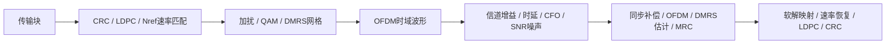

# PDSCH首版时域收发

```powershell
.venv\Scripts\python -X utf8 examples/pdsch/NRPDSCH_demo.py
.venv\Scripts\python -X utf8 examples/pdsch/compare_NRPDSCH_reference.py
```

[NRPDSCH_demo.py](NRPDSCH_demo.py)：256位TB、目标R0.5、RV0、16QAM、4RB、符号1起始/长度12、单层CP-OFDM、Type-A/Type-1单符号DMRS。DL-SCH显式Nref=1440；实际波形经两Rx复增益、延迟2采样点、CFO731Hz/初相0.23rad、整slot SNR25dB噪声后，显式同步补偿并接收译码。



`main(log,plot_config=None)`：log为ExampleLogger，plot_config可选NRPlotConfig，默认enabled=True/channel=PDSCH，传NRPlotConfig(enabled=False)关闭。返回接收dict，含bits、detected、crc_ok、converged、iterations等。阶段图包括编码位、QAM、网格、OFDM内部步骤、信道输出、信道估计、均衡星座和软值，直接显示、不保存图像或数值产物；本地日志Git忽略。

| 文件 | 用途 |
|---|---|
| [export_NRPDSCH_reference.m](export_NRPDSCH_reference.m) | 实际MATLAB生成32个PDSCH编码/网格/时域案例，包含有限缓冲 |
| [NRPDSCH_reference.json](NRPDSCH_reference.json) | 实际版本、输入TB、配置、编码位、网格、两Rx波形 |
| [compare_NRPDSCH_reference.py](compare_NRPDSCH_reference.py) | compare(write_report=True)逐位/逐样点比较并译码，默认写报告；False只比较；命令行精简输出 |
| [NRPDSCH_comparison.json](NRPDSCH_comparison.json) | 误差、TB CRC/LDPC状态、相关实现及参考SHA256 |

公共DL-SCH参考位于examples/common/export_NRDLSCHCode_reference.m、NRDLSCHCode_reference.json、compare_NRDLSCHCode_reference.py及NRDLSCHCode_comparison.json，包含CRC24A与4000位单码块。

TBS、目标码率和Nref均显式给定，不包含MCS/TBS调度或UE能力到Nref的自动选择。[资源文档](../../src/pdsch/NRPDSCH.md)、[发射机](../../src/pdsch/NRPDSCHTransmitter.md)、[接收机](../../src/pdsch/NRPDSCHReceiver.md)、[公共DL-SCH](../../src/common/NRDLSCHCode.md)、[验证边界](../../documentation/validation/NRPDSCH_validation.md)。

## 多层和DMRS扩展

运行`python examples/pdsch/NRPDSCH_mimo_demo.py`。main(log,plot_config=None)构造4层/4Rx、Type2双符号/附加位置1、相对端口(1,7,4,10)，16QAM/256位TB。每层波形经非对角4×4复信道实际叠加到Rx，再加入2采样点延迟、731Hz频偏和SNR25dB噪声；Rx通过DMRS联合LS/ZF恢复，不能读取真实H。plot_config默认NRPlotConfig(enabled=True,channel=PDSCH)，可按stages筛选；enabled=False关闭；返回接收dict，图只显示不保存。均衡星座图例为Layer，不是接收天线。

[实际MATLAB导出](export_NRPDSCH_mimo_reference.m)、[64例参考](NRPDSCH_mimo_reference.json)、[独立比较](compare_NRPDSCH_mimo_reference.py)、[比较报告](NRPDSCH_mimo_comparison.json)。compare(write_report=True)写报告，False只比较；命令行打印精简误差。新接口和实际范围见[最新验证](../../documentation/validation/NRPDSCH_mimo_validation.md)。上方单层例继续可用，实际接收已统一到LS/ZF（单层与MRC等价）。

## 100MHz / 30kHz测试

- [NRPDSCH_100MHz_30kHz_demo.py](NRPDSCH_100MHz_30kHz_demo.py)：PRB0～272，12符号，1024bit TB，单层QPSK。

统一使用FR1 273PRB/4096FFT/122.88MS/s；run_case(plot_config=None)关闭绘图，直接运行脚本默认显示。结果包含passed、公共元信息、resource、sent及result；图片不保存。每例独立MATLAB参考/比较文件同目录，名称为<类名>_100MHz_30kHz_reference.json和_comparison.json。

共同入口：[MATLAB导出](../common/export_NR100MHz_30kHz_reference.m)、[独立比较](../common/compare_NR100MHz_30kHz_reference.py)、[用例矩阵及边界](../../documentation/validation/NR100MHz_30kHz_validation.md)。
