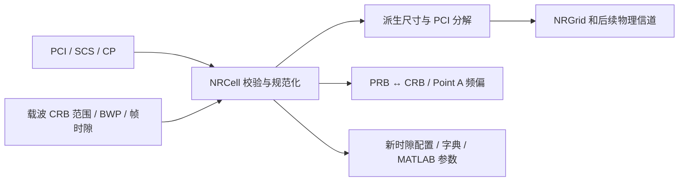
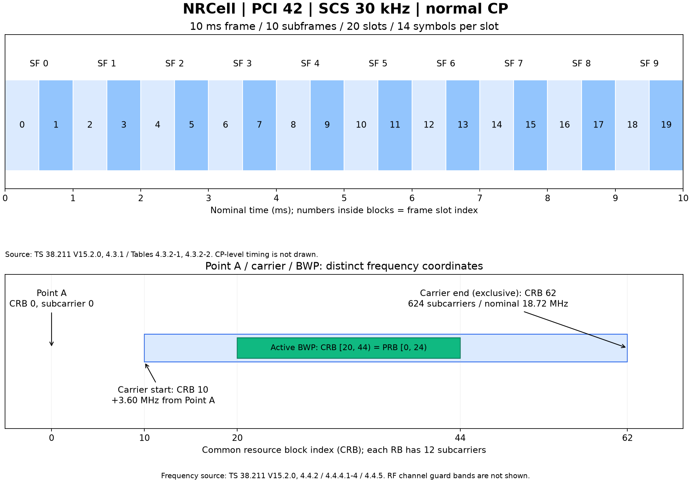
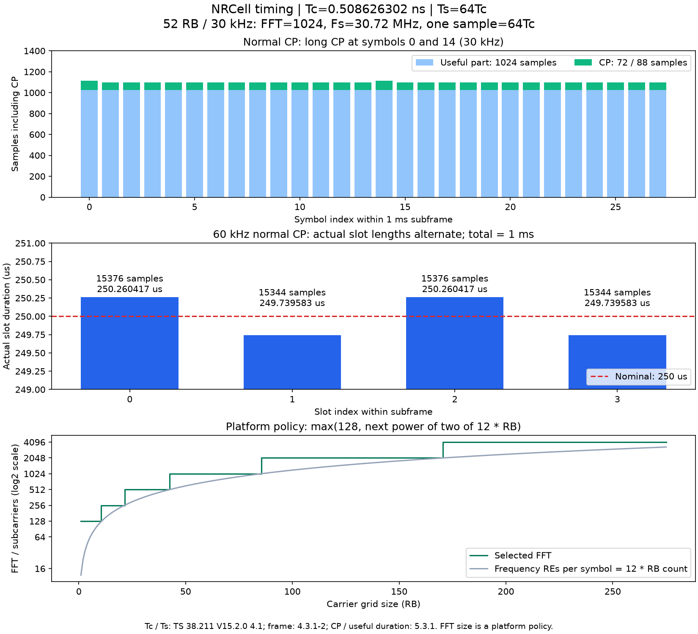

# NRCell 小区配置类

源码：[`NRCell.py`](NRCell.py)  
测试：[`tests/unit/test_NRCell.py`](../../tests/unit/test_NRCell.py)  
基线：**3GPP TS 38.211 V15.2.0 Release 15**。以下“§”均表示原文章节，另有说明的除外。

导入方式为 `from cell import NRCell`；直接从类文件导入也可使用 `from cell.NRCell import NRCell`。`cell` 是模块目录名，`NRCell` 是类名、源码文件名和类文档名，大小写保持一致。示例、测试及 MATLAB 脚本的命名规则见[工程架构](../../documentation/architecture.md)。

## 1. 这个类做什么

`NRCell` 保存小区物理标识、双工模式、物理收发天线分支数、一个 numerology 对应的载波网格、一个活动 BWP 及当前帧/时隙。它提供参数校验、资源坐标转换、FFT/采样率选择、逐符号 CP 和精确采样时序，以及 MATLAB 参数导出，供 NRGrid 和后续物理信道读取。

一个真实小区可以包含多个载波、方向与 BWP；当前类是它在链路仿真中的配置切片。它不产生资源网格或波形，也不执行调度、TDD 方向判定或 RF 带宽合法性检查。单元测试验证的是这些明确声明的功能。

构造后不可修改，防止后续信道生成时配置漂移。使用 `dataclasses.replace` 或 `with_slot_offset` 创建新对象。对象可相等比较、哈希及用 `repr` 查看。



## 2. 初始化变量：每个字段的含义与示例

下表是**本项目 API 设计表**，不是规范原表；最后一列给出规范概念或软件边界来源。所有索引从 0 开始。整数严格采用 Python `int`，拒绝 `bool`、浮点数和字符串；NumPy 整数需先 `int(value)`。

| 字段 | 默认值、单位、范围 | 用途及单独修改示例 | 原文/设计依据 |
|---|---|---|---|
| `n_cell_id` | `1`；0..1007 | PCI；`NRCell(n_cell_id=42)`；不是全球小区标识 NCGI | §7.4.2.1 |
| `subcarrier_spacing_khz` | `30` kHz；15/30/60/120/240 | 选择 numerology；`NRCell(subcarrier_spacing_khz=60)` | §4.2，原表 4.2-1 |
| `cyclic_prefix` | 默认 `"normal"`；可选 `"extended"` | CP 类型；`NRCell(subcarrier_spacing_khz=60, cyclic_prefix="extended")` | §4.2，原表 4.2-1；扩展 CP 只配 60 kHz |
| `n_size_grid` | `52` RB；1..275 | 载波网格宽度；`NRCell(n_size_grid=106)` | §4.4.2；范围对应 TS 38.331 V15.2.1 §6.3.2 SCS-SpecificCarrier / maxNrofPhysicalResourceBlocks |
| `n_start_grid` | `0` CRB；0..2199 | 载波最低 CRB；`NRCell(n_start_grid=10)` | §4.4.2；范围对应 TS 38.331 V15.2.1 §6.3.2 SCS-SpecificCarrier.offsetToCarrier |
| `bwp_start` | `None` → `n_start_grid`；单位 CRB | 活动 BWP 相对 **CRB 0** 的起点；`NRCell(bwp_start=10,bwp_size=24)` | §4.4.4.4、§4.4.5；上界由载波包含约束决定 |
| `bwp_size` | `None` → `n_size_grid`；单位 RB | 活动 BWP 宽度；`NRCell(bwp_size=24)` | §4.4.5；必须完整位于载波内 |
| `n_frame` | `0`；0..1023 | 当前系统帧号 SFN；`NRCell(n_frame=1023)` | TS 38.331 V15.2.1 §6.2.2 MIB 的 SFN 比特及说明；本 API 使用完整 10 bit SFN |
| `n_slot` | `0`；0..`slots_per_frame-1` | 帧内时隙；`NRCell(n_slot=19)` | §4.3.2；本 API 强制帧内索引 |
| `duplex_mode` | 默认 `"TDD"`；可选 `"FDD"` | `NRCell(duplex_mode="FDD")`；区分时分/频分双工 | §4.3.1 的双工适用帧结构；默认值为平台约定，不表示标准强制 |
| `n_tx_antennas` | 默认 `1`；正 Python int | `NRCell(n_tx_antennas=4)`；仿真端点的物理发送分支数 | 平台参数；§4.4.1 的逻辑天线端口不等同于物理天线数 |
| `n_rx_antennas` | 默认 `1`；正 Python int | `NRCell(n_rx_antennas=2)`；仿真端点的物理接收分支数 | 平台参数；不限制为某个协议端口上限 |

双工模式只记录 TDD/FDD，不自动分配 TDD 的 D/U/F 符号，也不配置 FDD 上下行中心频率。收发天线数不等于层数或参考信号端口数，不乘入每分支的 FFT、采样率或 RE 数。更大天线数可以表示，实际内存和信道维度在后续网格/信道模块中管理。

`bwp_start=None` 与 `bwp_size=None` 分别采用载波起点和整个载波宽度。若只把 BWP 起点向右移动而不缩小宽度，会超出载波并报错；不会静默裁剪。

```python
from cell import NRCell

cell = NRCell(n_cell_id=42, subcarrier_spacing_khz=30,
              cyclic_prefix="normal", n_size_grid=52, n_start_grid=10,
              bwp_start=20, bwp_size=24, n_frame=9, n_slot=3)
```

代码校验 `bwp_start` 的绝对包络 0..2473，来自本 API 最大载波起点 2199、最大宽度 275 和包含关系；**2473 不是规范另行规定的 BWP 起点上限**。此类也不解码 RRC 的 `locationAndBandwidth`。

## 3. 标准常量

以下为项目常量映射表，每个值均标注原文出处。

| 常量 | 值及示例 | 原文依据 |
|---|---|---|
| `SUBCARRIERS_PER_RB` | `NRCell.SUBCARRIERS_PER_RB == 12` | TS 38.211 V15.2.0 §4.4.4.1 |
| `SUBFRAMES_PER_FRAME` | `NRCell.SUBFRAMES_PER_FRAME == 10` | 同上 §4.3.1 |
| `FRAME_DURATION_S` | `NRCell.FRAME_DURATION_S == 0.01`，秒 | 同上 §4.3.1 |
| `SFN_MODULUS` | `NRCell.SFN_MODULUS == 1024` | TS 38.331 V15.2.1 §6.2.2，完整 SFN 的 10 bit 编号空间 |
| `TC_FREQUENCY_HZ` | `NRCell.TC_FREQUENCY_HZ == 1_966_080_000` Hz，即 1/Tc | TS 38.211 V15.2.0 §4.1，480000×4096 |
| `TS_FREQUENCY_HZ` | `NRCell.TS_FREQUENCY_HZ == 30_720_000` Hz，即 1/Ts | 同上 §4.1，15000×2048 |
| `KAPPA` | `NRCell.KAPPA == 64`，Ts/Tc | 同上 §4.1 |
| `MIN_FFT_SIZE` | `NRCell.MIN_FFT_SIZE == 128` | 平台约定；结合 §5.3.1 保证普通 CP 采样点数为整数，不是标准强制 FFT 下限 |

## 4. 只读属性：含义、单位与示例

除特别注明，下列示例使用上面的 `cell`。本表是 API 派生表，不是规范原表。

| 属性 | 含义及结果示例 | 原文依据/推导 |
|---|---|---|
| `numerology` | μ；`cell.numerology == 1` | §4.2，表 4.2-1 |
| `symbols_per_slot` | 每时隙符号数；`14`；扩展 CP 为 `12` | §4.3.2，表 4.3.2-1/-2 |
| `slots_per_subframe` | 每 1 ms 子帧时隙数；`2` | 同上 |
| `slots_per_frame` | 每 10 ms 帧时隙数；`20` | 同上 |
| `nominal_slot_duration_s` | **平均**时隙时长；`0.0005` 秒 | §4.3.1/§4.3.2 推导；不是逐 CP 精确时间戳 |
| `subframe_index` | 帧内子帧索引；`1` | §4.3.2 编号关系推导 |
| `slot_in_subframe` | 子帧内时隙索引；`1` | §4.3.2 编号关系推导 |
| `n_subcarriers` | 载波网格子载波数；`624` | §4.4.2、§4.4.4.1 |
| `bwp_n_subcarriers` | BWP 子载波数；`288` | §4.4.4.1、§4.4.5 推导 |
| `occupied_bandwidth_hz` | 网格名义占用带宽；`18_720_000` Hz | §4.2、§4.4.2 推导；非 TS 38.104 的 RF 信道带宽 |
| `n_id_1` | PCI 组号；`14` | §7.4.2.1 |
| `n_id_2` | PCI 组内编号；`0` | §7.4.2.1 |

### 4.1 帧结构、FFT 和采样单位

下表是 API 推导表，默认示例采用 `cell = NRCell()`，即 52 RB、30 kHz、normal CP、slot 0。FFT 根据**每个 OFDM 符号的频域 RE 数（子载波数）**选择，不能根据整个时隙 RE 数选择。RE 总数也不是可用的数据 RE 数，包含参考信号和保留资源。

| 属性 | 含义与默认结果示例 | 原文/设计依据 |
|---|---|---|
| `subframes_per_frame` | `cell.subframes_per_frame == 10` | §4.3.1 |
| `symbols_per_subframe` | `cell.symbols_per_subframe == 28` | §4.3.2 表 4.3.2-1/-2 推导 |
| `symbols_per_frame` | `cell.symbols_per_frame == 280` | §4.3.1/§4.3.2 推导 |
| `resource_elements_per_slot` | 每端口时隙 RE 数；`8736 = 624×14` | §4.4.2/§4.4.3 推导 |
| `n_fft` | `1024` 点；不小于频域 RE 数的最小 2 的幂，至少 128 | 平台规则 F10 |
| `sample_rate_hz` | `30_720_000` Hz，每个物理分支的采样率 | F11，§5.3.1 推导 |
| `sample_period_s` | `1/30_720_000` 秒，即约 32.552083333 ns | F11 |
| `tc_s` | 固定 Tc，约 `0.508626302083 ns` | §4.1，F9 |
| `ts_s` | 固定 Ts，约 `32.552083333 ns`；本配置恰好等于采样间隔 | §4.1，F9；其他配置不一定相等 |
| `tc_per_sample` | `64` Tc/采样点 | F11；当前自动 FFT 范围内恒为整数 |
| `useful_symbol_length_tc` | 不含 CP 的有效部分长度；`65536` Tc | §5.3.1，F12 |
| `samples_per_subframe` | `30720` 点，完整 1 ms | §4.3.1、F11 |
| `samples_per_frame` | `307200` 点，完整 10 ms | 同上 |
| `samples_per_slot` | 当前时隙含 CP 的总点数；`15360` | §5.3.1 求和；不是固定使用 Fs×平均时隙长度 |
| `slot_duration_s` | 当前时隙精确长度；`0.0005` 秒 | 当前时隙采样点数 / Fs |
| `slot_start_sample` | 当前时隙相对所在子帧的精确起点；slot 0 为 `0` | §5.3.1 逐符号累加 |

### 4.2 逐符号数组

以下是 API 数组表，依据 TS 38.211 V15.2.0 §5.3.1（无独立原表）。所有数组返回不可变 `tuple`，除 `slot_` 前缀外都覆盖**完整一个子帧**。`n_slot` 决定当前时隙数组，跨帧/跨子帧采用相同周期的时序。

| 属性 | 单位、范围和默认示例 |
|---|---|
| `cp_lengths_tc` | 各符号 CP 的 Tc 数；28 个值，前两个为 `(5632, 4608)` |
| `symbol_lengths_tc` | 各符号有效部分+CP 的 Tc 数；前两个为 `(71168, 70144)` |
| `cp_lengths_samples` | 各符号 CP 采样点数；前两个为 `(88, 72)` |
| `symbol_lengths_samples` | 各符号总点数；前两个为 `(1112, 1096)` |
| `symbol_start_samples` | 各符号 CP 起点，相对子帧；前 3 个为 `(0, 1112, 2208)`，不含末尾终点 |
| `slot_cp_lengths_samples` | 当前时隙各符号 CP 点数；14 个值，前两个为 `(88, 72)` |
| `slot_symbol_lengths_samples` | 当前时隙各符号总点数；14 个值，前两个为 `(1112, 1096)` |

60 kHz normal CP 时，长 CP 在子帧符号 0 和 28，slot 0/2 含长 CP，slot 1/3 全为短 CP。默认 52 RB 下，它们分别为 15376/15344/15376/15344 点。长 CP 不能错误地加到每个 slot 的首符号。`nominal_slot_duration_s` 为平均值，`slot_duration_s` 为当前 slot 的精确值。

## 5. Numerology 表与公式出处

以下按 **TS 38.211 V15.2.0 原表 4.2-1、4.3.2-1、4.3.2-2** 汇总。240 kHz 的数据行表示 numerology 本身，不代表该 SCS 可用于所有物理信道；具体信道必须另行校验。

| μ | SCS/kHz | CP | 符号/slot | slot/subframe | slot/frame | 原表 |
|---|---|---|---|---|---|---|
| 0 | 15 | normal | 14 | 1 | 10 | 4.2-1、4.3.2-1 |
| 1 | 30 | normal | 14 | 2 | 20 | 4.2-1、4.3.2-1 |
| 2 | 60 | normal | 14 | 4 | 40 | 4.2-1、4.3.2-1 |
| 2 | 60 | extended | 12 | 4 | 40 | 4.2-1、4.3.2-2 |
| 3 | 120 | normal | 14 | 8 | 80 | 4.2-1、4.3.2-1 |
| 4 | 240 | normal | 14 | 16 | 160 | 4.2-1、4.3.2-1 |

下列 F1–F13 是**本文自编号**。规范部分表达式未印独立公式号，因此用原文章节定位，不伪造 3GPP 公式编号。

**F1：SCS 与 numerology**，原文 §4.2 表 4.2-1：

$$\Delta f = 15\times 2^\mu\;\mathrm{kHz}$$

**F2：帧和时隙尺寸**，由原文 §4.3.1、§4.3.2 表 4.3.2-1/-2 推导：

$$N_{slot}^{subframe}=2^\mu,\quad N_{slot}^{frame}=10\times 2^\mu,\quad \overline T_{slot}=\frac{0.01}{N_{slot}^{frame}}\;\mathrm{s}$$

横线表示平均时长。精确 CP 和符号边界按 §5.3.1 计算，使用第 4.2 节数组与 `symbol_timing` 查询。

**F3：资源尺寸与网格名义带宽**，由 §4.4.2、§4.4.4.1 与 F1 推导：

$$N_{sc}=12N_{grid}^{size},\quad N_{sc,BWP}=12N_{BWP}^{size},\quad B_{grid}=N_{sc}\Delta f$$

最后一个公式的 Δf 使用 Hz。`occupied_bandwidth_hz` 不含 RF 信道保护带。

**F4：BWP 到公共资源块**，原文 §4.4.4.4：

$$n_{CRB}=n_{PRB}+N_{BWP}^{start}$$

**F5：BWP 包含约束**，将原文 §4.4.5 的两个约束写成等价区间形式：

$$[N_{BWP}^{start},N_{BWP}^{start}+N_{BWP}^{size})\subseteq[N_{grid}^{start},N_{grid}^{start}+N_{grid}^{size}),\quad N_{BWP}^{size}>0$$

**F6：网格子载波相对 Point A 的频偏**，由 §4.4.2、§4.4.4.2/§4.4.4.3 推导：

$$f_{offset}(k_{grid})=(12N_{grid}^{start}+k_{grid})\Delta f$$

Point A 是 CRB 0 子载波 0 的中心；本类不存 Point A 的绝对频率，也不将它当作载波中心。

**F7：PCI 分解**，原文 §7.4.2.1：

$$N_{ID}^{cell}=3N_{ID}^{(1)}+N_{ID}^{(2)},\quad N_{ID}^{(1)}\in[0,335],\;N_{ID}^{(2)}\in[0,2]$$

**F8：时隙推进**，本项目算法，基于 §4.3.2 的编号关系与 TS 38.331 V15.2.1 §6.2.2 的 SFN 编号空间推导：

$$q,r=\operatorname{divmod}(n_{slot}+offset,N_{slot}^{frame}),\quad SFN'=(SFN+q)\bmod1024,\quad n_{slot}'=r$$

**F9：固定时间单位**，原文 TS 38.211 V15.2.0 §4.1：

$$T_c=\frac{1}{480000\times4096},\quad T_s=\frac{1}{15000\times2048},\quad\kappa=\frac{T_s}{T_c}=64$$

**F10：FFT 点数选择**，平台规则；标准 §5.3.1 的连续时间表达式不强制这个离散 FFT 选择：

$$N_{FFT}=\max\left(128,\;2^{\lceil\log_2(12N_{grid}^{size})\rceil}\right)$$

128 下限保证 R15 普通 CP 长度为整数采样点。选择不计入 CRB 起点、时域符号数、BWP 宽度、天线数或保护带比例；本平台并未自动执行 RF 带宽/保护带约束校验。

**F11：采样间隔与 Tc 换算**，由 §4.1/§5.3.1 推导，Δf 用 Hz，不进行额外重采样：

$$F_s=N_{FFT}\Delta f,\quad T_{sample}=\frac1{F_s},\quad N_{Tc/sample}=\frac{1}{T_cF_s}$$

**F12：有效部分和 CP 的 Tc 数**，原文 §5.3.1，l 为**子帧内**符号编号：

$$N_u^\mu=2048\kappa\,2^{-\mu}$$

$$N_{CP,l}^\mu=\begin{cases}512\kappa\,2^{-\mu}&\text{extended CP}\\144\kappa\,2^{-\mu}+16\kappa&\text{normal CP},\ l=0\text{ or }l=7\cdot2^\mu\\144\kappa\,2^{-\mu}&\text{other normal CP symbols}\end{cases}$$

**F13：逐符号采样数与起点**，由 §5.3.1 的长度和起点递推推导：

$$N_{CP,l}^{sample}=\frac{N_{CP,l}^\mu}{N_{Tc/sample}},\quad N_{symbol,l}^{sample}=N_{FFT}+N_{CP,l}^{sample},\quad n_{start,l}=\sum_{i=0}^{l-1}N_{symbol,i}^{sample}$$

在自动 FFT 和 R15 参数范围内，上述 Tc 数及采样数均为整数。一个子帧总计 1966080 Tc，逐符号点数之和为 Fs/1000；一个系统帧为其 10 倍。

## 6. 每个函数做什么

此表是软件 API 表，不属于 3GPP 原表；规范相关操作对应上面的 F1–F8。

| 函数 | 输入、输出与示例 | 说明/依据 |
|---|---|---|
| `NRCell(...)` / 自动生成的 `__init__` | 第 2 节十二个字段 → 实例 | 自动调用 `__post_init__` |
| `__post_init__()` | 无显式输入、无返回值 | 校验整数类型、PCI/SCS/CP/尺寸/时序；将两个 `None` 规范化为整数；应用 F5 |
| `prb_to_crb(prb)` | `cell.prb_to_crb(0) == 20`；`23 → 43` | 输入必须属于活动 BWP；F4 |
| `crb_to_prb(crb)` | `cell.crb_to_prb(20) == 0`；`43 → 23` | 输入 CRB 必须属于当前活动 BWP；F4 逆变换 |
| `subcarrier_offset_hz(grid_subcarrier)` | `cell.subcarrier_offset_hz(0) == 3_600_000` | 输入为载波网格内子载波索引；F6 |
| `with_slot_offset(offset=1)` | `cell.with_slot_offset().n_slot == 4` | 返回新配置；支持负数和多帧偏移；F8 |
| `to_dict()` | 完整初始化字段字典 | `NRCell(**cell.to_dict()) == cell`；不含派生属性和类常量 |
| `to_matlab_config()` | MATLAB 属性名字典 | 见下节；不包含 BWP |
| `symbol_timing(symbol)` | 当前 slot 内单个符号索引 → 10 个整数信息字段 | 输入 0..symbols_per_slot-1，非法类型抛 TypeError、越界抛 ValueError；F12/F13 |
| 模块内 `_integer(name,value,lower,upper)` | 无返回值；非法时抛异常 | 软件校验工具，闭区间，不对应规范算法；由字段/坐标参数测试覆盖 |
| dataclass 自动生成的 `__repr__`、`__eq__`、`__hash__` | `repr(cell)`、`cell == NRCell(**cell.to_dict())`、`hash(cell)` | Python dataclass 行为，不属于通信规范 |

所有只读属性的 getter 已在第 4 节逐项说明。传入类型错误时抛 `TypeError`，取值或包含关系错误时抛 `ValueError`。冻结字段被赋值时抛 `FrozenInstanceError`。

`_integer` 的 `name` 是异常消息中的参数名，`value` 是待验证值，`lower`/`upper` 是含端点的范围；`upper=None` 表示不设上限，用于正整数天线数量。校验成功返回 `None`，不修改输入。它是模块内部函数，不需要由业务代码直接调用。

所有索引方法只接收单个 Python 整数，不接收列表或 NumPy 数组。`with_slot_offset` 的 `offset=0` 返回等值的新配置；偏移可以超过一帧，也可以为负。`to_dict` 和 `to_matlab_config` 返回独立字典，不返回内部状态的可变引用。

```python
from dataclasses import replace
from cell import NRCell

cell = NRCell(n_frame=1023, n_slot=19)
next_cell = cell.with_slot_offset()
assert (next_cell.n_frame, next_cell.n_slot) == (0, 0)
assert next_cell.with_slot_offset(-1) == cell
assert replace(cell, n_cell_id=42).n_cell_id == 42

# NRCell(cyclic_prefix="extended")  # ValueError：默认 SCS=30，需显式改为 60。
# NRCell(bwp_start=10)              # ValueError：默认宽度 52，超出默认载波。
# cell.n_slot = 1                   # FrozenInstanceError：请创建新配置。
```

### 6.1 导出的完整字典示例

```python
from cell import NRCell

cell = NRCell(n_cell_id=42, n_start_grid=10, bwp_start=20, bwp_size=24,
              n_frame=9, n_slot=3)
assert cell.to_dict() == {
    "n_cell_id": 42, "subcarrier_spacing_khz": 30, "cyclic_prefix": "normal",
    "n_size_grid": 52, "n_start_grid": 10, "bwp_start": 20, "bwp_size": 24,
    "n_frame": 9, "n_slot": 3,
    "duplex_mode": "TDD", "n_tx_antennas": 1, "n_rx_antennas": 1,
}
assert cell.to_matlab_config() == {
    "NCellID": 42, "SubcarrierSpacing": 30, "CyclicPrefix": "normal",
    "NSizeGrid": 52, "NStartGrid": 10, "NFrame": 9, "NSlot": 3,
}
assert NRCell(**cell.to_dict()) == cell
```

### 6.2 修改载波和 BWP 时的注意事项

构造完成后 `bwp_start` / `bwp_size` 已转成具体整数。`dataclasses.replace` 会保留这些整数，不会自动记住它们原本是否为 `None`。改变载波时，如希望 BWP 跟随新载波，需显式将两个字段设为 `None`；改变 SCS 时也需确保保留的 `n_slot` 对新 numerology 有效。

```python
from dataclasses import replace
from cell import NRCell

cell = NRCell()
moved = replace(cell, n_start_grid=10, bwp_start=None, bwp_size=None)
assert (moved.bwp_start, moved.bwp_size) == (10, 52)
assert cell.n_start_grid == 0
```

## 7. MATLAB 对应关系

这是项目接口对应表，参考 [MathWorks nrCarrierConfig](https://www.mathworks.com/help/5g/ref/nrcarrierconfig.html)，并以本机 R2024a 实际导出为验证依据；不是 3GPP 原表。

| Python | MATLAB nrCarrierConfig | 比对范围 |
|---|---|---|
| `n_cell_id` | `NCellID` | 配置输入 |
| `subcarrier_spacing_khz` | `SubcarrierSpacing` | 配置输入 |
| `cyclic_prefix` | `CyclicPrefix` | 配置输入 |
| `n_size_grid` | `NSizeGrid` | 配置输入 |
| `n_start_grid` | `NStartGrid` | 配置输入 |
| `n_frame` / `n_slot` | `NFrame` / `NSlot` | Python 强制帧号与帧内时隙范围；MATLAB 可使用更大的循环计数 |
| `symbols_per_slot` | `SymbolsPerSlot` | 实际属性及 `nrResourceGrid` 第二维 |
| `slots_per_subframe` | `SlotsPerSubframe` | 实际只读属性 |
| `slots_per_frame` | `SlotsPerFrame` | 实际只读属性 |
| `n_subcarriers` | `size(nrResourceGrid(carrier,1),1)` | 实际生成网格第一维 |
| `bwp_start` / `bwp_size` | 不属于此 MATLAB 对象 | 当前由单元测试验证，不宣称 MATLAB BWP 比对通过 |
| `duplex_mode` / `n_tx_antennas` / `n_rx_antennas` | 不属于 nrCarrierConfig 对象 | 平台元数据，单元测试验证，不影响每分支采样时序 |
| `n_fft` / `sample_rate_hz` | `nrOFDMInfo.Nfft` / `SampleRate` | 显式传入平台选择的 Nfft，Windowing=0，不重采样 |
| `cp_lengths_samples` / `symbol_lengths_samples` | `CyclicPrefixLengths` / `SymbolLengths` | 比较完整子帧的所有符号 |
| `symbol_start_samples` 及当前 slot 信息 | 从 MATLAB 实际 SymbolLengths 累加、切片 | 比较真实时隙起点和采样点数 |

MATLAB 默认 FFT 采用其带宽占用率规则，可能不同于本项目的最小 2 的幂规则。参考脚本对 6 组 SCS/CP、13 个 RB 宽度（含 FFT 切换边界）共 78 组配置显式传入 `Nfft`。Tc 数通过 MATLAB 实际 CP/符号采样点数与固定 Tc 定义换算，不使用 Python 输出作为期望值。

显式 FFT 和采样率接口参见 [MathWorks 自定义 FFT/采样率说明](https://www.mathworks.com/help/5g/ug/use-custom-ofdm-sample-rate-and-custom-fft-size.html)。本项目没有额外重采样，不将参考 Ts 误当作所有配置的实际采样间隔。

已实现的 [NRGrid](../grid/NRGrid.md) 采用逻辑端口×符号×子载波的轴顺序，目前只支持端口域。MATLAB 的子载波×符号×端口布局通过 to_matlab 显式转换，不能直接当作 Python 网格布局；端口到物理天线的预编码仍待后续实现。

## 8. 图解与运行方法



图上半部分展示 10 ms 帧的子帧与时隙编号；下半部分展示 Point A、载波和活动 BWP。只画资源编号和平均时间结构，不表达逐 CP 精确时间。

```powershell
.venv\Scripts\python examples/cell/NRCell_demo.py
.venv\Scripts\python examples/cell/plot_NRCell.py
.venv\Scripts\python -m pytest --require-matlab --cov=cell --cov=grid --cov=diagnostics --cov-branch --cov-report=term-missing --cov-fail-under=100
matlab -batch "addpath('examples/cell'); export_NRCell_reference;"
```

图与演示脚本可重现。演示生成的 `NRCell_config.json`、MATLAB 实测输出 `NRCell_reference.json` 和 PNG/SVG 图片均位于 `examples/cell/`，与对应脚本同级，输出位置不依赖启动脚本时的工作目录。绘图需要 `pip install -e ".[plots]"`，核心 NRCell 不依赖 NumPy 或 MATLAB Engine。

脚本入口、每个输出文件的用途及 JSON 字段见[示例目录说明](../../examples/cell/README.md)。MATLAB 比较覆盖载波尺寸、FFT、采样率及逐符号采样时序；BWP 坐标、双工模式、物理天线数和时隙推进由 Python 单元测试验证。详细边界见[验证报告](../../documentation/validation/NRCell_validation.md)。

## 9. 查询 Tc、采样率和逐符号时序

```python
from cell import NRCell

cell = NRCell(duplex_mode="FDD", n_tx_antennas=4, n_rx_antennas=2)
assert (cell.subframes_per_frame, cell.slots_per_subframe, cell.symbols_per_slot) == (10, 2, 14)
assert (cell.n_subcarriers, cell.n_fft, cell.sample_rate_hz) == (624, 1024, 30_720_000)
assert cell.tc_per_sample == 64
symbol = cell.symbol_timing(0)
assert (symbol["useful_length_tc"], symbol["cp_length_tc"], symbol["total_length_tc"]) == (65536, 5632, 71168)
assert (symbol["useful_samples"], symbol["cp_samples"], symbol["total_samples"]) == (1024, 88, 1112)
assert cell.symbol_timing(1)["cp_samples"] == 72

# 60 kHz 的两个相邻普通 CP 时隙精确长度不相同。
a = NRCell(subcarrier_spacing_khz=60)
b = a.with_slot_offset()
assert (a.samples_per_slot, b.samples_per_slot) == (15376, 15344)
assert b.slot_start_sample == 15376
```

`symbol_timing` 返回字段定义如下。这是软件返回值说明表，依据 §5.3.1 与 F12/F13，不是规范原表。

| 字段 | 含义 |
|---|---|
| `symbol` | 当前 slot 内符号编号 |
| `symbol_in_subframe` | 所在子帧内符号编号 |
| `cp_length_tc` / `useful_length_tc` / `total_length_tc` | CP / 有效部分 / 含 CP 总长度，单位 Tc |
| `cp_samples` / `useful_samples` / `total_samples` | 同上三部分的实际采样点数 |
| `start_sample_in_subframe` | 符号 CP 起点相对当前子帧的采样点索引 |
| `start_tc_in_subframe` | 同一起点对应的 Tc 数 |



运行 `python examples/cell/plot_NRCell_timing.py` 重新生成上图。`NRCell_demo.py` 同时导出 `NRCell_timing.json`（子帧数组及当前时隙明细）和 `NRCell_timing.csv`（当前时隙逐符号表），产物均与示例脚本同级。

## 10. 日志与变量快照

三个 Python 示例通过 [ExampleLogger](../diagnostics/ExampleLogger.md) 记录 main 到 NRCell 方法/属性的实际调用路径，构造器、参数检查和属性依赖也会出现。变量快照完整打印本类 12 个配置字段、8 个常量和 35 个只读属性，数组不截断。状态快照在指定对象创建后打印一次；希望观察新时隙时，可再对 `cell.with_slot_offset()` 调用 dump_state。

日志与示例同级，终端默认显示完整状态和摘要，调用详情写入 DEBUG 文件。直接导入或构造 NRCell 不会自动开启日志，不为本类引入 logger 字段或修改计算结果。完整入口与环境变量用法见[示例目录说明](../../examples/cell/README.md)。
