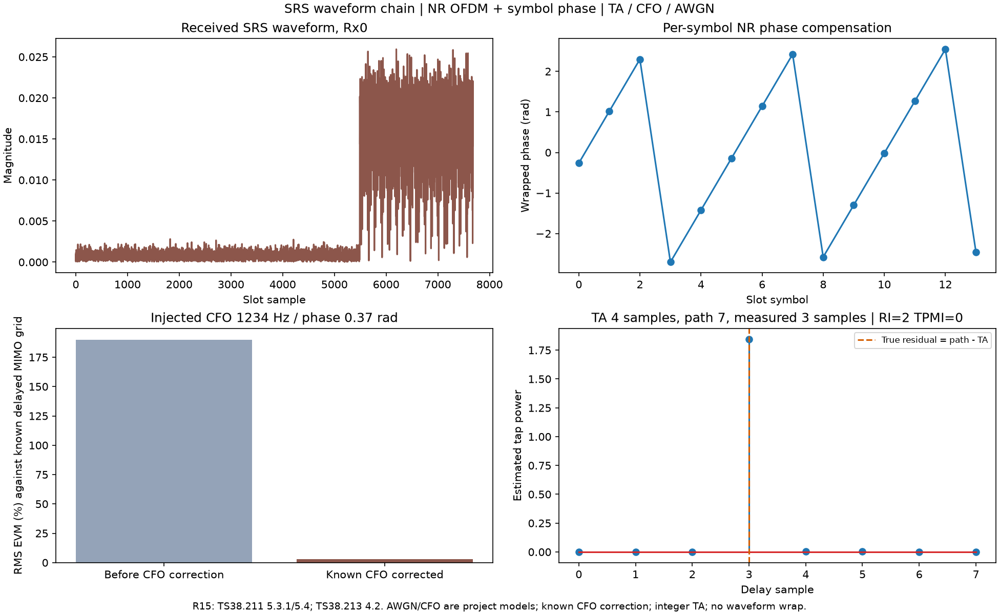

# NRChannel：TA、复噪声与载波频偏

[NRChannel.py](NRChannel.py)管理时域信道作用，导入 `from channel import NRChannel`。所有波形采用 `[分支,样点]`，与common.NROFDM波形一致；不把接收分支和发送逻辑端口自动等同。冻结slots dataclass只有一个字段`cell:NRCell`，提供Fs、Tc/样点、numerology与Nfft；例如`NRChannel(NRCell(n_size_grid=24))`。

**TA接口统一以采样点（samples）为单位**：`timing_advance(waveform,ta_samples=4)`表示提前4点，`ta_samples=-4`表示延迟4点。一个采样点的时间是`1/cell.sample_rate_hz`秒。仿真接口可直接指定任意范围内的整数样点；协议TA命令字段是可选换算入口，`ta_command_samples`返回的也始终是采样点数。

TA换算固定 **TS38.213 V15.3.0 §4.2**；Tc定义为 **TS38.211 V15.2.0 §4.1**。复AWGN与CFO是项目信道模型，不是这些规范强制的噪声/频偏算法。当前不实现多径衰落、TAG定时生效/调度、TA_offset默认频段规则、分数样点TA滤波或盲频偏估计。示例的空间矩阵和传播延迟由上层显式提供。

## 方法和每个参数

无隐藏时钟/随机状态，自动`__init__(cell)`后由`__post_init__()`验证NRCell；没有额外类常量或属性。以下表为项目接口表。

### timing_advance(waveform,ta_samples)

waveform为有限complex可转换二维数组，分支数≥1、允许空采样块；ta_samples是Python int，范围[-样点数,+样点数]。返回同形complex128新数组：

$$
y[n]=\begin{cases}x[n+a],&0\le n+a<T\\0,&其他\end{cases},\quad a=ta\_samples.\tag{C1}
$$

C1为项目离散操作，TA正负号依据38.213 V15.3.0 §4.2：**正TA提前，负TA延迟**。例如输入[0,1,2,3,4,5]、a=2得到[2,3,4,5,0,0]；a=-2得到[0,0,0,1,2,3]。0也返回副本。有限窗口越界补零，绝不循环回绕；边缘信号可能丢失，调用者需保留保护区/捕获余量。不是对整个波形做频域循环移位。

### ta_command_samples(command,initial=False)

command为严格Python int，initial为严格bool：

| 模式 | 参数范围 | 结果 | 原文 |
|---|---|---|---|
| initial=False（默认） | 相对MAC TA字段0..63 | 当前TA的**增量**，31→0，32→正一步，0→负31步 | TS38.213 V15.3.0 §4.2，英文PDF页12 |
| initial=True | RAR TA字段0..3846 | 初始TA绝对量，0→0 | 同节，英文PDF页11 |

下列C2/C3为本文自编号，不是原文公式号：

$$
\Delta N_{TA}=(T_A-31)\,16\cdot64/2^\mu\;(T_c),\quad
N_{TA,initial}=T_A\,16\cdot64/2^\mu\;(T_c).\tag{C2}
$$

$$
\text{一步样点数}=\frac{1024/2^\mu}{cell.tc\_per\_sample}=N_{FFT}/128.\tag{C3}
$$

Nfft至少128且为2次幂，所以当前平台步长为整数。24RB Nfft512时command32得到4样点。返回量没有自动累计到TAG状态，也没有包含N_TA_offset或安排未来slot生效。多活动BWP的跨numerology规则还需上层实现；这里是NRCell单numerology切片。

### frequency_offset(waveform,frequency_offset_hz,initial_phase_rad=0.0,start_sample=0)

| 参数 | 含义/范围/示例 |
|---|---|
| waveform | 有限[分支,样点]，允许空样点块，返回同形新数组 |
| frequency_offset_hz | 有限实数Hz，严格在(-Fs/2,Fs/2)内；正数提高频率，例如1234；不等于common逐符号补偿中的f0 |
| initial_phase_rad | 有限实数rad，默认0，例如0.37 |
| start_sample | 非负Python int，连续时间样点号，默认0；分块调用第二块应加第一块长度 |

项目CFO模型：

$$
y[n]=x[n]e^{j(\phi_0+2\pi\Delta f(start\_sample+n)/F_s)}.\tag{C4}
$$

类不保存跨块相位状态。已知CFO校正可用同一个start_sample、负频偏和负initial_phase_rad；多用户具有不同CFO时，不能用一个公共逆旋转消除所有用户频偏。CFO应在连续时域施加，会产生ICI，不能只按OFDM符号乘一个相位替代。

### add_awgn(waveform,snr_db,*,seed=None,noise_standard=None)

返回`(noisy_waveform,noise_waveform)`两个complex128新数组。

| 参数 | 作用/单位/示例 |
|---|---|
| waveform | 有限[分支,样点]，样点数≥1，不修改原数组 |
| snr_db | 有限实数标量，单位dB，如20；0表示预期信号功率等于噪声功率，允许负数；拒绝bool。所有支路使用相同目标SNR，按各自信号功率生成噪声 |
| seed=None | None创建新随机源；非负Python int可重现，例如42，不改变全局NumPy随机状态；每次相同seed会从同一序列起点重算 |
| noise_standard=None | 可选同形有限复数数组；调用者提供单位复方差随机向量用于跨实现对照/复用随机数；与非None seed互斥。不会强制按有限样本的测量功率重新归一化 |

默认生成z=(nI+j*nQ)/√2，nI/nQ独立N(0,1)，再按整段波形的平均功率缩放：

$$
P_b=\frac1T\sum_n|x_b[n]|^2,\quad \sigma_b^2=P_b10^{-snr\_db/10},\quad n_b=\sqrt{\sigma_b^2}\,z_b,\quad E|n|^2=\sigma^2,\quad y=x+n.\tag{C5}
$$

C5为项目自编号工程公式，非3GPP原文公式。**仅接受SNR配置，不提供直接指定噪声功率入口**。整段波形含静默样点；因此这里的时域SNR与活跃SRS RE上的接收SNR不同。零功率支路返回零噪声，SNR此时无定义；空块不能测功率，报ValueError。极端SNR产生不可表示方差时报ValueError。有限随机样本的实际SNR围绕目标波动。

NROFDM使用IFFT1/N和未缩放FFT，因此时域复噪声方差经FFT后变为Nfft倍；无需调用者配置噪声功率。返回的noise_waveform可用于检查实际加噪效果。

类型错误TypeError，维度/范围/非有限/互斥参数报ValueError；内部`waveform_array`和`real_value`只负责校验，不创建任何信道隐藏状态。

## 可运行示例

```python
import numpy as np
from cell import NRCell
from channel import NRChannel

channel = NRChannel(NRCell(n_size_grid=24))
wave = np.ones((2,128), dtype=complex)
ta_samples = 4  # TA直接使用采样点；正数提前、负数延迟
advanced = channel.timing_advance(wave,ta_samples)
offset = channel.frequency_offset(advanced,1234,initial_phase_rad=0.37)
noisy,noise = channel.add_awgn(offset,snr_db=20,seed=42)
corrected = channel.frequency_offset(noisy,-1234,initial_phase_rad=-0.37)
assert noisy.shape == corrected.shape == wave.shape
```

完整 [NRChannel_demo.py](../../examples/channel/NRChannel_demo.py)连接NRSRS→NROFDM→TA→传播延迟→CFO/AWGN→已知CFO校正→OFDM解调→NRSRSReceiver。测得残余3样点、RI2/TPMI0，并保留同级波形/数据/图像/日志。已知CFO的例子没有宣称具备盲频偏估计。



真实MATLAB原生计算24组TA/CFO/显式噪声向量逐点比对；OFDM使用独立5G Toolbox实际波形，不伪造通信工具箱信道API。详见 [验证报告](../../documentation/validation/NROFDM_validation.md)。
