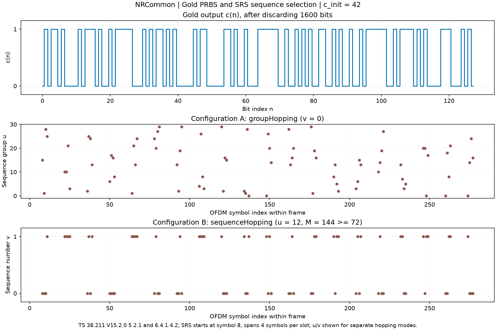

# NRCommon：公共 Gold 序列与 SRS 的 u、v

[NRCommon.py](NRCommon.py) 放置可复用的序列算法。通过 `from common import NRCommon` 导入；NRSRS.sequence_parameters 调用公共接口取得 u/v，然后在 SRS 类内计算端口循环移位 alpha。公共层不依赖 NRSRS 或 NRGrid，也不保存随机状态、小区实例或日志对象。

目前包含两个静态方法：通用31bit Gold生成器，以及**专用于SRS**的u/v选择。后续PUSCH、PUCCH等信道可复用 Gold生成器，但不能直接套用SRS的u/v规则。当前尚未实现完整调制、编码、OFDM等NRCommon功能。

固定规范：**TS 38.211 V15.2.0 §5.2.1、§6.4.1.4.2**；SRS ID范围依据 **TS 38.331 V15.2.1 §6.3.2 SRS-Resource.sequenceId（10bit）**。下文 C1–C5 均为本文自编号，不是规范原公式号。接口表为项目说明表，不是协议原表。

## 伪随机序列怎样生成

Gold序列是确定性的二进制序列。它通过两个31级线性反馈移位寄存器x1和x2生成；相同c_init得到相同结果，不调用操作系统随机源。

**C1，38.211 V15.2.0 §5.2.1：初始状态。** x1(0)=1、x1(1..30)=0。种子低位先放入x2：

\[
x_2(i)=(c_{init}\gg i)\mathbin{\&}1,\quad i=0,\ldots,30.
\]

例如c_init=42，其最低六位按低位在前为 `[0,1,0,1,0,1]`，剩余位为0。31指寄存器级数，输出可以有任意指定长度。

**C2，同版本同节：逐位递推。** ⊕是异或，等价于二进制加法模2：

\[
x_1(n+31)=x_1(n+3)\oplus x_1(n),
\]
\[
x_2(n+31)=x_2(n+3)\oplus x_2(n+2)\oplus x_2(n+1)\oplus x_2(n).
\]

**C3，同版本同节：丢弃前Nc=1600位，再异或。**

\[
c(n)=x_1(n+1600)\oplus x_2(n+1600).
\]

本接口的offset从这个c(0)开始计数。例如offset=17表示返回c(17)，对应x1/x2的1617位置；不是把Nc改为17。

## u、v怎样获得

u是低PAPR基序列组号，范围0..29；v是组内基序列编号0或1。它们决定使用哪条基序列，与端口循环移位alpha分开计算。

**C4，38.211 V15.2.0 §6.4.1.4.2：SRS组号。** 令t=n_slot*N_symbols_slot+symbol_start+l'，其中n_slot是帧内时隙，l'从0开始。

\[
u=(f_{gh}+n_{ID}^{SRS})\bmod30,
\quad f_{gh}=\begin{cases}
(\sum_{m=0}^{7}c(8t+m)2^m)\bmod30,&groupHopping\\
0,&其他.
\end{cases}
\]

groupHopping使用8个Gold比特按**低位在前**组成整数，再模30；v=0。neither模式下u=sequence_id mod30、v=0。

**C5，同版本同节：SRS组内序列号。**

\[
v=\begin{cases}c(t),&sequenceHopping且M\ge72\\0,&其他.\end{cases}
\]

sequenceHopping时u固定为sequence_id mod30，只有长度M≥72才使用c(t)选择v；短序列仍取v=0。两种跳变模式互斥。Gold初始化种子为sequence_id，每帧重新初始化，所以u/v使用帧内slot，不累计SFN；这与SRS频率跳频计数n_SRS是两个不同概念。

## 常量与方法

类没有实例字段/属性；`NRCommon()`不携带状态，推荐直接使用类名调用静态方法。

| 常量 | 含义、单位、示例 | 原文 |
|---|---|---|
| `GOLD_NC=1600` | 固定丢弃bit数；`NRCommon.GOLD_NC` | 38.211 V15.2.0 §5.2.1 |
| `GOLD_SEED_BITS=31` | 寄存器级数/种子bit数；最大种子`(1 << NRCommon.GOLD_SEED_BITS)-1` | 同节 |

### gold_sequence(c_init, length, offset=0)

返回新的uint8数组，形状(length,)，元素只为0/1；返回值可修改，不影响后续调用。

| 参数 | 范围 / 作用 | 示例 |
|---|---|---|
| c_init | Python int，0..2**31-1，通用Gold种子 | `NRCommon.gold_sequence(42, 16)` |
| length | 非负Python int，输出bit数 | `NRCommon.gold_sequence(42, 128).shape` → (128,) |
| offset | 非负Python int，默认0，从标准c(0)开始跳过的bit数 | `NRCommon.gold_sequence(42, 8, offset=17)` |

length=0返回空uint8数组，也验证全部参数。bool、float、NumPy int报TypeError，范围错误报ValueError。当前实现为直接递推，时间/内存随Nc+offset+length线性增长，适合参考仿真；未实现长跳跃状态加速或流式保存寄存器。

### srs_sequence_uv(sequence_id, n_slot, symbol_start, n_symbols, sequence_length, group_seq_hopping="neither", symbols_per_slot=14)

返回新字典`{"u":u,"v":v}`，两个值均为(n_symbols,)的int64数组。即使未安排SRS发送，也可调用它观察配置参数；候选时隙和外部许可由NRSRS管理。

| 参数 | 范围 / 作用 | 示例 |
|---|---|---|
| sequence_id | 0..1023；R15 SRS的10bit种子，独立于PCI | `sequence_id=42` |
| n_slot | 帧内slot，0..159；具体SCS下更窄的边界由NRCell校验 | `n_slot=3` |
| symbol_start | 正向时隙符号号，最后6个符号内，且整个资源不越过slot末尾；**不是倒数start_position** | 普通CP `symbol_start=8`；扩展CP为6 |
| n_symbols | 1/2/4个连续SRS符号 | `n_symbols=4` |
| sequence_length | M，每端口每符号序列长度，12..1632、12的倍数 | `sequence_length=72`；60时sequenceHopping的v仍为0 |
| group_seq_hopping | neither/groupHopping/sequenceHopping，互斥 | `group_seq_hopping="groupHopping"` |
| symbols_per_slot | 14普通CP或12扩展CP | `symbols_per_slot=12` |

全部整数严格使用Python int；错误类型报TypeError，范围/组合错误报ValueError。1632来自R15原表最大m=272、comb2：272*12/2；长度边界依据38.211 V15.2.0 §6.4.1.4.3表6.4.1.4.3-1。该接口只计算u/v，不推导带宽表、alpha、RE坐标或射频配置。

模块内部`_integer(name,value,lower,upper=None)`验证Python整数闭区间：name用于错误消息，None上界表示只验证最小值。Gold内部x1/x2是uint8递推工作数组，stop=Nc+offset+length，start=Nc+offset；u/v内部symbol数组即C4的t，group为8bit值模30。均是每次调用创建的局部变量。

## 运行示例

```python
import numpy as np
from cell import NRCell
from common import NRCommon

bits = NRCommon.gold_sequence(c_init=42, length=128)
part = NRCommon.gold_sequence(c_init=42, length=8, offset=17)
np.testing.assert_array_equal(part, bits[17:25])

cell = NRCell(n_slot=3)
uv = NRCommon.srs_sequence_uv(
    sequence_id=42, n_slot=cell.n_slot, symbol_start=8,
    n_symbols=4, sequence_length=144, group_seq_hopping="groupHopping",
    symbols_per_slot=cell.symbols_per_slot)
print(bits[:16], uv["u"], uv["v"])
```

[NRCommon_demo.py](../../examples/common/NRCommon_demo.py)输出Gold比特及一帧内SRS的u/v示意图。下面的u/v来自两种独立配置，不能理解为同时开启两种跳变。



## 验证

[test_NRCommon.py](../../tests/unit/test_NRCommon.py)检查参数、offset切片、空输出、数据副本、种子影响、u/v模式、72点阈值与普通/扩展CP。[MATLAB脚本](../../examples/common/export_NRCommon_reference.m)真实调用nrPRBS，输出20组独立bit向量；[公共接口独立测试](../../tests/matlab/test_NRCommon_matlab.py)精确比对这些bit，并直接使用已有832组SRS实测参考中的活跃配置核对u/v。NRSRS全序列和映射仍继续通过原有MATLAB对比。

公共算法示例、输出格式与验证入口见 [examples/common/README.md](../../examples/common/README.md)。
