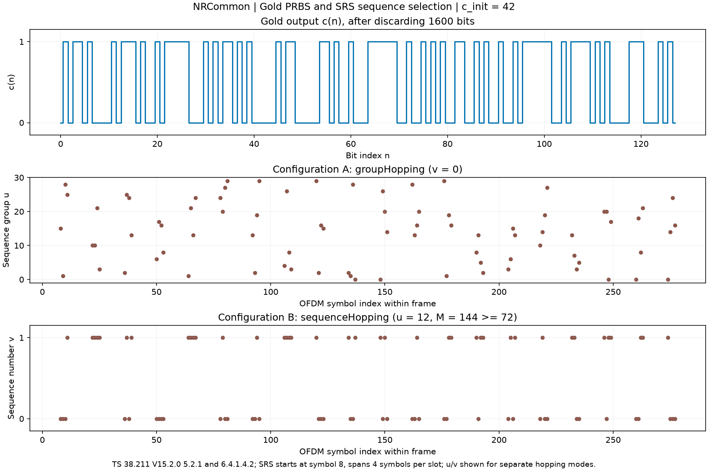

# NRCommon：Gold、低PAPR短序列与SRS/PUCCH跳变参数

公式使用的标量、数组、单位和运算符总约定见[公式变量阅读指南](../../documentation/formula_reference.md#conventions)。下列辅助变量表不替代规范参数表；式号沿用本文自编号，协议版本/章节见各式原说明。


[NRCommon.py](NRCommon.py) 放置可复用的序列算法。通过 `from common import NRCommon` 导入；NRSRS.sequence_parameters 调用公共接口取得 u/v，然后在 SRS 类内计算端口循环移位 alpha。公共层不依赖 NRSRS 或 NRGrid，也不保存随机状态、小区实例或日志对象。

目前包含四个静态方法：通用31bit Gold生成器、SRS专用u/v、12点低PAPR序列、PUCCH F0逐符号跳变参数。SRS与PUCCH使用各自规范的寻址/种子规则，不能互相代用；OFDM由独立NROFDM类提供。

固定规范：**TS 38.211 V15.2.0 §5.2.1、§6.4.1.4.2**；SRS ID范围依据 **TS 38.331 V15.2.1 §6.3.2 SRS-Resource.sequenceId（10bit）**。下文 C1–C5 均为本文自编号，不是规范原公式号。接口表为项目说明表，不是协议原表。

## 伪随机序列怎样生成

Gold序列是确定性的二进制序列。它通过两个31级线性反馈移位寄存器x1和x2生成；相同c_init得到相同结果，不调用操作系统随机源。

**C1，38.211 V15.2.0 §5.2.1：初始状态。** x1(0)=1、x1(1..30)=0。种子低位先放入x2：

$$
x_2(i)=(c_{init}\gg i)\mathbin{\&}1,\quad i=0,\ldots,30.
$$

**变量说明（项目辅助表，范围以本式上下文为准）**

| 符号/代码变量 | 含义与作用 | 取值范围/约束 | 单位 | 维度/类型 |
|---|---|---|---|---|
| $x_2(i)$ | 第二个31级寄存器第i初始比特 | 0或1 | bit | 单值；初态数组[31] |
| $c_{init}$ | 初始化整数种子 | 通用PRBS允许0..2^31-1；SRS调用只用0..1023 | 无量纲整数 | 标量 |
| $i$ | 寄存器位号，低位在前 | 0..30 | bit索引 | 整数标量 |
| $\gg$、$\mathbin{\&}$ | 右移与逐位AND；取第i位 | 右移i位后与1按位AND | 无量纲运算 | 整数→整数 |

例如c_init=42，其最低六位按低位在前为 `[0,1,0,1,0,1]`，剩余位为0。31指寄存器级数，输出可以有任意指定长度。

**C2，同版本同节：逐位递推。** ⊕是异或，等价于二进制加法模2：

$$
x_1(n+31)=x_1(n+3)\oplus x_1(n),
$$

**变量说明（项目辅助表，范围以本式上下文为准）**

| 符号/代码变量 | 含义与作用 | 取值范围/约束 | 单位 | 维度/类型 |
|---|---|---|---|---|
| $x_1(n)$ | 第一个移位寄存器产生的比特序列 | 0/1；x1(0)=1，其余初始30位为0 | bit | 公式每次一个标量；序列是一维 |
| $n$ | 递推起始位置 | 非负整数，需生成至Nc+offset+length-1 | bit索引 | 整数标量 |
| $\oplus$ | 逐比特异或 | 0 XOR 0=0；1 XOR 0=1 | 二进制运算 | 标量或等长向量 |

$$
x_2(n+31)=x_2(n+3)\oplus x_2(n+2)\oplus x_2(n+1)\oplus x_2(n).
$$

**变量说明（项目辅助表，范围以本式上下文为准）**

| 符号/代码变量 | 含义与作用 | 取值范围/约束 | 单位 | 维度/类型 |
|---|---|---|---|---|
| $x_2(n)$ | 种子初始化的第二个寄存器比特 | 0/1 | bit | 单值；生成过程为一维序列 |
| $n$ | 递推位置 | 非负整数 | bit索引 | 整数标量 |
| $31$、$3$、$2$、$1$ | 寄存器级数及反馈抽头偏移 | 固定协议常量 | bit位置偏移 | 整数常量 |
| $\oplus$ | 二进制异或，等价于求和模2 | 结果0/1 | 无量纲 | 标量运算 |

**C3，同版本同节：丢弃前Nc=1600位，再异或。**

$$
c(n)=x_1(n+1600)\oplus x_2(n+1600).
$$

**变量说明（项目辅助表，范围以本式上下文为准）**

| 符号/代码变量 | 含义与作用 | 取值范围/约束 | 单位 | 维度/类型 |
|---|---|---|---|---|
| $c(n)$ | 跳过Nc后输出的Gold伪随机比特 | 0/1；函数返回uint8 | bit | 接口结果[length] |
| $x_1$、$x_2$ | 两个递推序列 | 比特0/1 | bit | 一维序列 |
| $n$、$1600$ | 输出相对位置与固定跳过长度Nc | n≥0；Nc固定1600 | bit索引、bit计数 | 整数标量 |
| $offset$ | 接口从c(0)后的额外起点 | 非负整数；不改变Nc | bit计数 | 整数标量 |

本接口的offset从这个c(0)开始计数。例如offset=17表示返回c(17)，对应x1/x2的1617位置；不是把Nc改为17。

## u、v怎样获得

u是低PAPR基序列组号，范围0..29；v是组内基序列编号0或1。它们决定使用哪条基序列，与端口循环移位alpha分开计算。

**C4，38.211 V15.2.0 §6.4.1.4.2：SRS组号。** 令t=n_slot*N_symbols_slot+symbol_start+l'，其中n_slot是帧内时隙，l'从0开始。

$$
u=(f_{gh}+n_{ID}^{SRS})\bmod30,
\quad f_{gh}=\begin{cases}
(\sum_{m=0}^{7}c(8t+m)2^m)\bmod30,&groupHopping\\
0,&其他.
\end{cases}
$$

**变量说明（项目辅助表，范围以本式上下文为准）**

| 符号/代码变量 | 含义与作用 | 取值范围/约束 | 单位 | 维度/类型 |
|---|---|---|---|---|
| $u$ | 低PAPR基序列组号 | 0..29 | 无量纲ID | 整数标量 |
| $f_{gh}$ | Gold派生的组跳变偏移 | 0..29；关闭时0 | 无量纲 | 整数标量 |
| $n_{ID}^{SRS}$ | SRS序列ID，对应sequence_id | 0..1023；不是必须等于PCI | 无量纲ID | 整数标量 |
| $t$ | 该SRS符号在帧内的线性符号号 | n_slot*L+symbol_start+l_prime，0..L*slots_per_frame-1 | 符号索引 | 整数标量 |
| $n_{slot}$、$L$、$l'$ | 帧内slot、每slot符号数、SRS内符号号 | slot在帧内；L=12/14；0≤l_prime<n_symbols | 索引、计数、索引 | 各一整数标量 |
| $m$、$c(8t+m)$ | 组跳变使用的8个bit的位权号与比特 | m=0..7；bit=0/1 | bit索引、bit | 标量；8个比特组成一个整数 |

groupHopping使用8个Gold比特按**低位在前**组成整数，再模30；v=0。neither模式下u=sequence_id mod30、v=0。

**C5，同版本同节：SRS组内序列号。**

$$
v=\begin{cases}c(t),&sequenceHopping且M\ge72\\0,&其他.\end{cases}
$$

**变量说明（项目辅助表，范围以本式上下文为准）**

| 符号/代码变量 | 含义与作用 | 取值范围/约束 | 单位 | 维度/类型 |
|---|---|---|---|---|
| $v$ | 同组内的基序列编号 | 0/1；neither/groupHopping强制0 | 无量纲ID | 整数标量 |
| $c(t)$ | Gold在帧内符号位置t的比特 | 0/1 | bit | 整数标量 |
| $M$ | 每端口每SRS符号的序列点数 | 正整数；仅M≥72允许序列跳变 | 序列点数 | 整数标量 |
| $t$ | 帧内SRS线性符号号 | 见C4定义，不使用无限累计SFN | 符号索引 | 整数标量 |

sequenceHopping时u固定为sequence_id mod30，只有长度M≥72才使用c(t)选择v；短序列仍取v=0。两种跳变模式互斥。Gold初始化种子为sequence_id，每帧重新初始化，所以u/v使用帧内slot，不累计SFN；这与SRS频率跳频计数n_SRS是两个不同概念。

## 常量与方法

类没有实例字段/属性；`NRCommon()`不携带状态，推荐直接使用类名调用静态方法。

| 常量 | 含义、单位、示例 | 原文 |
|---|---|---|
| `GOLD_NC=1600` | 固定丢弃bit数；`NRCommon.GOLD_NC` | 38.211 V15.2.0 §5.2.1 |
| `GOLD_SEED_BITS=31` | 寄存器级数/种子bit数；最大种子`(1 << NRCommon.GOLD_SEED_BITS)-1` | 同节 |

### gold_sequence(c_init, length, offset=0)

返回新的uint8数组，形状(length,)，元素只为0/1；返回值可修改，不影响后续调用。

| 参数 | 范围 / 作用 | 示例 |
|---|---|---|
| c_init | Python int，0..2**31-1，通用Gold种子 | `NRCommon.gold_sequence(42, 16)` |
| length | 非负Python int，输出bit数 | `NRCommon.gold_sequence(42, 128).shape` → (128,) |
| offset | 非负Python int，默认0，从标准c(0)开始跳过的bit数 | `NRCommon.gold_sequence(42, 8, offset=17)` |

length=0返回空uint8数组，也验证全部参数。bool、float、NumPy int报TypeError，范围错误报ValueError。当前实现为直接递推，时间/内存随Nc+offset+length线性增长，适合参考仿真；未实现长跳跃状态加速或流式保存寄存器。

### srs_sequence_uv(sequence_id, n_slot, symbol_start, n_symbols, sequence_length, group_seq_hopping="neither", symbols_per_slot=14)

返回新字典`{"u":u,"v":v}`，两个值均为(n_symbols,)的int64数组。即使未安排SRS发送，也可调用它观察配置参数；候选时隙和外部许可由NRSRS管理。

| 参数 | 范围 / 作用 | 示例 |
|---|---|---|
| sequence_id | 0..1023；R15 SRS的10bit种子，独立于PCI | `sequence_id=42` |
| n_slot | 帧内slot，0..159；具体SCS下更窄的边界由NRCell校验 | `n_slot=3` |
| symbol_start | 正向时隙符号号，最后6个符号内，且整个资源不越过slot末尾；**不是倒数start_position** | 普通CP `symbol_start=8`；扩展CP为6 |
| n_symbols | 1/2/4个连续SRS符号 | `n_symbols=4` |
| sequence_length | M，每端口每符号序列长度，12..1632、12的倍数 | `sequence_length=72`；60时sequenceHopping的v仍为0 |
| group_seq_hopping | neither/groupHopping/sequenceHopping，互斥 | `group_seq_hopping="groupHopping"` |
| symbols_per_slot | 14普通CP或12扩展CP | `symbols_per_slot=12` |

全部整数严格使用Python int；错误类型报TypeError，范围/组合错误报ValueError。1632来自R15原表最大m=272、comb2：272*12/2；长度边界依据38.211 V15.2.0 §6.4.1.4.3表6.4.1.4.3-1。该接口只计算u/v，不推导带宽表、alpha、RE坐标或射频配置。

模块内部`_integer(name,value,lower,upper=None)`验证Python整数闭区间：name用于错误消息，None上界表示只验证最小值。Gold内部x1/x2是uint8递推工作数组，stop=Nc+offset+length，start=Nc+offset；u/v内部symbol数组即C4的t，group为8bit值模30。均是每次调用创建的局部变量。

## 运行示例

```python
import numpy as np
from cell import NRCell
from common import NRCommon

bits = NRCommon.gold_sequence(c_init=42, length=128)
part = NRCommon.gold_sequence(c_init=42, length=8, offset=17)
np.testing.assert_array_equal(part, bits[17:25])

cell = NRCell(n_slot=3)
uv = NRCommon.srs_sequence_uv(
    sequence_id=42, n_slot=cell.n_slot, symbol_start=8,
    n_symbols=4, sequence_length=144, group_seq_hopping="groupHopping",
    symbols_per_slot=cell.symbols_per_slot)
print(bits[:16], uv["u"], uv["v"])
```

[NRCommon_demo.py](../../examples/common/NRCommon_demo.py)输出Gold比特及一帧内SRS的u/v示意图。下面的u/v来自两种独立配置，不能理解为同时开启两种跳变。



## 验证

[test_NRCommon.py](../../tests/unit/test_NRCommon.py)检查参数、offset切片、空输出、数据副本、种子影响、u/v模式、72点阈值与普通/扩展CP。[MATLAB脚本](../../examples/common/export_NRCommon_reference.m)真实调用nrPRBS，输出20组独立bit向量；[公共接口独立测试](../../tests/matlab/test_NRCommon_matlab.py)精确比对这些bit，并直接使用已有832组SRS实测参考中的活跃配置核对u/v。NRSRS全序列和映射仍继续通过原有MATLAB对比。

公共算法示例、输出格式与验证入口见 [examples/common/README.md](../../examples/common/README.md)。


## NRCommon计数核对例

normal CP、帧内slot=2、SRS起始slot符号=10、SRS局部符号l_prime=1时，Gold寻址的符号号t=2*14+10+1=39。组跳变读取c(312)..c(319)共8个bit，序列跳变读取c(39)一个bit；两者读取位置不同。


## PUCCH公共函数：字段、坐标与返回值

新增方法仍为无实例状态的静态函数，固定TS38.211 V15.2.0 §5.2.2.2表5.2.2.2-2与§6.3.2.2.1/2；不引入新Release功能。

### low_papr_sequence_12(group,cyclic_shift=0)

| 参数/结果 | 含义、范围、单位与维度 | 示例 |
|---|---|---|
| group | 基序列组u，Python int 0..29，无量纲标量 | 17 |
| cyclic_shift | 最终mod12循环移位，Python int 0..11，无量纲标量 | 6对应逐点pi rad |
| 返回值 | 新complex128[12]，单点模长1，不乘发送beta | `NRCommon.low_papr_sequence_12(17,6)` |

PHI_12表统一位于`common/_low_papr_tables.py`，SRS的`_tables.py`保留导入别名，避免两个信道维护不同副本。相位系数为-3/-1/1/3，乘pi/4，再加2*pi*cyclic_shift*n/12取复指数；n=0..11。整数类型/范围校验遵循现有_integer；不依赖MATLAB输出生成表。

### pucch_sequence_parameters(...)

| 参数 | 含义、范围与单位 | 示例 |
|---|---|---|
| hopping_id | Python int 0..1023，PUCCH hoppingId，不等于RNTI | 731 |
| n_slot | 帧内slot号，normal0..159、extended0..39；实际mu边界还由NRCell检查 | 3 |
| symbol_start | 正向slot符号号，0..symbols_per_slot-n_symbols | 10 |
| n_symbols | 当前F0资源符号数量，Python int1/2 | 2 |
| initial_cyclic_shift=0 | m0，Python int0..11，移位号 | 5 |
| m_cs=0 | 已从UCI表获得的移位偏移，Python int0..11 | 10 |
| group_hopping='neither' | 'neither'/'enable'/'disable'，最后一项仅计算协议原始v供诊断，F0资源接口拒绝该模式 | 'enable' |
| frequency_hopping=False | 严格bool，True要求2符号，第二符号n_hop=1 | True |
| symbols_per_slot=14 | Python int12/14，用于资源边界校验；不改变R15固定14*slot的Gold寻址 | 12 |

返回字典每项新数组[n_symbols]：u为0..29组号、v为0/1原始组内号、hop为0/1跳段号、n_cs为0..255的8bit值、cyclic_shift为0..11最终移位，均int64；alpha为float64，单位rad/序列点。短序列仅v=0有定义，不能用返回的v=1去假造12点第二基序列。

**PC1，本文自编号**：按同版本§6.3.2.2.1，enable模式用种子floor(hopping_id/30)，在8*(2*n_slot+hop)起读取8bit（低位在前），fgh为该整数mod30，u=(fgh+hopping_id)mod30，v=0。neither时u=hopping_id mod30、v=0。disable按原文以种子32*floor(ID/30)+ID mod30读取c(2*slot+hop)得到v；本函数提供原始参数计算，NRPUCCH0不接受该配置。

**PC2，本文自编号**：按同版本§6.3.2.2.2，循环移位使用不同种子hopping_id，在8*(14*n_slot+symbol_start+l_prime)起读取8bit，n_cs=sum(c_i*2**i)，最终shift=(initial_cyclic_shift+m_cs+n_cs)mod12，alpha=2*pi*shift/12。i为bit号0..7，l_prime为资源内符号号0..n_symbols-1；种子/索引均无量纲，alpha单位rad/点。extended CP仍使用14寻址，资源边界检查才使用12。

```python
from common import NRCommon
p=NRCommon.pucch_sequence_parameters(731,3,10,2,5,10,'enable',True)
assert p['u'].shape==p['alpha'].shape==(2,)
x=NRCommon.low_papr_sequence_12(int(p['u'][0]),int(p['cyclic_shift'][0]))
assert x.shape==(12,)
```

[专门单测](../../tests/unit/test_NRCommon_pucch.py)验证30组×12种循环移位的能量/正交性、Gold种子及扩展CP固定14坐标；[真实PUCCH参考](../../examples/pucch/README.md)覆盖960组序列/坐标，间接独立验证组合计算。SRS原有832组独立参考仍通过。
