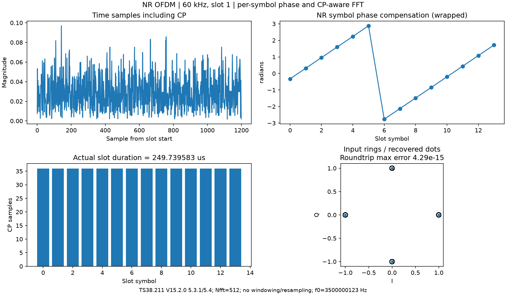

# NROFDM：NR单时隙调制与解调

公式使用的标量、数组、单位和运算符总约定见[公式变量阅读指南](../../documentation/formula_reference.md#conventions)。下列辅助变量表不替代规范参数表；式号沿用本文自编号，协议版本/章节见各式原说明。


[NROFDM.py](NROFDM.py)直接使用NRCell的FFT、采样率及精确CP表，完成网格到波形以及波形到网格的转换，导入 `from common import NROFDM`。逐符号载波相位及提前FFT窗口补偿委托 [NRPhaseRotation](NRPhaseRotation.md)。

固定 **TS38.211 V15.2.0 §5.3.1、§5.4**，单numerology、单载波、一个当前时隙、普通/扩展CP，适用于除PRACH外的NR CP-OFDM。FFT沿用NRCell的最小2次幂选择，至少128。当前不加窗、不重采样、不实现混合numerology、WOLA、PRACH调制或盲定时/频偏估计。

## 输入字段和方法

冻结slots dataclass，只有2个字段，没有内部缓存/流状态。以下为项目接口表，不是协议原表。

| 字段 | 含义、单位、默认值、示例 |
|---|---|
| cell | 必填NRCell，当前帧内slot决定精确CP和相位下标；`NROFDM(NRCell(n_size_grid=24))` |
| carrier_frequency_hz=0.0 | 有限非负实数Hz，§5.4的f0；0表示不施加符号载波补偿，`NROFDM(cell,3500000123)`；不是CFO |

自动`__init__`之后，`__post_init__()`复用NRPhaseRotation校验cell/载频。bool不作为实数参数，非法类型TypeError、范围ValueError。

| 方法 | 每个参数、返回和边界 |
|---|---|
| `modulate(grid)` | grid是有限复数`[端口或分支,L,K]`，L=cell.symbols_per_slot，K=cell.n_subcarriers，端口数≥1。返回complex128新数组`[端口或分支,cell.samples_per_slot]`；先逐符号旋转，再居中映射/IFFT/加CP。错误维度/NaN/Inf报ValueError |
| `demodulate(waveform,cp_fraction=1.0)` | waveform是有限复数`[Rx,样点]`，必须恰好包含当前slot采样数；cp_fraction为有限实数[0,1]，FFT在CP内的起点比例。返回新complex128`[Rx,L,K]`；自动补偿提前窗口相位并撤销§5.4旋转。多余/缺失样点报错，不自动裁剪 |

输入数组不被修改。波形统一**分支在前、样点在后**；MATLAB为`[样点,分支]`，导入/导出须转置。调制端口域波形不会自动成为物理天线波形，若有预编码须在上层进行；解调分支数也不强制等于发送端口数。

使用默认cp_fraction=1时从CP末端开始；0.5从CP中间开始，实际起点为`floor(CP*cp_fraction)`。MATLAB默认比例不同，独立比对始终显式传入同一值。提前FFT窗口可以避开有限捕获尾部，但传播延迟、提前量、前一符号干扰仍须满足CP保护条件。

## 公式和坐标

以下O1–O4为本文自编号，原文未使用这些编号。O1/O2依据 **TS38.211 V15.2.0 §5.3.1** 的OFDM和CP；O3依据 **§5.4**；O4为傅里叶时移定理的项目离散推导。

**O1：单numerology下k0=0，网格k对应有符号频率bin m=k-K/2。**

$$
x_l[n]=\frac1N\sum_{k=0}^{K-1}a_{k,l}e^{j2\pi(k-K/2)n/N}.\tag{O1}
$$

**变量说明（项目辅助表，范围以本式上下文为准）**

| 符号/代码变量 | 含义与作用 | 取值范围/约束 | 单位 | 维度/类型 |
|---|---|---|---|---|
| $x_l[n]$ | OFDM符号l有效部分的复波形 | 有限复数，幅度由输入网格决定 | 归一化复幅度 | 每端口[N]；接口含CP后[P,T] |
| $a_{k,l}$ | 输入资源网格第k载波、第l符号 | 有限复数 | 归一化复幅度 | 每端口[L,K]；接口[P,L,K] |
| $N,K$ | FFT长度/有效网格子载波数 | N=cell.n_fft；K=12*n_size_grid≤N | 采样点、子载波计数 | 整数标量 |
| $k,n,l$ | 网格频率号、有效样点号、slot符号号 | 0≤k<K；0≤n<N；0≤l<L | 索引 | 整数标量 |
| $k-K/2$ | 以DC为0的有符号FFT bin | -K/2..K/2-1；当前K为偶数 | 频率bin | 每k一个实整数 |
| $j$ | 虚数单位 | 平方为-1；不是天线端口索引 | 无量纲 | 复常量 |

实现将网格放入居中N点谱的`(N-K)//2`起点，再ifftshift/IFFT。CRB起点NStartGrid与BWP起点不额外当作载波频移；NRCell仅单numerology，所以规范§5.3.1的k0在本范围为0。

**O2：CP和缩放。** 每符号复制最后CP_l点到前面，按实际CP_l+N长度拼接。普通CP的长CP位置按子帧符号号确定，使用NRCell，不能用固定slot时长切分。

FFT/IFFT选择为IFFT自带1/N、FFT不缩放，对齐MATLAB；原文连续时间求和的整体幅度与这个数字归一化之间需要发送功率约定。白色时域噪声的复方差σ_time²在解调RE上为：

$$
\sigma_{RE}^2=N\sigma_{time}^2.\tag{O2}
$$

**变量说明（项目辅助表，范围以本式上下文为准）**

| 符号/代码变量 | 含义与作用 | 取值范围/约束 | 单位 | 维度/类型 |
|---|---|---|---|---|
| $\sigma_{time}^2$ | 每时域样点每支路复AWGN方差 | 非负有限 | 归一化功率/sample | 实标量或[Rx] |
| $\sigma_{RE}^2$ | 解调后每RE每支路复噪声方差 | N乘时域方差；白噪声假定 | 归一化功率/RE | 实标量或[Rx] |
| $N$ | 未缩放FFT的长度 | cell.n_fft=128..4096，2的幂 | 采样点 | 整数标量 |

不能把channel中每样点噪声功率直接当作SRS接收机每RE噪声功率。

**O3：发送/接收符号相位。** §5.4以子帧首为t=0：

$$
\phi_l=-2\pi f_0(t_{start,l}+N_{CP,l}T_c),\quad
a'_{k,l}=a_{k,l}e^{j\phi_l}.\tag{O3}
$$

**变量说明（项目辅助表，范围以本式上下文为准）**

| 符号/代码变量 | 含义与作用 | 取值范围/约束 | 单位 | 维度/类型 |
|---|---|---|---|---|
| $\phi_l$ | 第l符号发送载频补偿相位 | 任意有限实数；未限制到[-pi,pi) | rad | [L] |
| $f_0$ | RF载频，对应carrier_frequency_hz；不是CFO | 有限非负，例如3500000123 | Hz | 实标量 |
| $t_{start,l}$ | 符号CP起点相对子帧首时刻 | 0≤t<1 ms | s | 每slot的[L]切片 |
| $N_{CP,l}$、$T_c$ | 协议CP时长的Tc个数与基本时间单位 | CP为正整数；Tc=1/1966080000 | Tc数、s | 每符号整数/常量 |
| $a'_{k,l}$、$a_{k,l}$ | 相位补偿后/前的网格元素 | 任意有限复数；旋转不改幅度 | 归一化复幅度 | 接口[P,L,K] |

发送整个符号含CP乘同一phasor；接收乘其共轭。f0默认0；发送和接收必须使用相同载频。PRACH不使用此逐符号式。

**O4：提前FFT窗口的补偿。** 令a=CP-floor(CP*cp_fraction)，窗口比有效起点提前a样点，恢复提取频点时乘：

$$
e^{+j2\pi(k-K/2)a/N}.\tag{O4}
$$

**变量说明（项目辅助表，范围以本式上下文为准）**

| 符号/代码变量 | 含义与作用 | 取值范围/约束 | 单位 | 维度/类型 |
|---|---|---|---|---|
| $a$ | FFT窗相对有效起点提前的样点数 | CP-floor(CP*cp_fraction)，0..CP；与资源元素a无关 | sample | 每符号整数 |
| $k,K,N$ | 网格bin、有效子载波数、FFT长度 | 0≤k<K≤N | 索引、计数、计数 | 标量 |
| $e^{+j2\pi(k-K/2)a/N}$ | 提前窗口的恢复相位因子 | 复数模长1 | 无量纲 | 每符号[K]，可广播到[Rx,L,K] |
| $cp\_fraction$ | FFT窗口在CP内的位置比例 | 有限实数0..1，默认1 | 无量纲 | 实标量 |

这个相位是窗口坐标补偿，不能当作信道时延补偿或CFO校正。各类相位因子接口见NRPhaseRotation。

## 可运行示例

```python
import numpy as np
from cell import NRCell
from common import NROFDM

cell = NRCell(n_size_grid=24, subcarrier_spacing_khz=60, n_slot=1)
ofdm = NROFDM(cell, carrier_frequency_hz=3500000123)
grid = np.ones((2, cell.symbols_per_slot, cell.n_subcarriers), dtype=complex)
waveform = ofdm.modulate(grid)
recovered = ofdm.demodulate(waveform, cp_fraction=0.5)
np.testing.assert_allclose(recovered, grid, atol=1e-12)
```

跨slot调用应为每个slot创建相应NRCell/NROFDM再拼接；CP和相位按各自子帧位置确定。NROFDM不维护跨块CFO时钟，该工作由NRChannel.frequency_offset的start_sample控制。

[NROFDM_demo.py](../../examples/common/NROFDM_demo.py)保存同级波形、网格、相位、JSON/NPZ与PNG/SVG，演示60kHz slot1的实际249.739583µs；[channel示例](../../examples/channel/README.md)连接SRS时域收发和RI/TPMI。



28组真实MATLAB OFDM/相位、84组扰动输入解调全向量对比已通过。单元测试包括精确CP、DC/负频率单音、FFT窗口、相位与输入边界，详见 [OFDM/channel验证](../../documentation/validation/NROFDM_validation.md)。


## NROFDM功率与轴核对例

24 RB、Nfft512时，频域[K]=[288]嵌入512点FFT谱。两个端口输入[2,14,288]，输出为[2,T]，T由本slot的逐符号CP之和决定；不是固定用Fs乘平均slot时长。若时域噪声方差为1e-6，解调后每RE噪声方差期望为512e-6=0.000512。


## 可选实际中间结果绘图

modulate(grid,*,plotter=None)与demodulate(waveform,cp_fraction=1,*,plotter=None)支持传NRStagePlotter。仅plotter.config.enabled为True时保留额外中间快照；原计算和返回数组不变，默认关闭。modulate记录相位参数、旋转网格、居中频谱、有效IFFT输出、加CP波形；demodulate记录选定FFT窗、居中FFT谱、裁剪载波、提前窗补偿网格和逆NR相位网格。调用不会保存图片，由上层plotter.show显示。具体阶段名和坐标见[收集器](../diagnostics/NRStagePlotter.md)。
