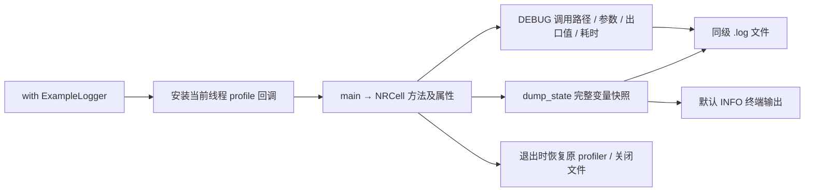

# ExampleLogger：示例日志与函数调用路径

源码：[ExampleLogger.py](ExampleLogger.py)；测试：[test_ExampleLogger.py](../../tests/unit/test_ExampleLogger.py)。这是工程诊断类，不实现 3GPP 算法，不涉及协议参数表或公式。

## 用途与输出

在 `with ExampleLogger(__file__) as log:` 中运行示例函数，即可记录当前线程的项目调用链、参数、出口值、耗时和异常。`log.dump_state(cell, "cell")` 输出该对象的字段、常量及全部只读属性。日志写在示例脚本同目录，文件名为示例名加 `.log`，每次运行覆盖旧文件。

当前已接入八个 Python 示例/比较入口：`NRCell_demo.py`、`plot_NRCell.py`、`plot_NRCell_timing.py`、[NRGrid_demo.py](../../examples/grid/NRGrid_demo.py)、[信道色卡示例](../../examples/grid/plot_NRGrid_channel_colors.py)、[NRSRS_demo.py](../../examples/srs/NRSRS_demo.py) 、[SRS比较脚本](../../examples/srs/compare_NRSRS_reference.py) 和 [NRCommon序列示例](../../examples/common/NRCommon_demo.py)。SRS示例输出小区/信号/网格的完整快照。MATLAB 导出脚本是独立的 MATLAB 入口，不由 Python profiler 追踪。

默认终端级别为 INFO，显示 START、STATE、业务摘要和 FINISH；文件固定保存 DEBUG，额外包含 CALL、EXIT。设置 `NR_LOG_LEVEL=DEBUG` 可使终端也显示调用路径。日志使用 UTF-8，时间戳明确标记为 UTC。



## 参数与所有成员变量

以下为软件 API 表，不是 3GPP 原表。

| 初始化参数 | 默认值与用途 | 示例 |
|---|---|---|
| `example_file` | 必填 `str` 或 `Path`，用于确定追踪入口和输出目录 | `ExampleLogger(__file__)` |
| `console_level` | `None` 表示读取 `NR_LOG_LEVEL`，环境变量未设置时为 INFO；允许 DEBUG/INFO/WARNING/ERROR/CRITICAL，大小写不敏感 | `ExampleLogger(__file__, console_level="DEBUG")` |
| `max_value_chars` | `240`，必须为不小于 32 的 Python int；只限制调用参数和出口值的 repr 长度，不限制 STATE 快照 | `ExampleLogger(__file__, max_value_chars=1000)` |

| 成员变量 | 含义、值或访问示例 |
|---|---|
| `example_path` | 解析后的示例绝对路径；`log.example_path.name == "NRCell_demo.py"` |
| `log_path` | 同级日志绝对路径；`log.log_path.name == "NRCell_demo.log"` |
| `console_level` | 解析后的 logging 整数级别，INFO 为 20，DEBUG 为 10 |
| `max_value_chars` | 调用参数/出口值显示上限；完整快照不使用该上限 |
| `logger` | 隔离的标准 `logging.Logger`；`log.logger.info("FFT=%s", cell.n_fft)`；不向 root logger 传播 |
| `_source_root` | 项目源码根目录，当前为 `src/`；源码下的函数可被追踪 |
| `_helper_path` | 本诊断类自身路径，避免把日志系统的内部调用混入业务路径 |
| `_previous_profile` | 进入 with 前的 `sys.getprofile()` 值，退出时恢复 |
| `_stack` | 被追踪调用的栈，元素为 `(frame_id, 显示名称, perf_counter起点)`；只保存 frame ID，不保存 frame 对象 |
| `_code_info` | code 对象到显示名称/源码位置的缓存；值为 None 表示不属于追踪范围 |
| `_active` | 是否已进入 with 作用域；用于拒绝重复进入同一实例或在作用域外请求快照 |
| `_suspended` | 快照求值期间暂停调用链记录，防止属性递归求值产生诊断噪声 |

下划线成员是实现状态，示例不应修改；可通过返回快照和日志文件检查效果。

## 每个方法

此表为软件行为说明，不对应协议原文表格。

| 方法 | 参数、返回值、行为与异常 |
|---|---|
| `__init__(example_file, console_level=None, max_value_chars=240)` | 初始化上表状态，不打开文件；级别或显示长度非法时抛 ValueError |
| `__enter__()` | 打开 UTF-8 文件和终端 handler，保存旧 profiler，安装当前线程回调并返回自身；重复进入抛 RuntimeError，目录不可写/不存在时传播文件系统异常 |
| `__exit__(exc_type, exc_value, traceback)` | 三个参数由 Python with 语句传入；正常退出写 OK，异常退出写 FAILED 和 traceback，恢复旧 profiler、移除并关闭 handler；返回 False，让业务异常继续传播 |
| `dump_state(instance, label="instance")` | instance 为待输出对象，label 为日志标签；返回 fields/constants/properties 三组字典，完整打印值；未进入 with 时抛 RuntimeError |
| `_describe_code(frame)` | 输入当前栈帧，返回 `(显示名称, 位置)` 或 None，并缓存结果；dataclass 生成的 `<string>` 构造器按模块原路径和 self 类型识别，位置标为 generated，不伪造源码行号 |
| `_value_repr(value, truncate=True)` | 返回安全 repr 字符串；超过限制附加 `<truncated>`，repr 失败输出 `<repr failed: 异常名>`；truncate=False 时完整输出 |
| `_arguments(frame)` | 返回当前函数的普通参数、可变位置参数及关键字参数文本；self/cls 只显示类型，防止访问尚未完成初始化的对象 |
| `_profile(frame, event, arg)` | 标准 profile 回调；call 读取参数并入栈，return 时记录 EXIT、出口值和耗时；arg 在 return 时为出口值；不处理 C 调用和其他事件 |

`dump_state` 支持当前项目使用的 dataclass（包括 frozen/slots），以及带 `__dict__` 的普通实例。字段来自 dataclass 或实例字典，常量来自类中的大写名称，属性来自类和基类的公开 property。单个属性求值失败时记录 `<error: ...>`，继续打印其他成员；属性仍会实际求值，不能把它视为对任意第三方对象无副作用的检查工具。

当前 `NRCell` 快照包括 **12 个字段、8 个常量、35 个属性**，CP/符号数组不截断。诊断类不通过修改 NRCell 或给它添加 logger 字段实现追踪，物理层计算及 MATLAB 参数保持原样。

## 使用示例

从项目根目录运行，先安装 `python -m pip install -e ".[dev,plots]"`：

```python
from pathlib import Path
from cell import NRCell
from diagnostics import ExampleLogger

with ExampleLogger(Path("examples/cell/NRCell_demo.py")) as log:
    cell = NRCell(n_cell_id=42, n_tx_antennas=4, n_rx_antennas=2)
    state = log.dump_state(cell, "cell")
    first_symbol = cell.symbol_timing(0)
    log.logger.info("First symbol: %s", first_symbol)
    assert state["fields"]["n_cell_id"] == 42
    assert state["properties"]["n_fft"] == 1024
```

上述 Python 示例已自行创建日志作用域，无需再包一层。直接执行：

```powershell
.venv\Scripts\python examples/cell/NRCell_demo.py
# 需要在终端同时查看全部调用路径时：
$env:NR_LOG_LEVEL = "DEBUG"
.venv\Scripts\python examples/cell/NRCell_demo.py
Remove-Item Env:\NR_LOG_LEVEL
```

默认日志文件名为 `NRCell_demo.log`、`plot_NRCell.log`、`plot_NRCell_timing.log`、`NRGrid_demo.log` 和 `plot_NRGrid_channel_colors.log`。日志与各自示例同级。这些是运行中间文件，已由 `.gitignore` 的 `*.log` 规则排除；不需要将日志文件提交到仓库。

## 日志阅读示例

以下为简化格式示意，具体参数和源码行号以实际运行日志为准：

```text
INFO  START example=NRCell_demo.py
DEBUG CALL NRCell_demo.main(...) | path=NRCell_demo.main
DEBUG   CALL NRCell.__init__(self=<NRCell>, n_cell_id=42, ...)
DEBUG     CALL NRCell.__post_init__(self=<NRCell>)
DEBUG       CALL NRCell._integer(name='n_cell_id', value=42, ...)
DEBUG       EXIT NRCell._integer | value=None | elapsed_ms=...
INFO  STATE cell.fields.n_cell_id = 42
INFO  STATE cell.constants.KAPPA = 64
INFO  STATE cell.properties.n_fft = 1024
INFO  STATE cell.properties.cp_lengths_samples = (88, 72, ...)
INFO  FINISH status=OK
```

STATE 中的省略号只出现在这段说明示意里，实际数组完整输出。CALL 的 `path` 使用 `->` 表示当前被追踪的完整调用链；缩进体现深度；`source` 给出源码文件及起始行，或 generated 标记。

`EXIT` 表示函数离开，不能单凭 `value=None` 判断是否异常，因为 profile 的 return 事件也可能由异常展开产生。未被示例捕获的业务异常会在最后写 `FINISH status=FAILED` 和完整 traceback，同时原样向外抛出；被示例自行捕获的异常由示例决定是否另行记录。

## 范围、耗时与测试

追踪只在 with 内开启，只涉及当前线程的项目 `src/` 和指定示例文件；诊断系统自身、第三方库和匿名生成器帧不记录。状态快照只对显式调用 dump_state 的具名对象输出一次；如需观察推进后的对象，再调用一次并更换 label。绘图中批量创建的临时 cell 记录构造器参数，不自动为 275 个临时对象重复打印所有属性。

使用 `sys.setprofile`，不替换 `sys.settrace`。已有 profiler 在作用域内暂时被替换，退出（含异常）后恢复；本类不追踪其他线程或其他进程，不适合在同一日志文件上并发启动多个相同示例。DEBUG 路径可能较多，日志每次覆盖控制累积增长。耗时包含诊断开销，只用于排查调用顺序，不作为物理层性能基准。

elapsed_ms 是包含子调用和日志开销的总耗时，不是排除子调用后的净耗时。实现依据：[Python sys.setprofile](https://docs.python.org/3/library/sys.html#sys.setprofile)、[Python logging](https://docs.python.org/3/library/logging.html)。这里没有引入第三方依赖，也没有创建新的协议规范要求。

测试覆盖：完整成员快照、调用链及参数、终端级别、覆盖旧文件、异常传播、原 profiler 恢复、handler 关闭、root logger 隔离、非法参数、不可写目录、repr 失败、属性求值失败、代码范围过滤与生成构造器定位。CPython 在 profile 回调内抑制递归 trace，因此除了真实运行测试，还直接注入 call/return 事件检查回调状态机，并让覆盖率工具观测这些分支。
