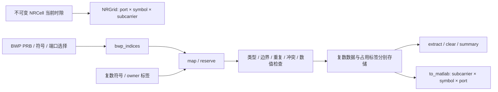

# NRGrid：单时隙频域资源网格

源码：[NRGrid.py](NRGrid.py)；单元测试：[test_NRGrid.py](../../tests/unit/test_NRGrid.py)；MATLAB 对比：[test_NRGrid_matlab.py](../../tests/matlab/test_NRGrid_matlab.py)。

规范基线为 **3GPP TS 38.211 V15.2.0 Release 15**。以下 § 均指该版本的原文章节，除非另有说明。协议原文位于 [documentation/protocols/](../../documentation/protocols/ts_138211v150200p.pdf)。

## 1. 用途、范围与依赖

NRGrid 保存一个 NRCell 当前时隙的端口域频域符号，提供 BWP RE 坐标生成、复数值映射、资源预留、占用冲突检查、提取、清理和 MATLAB 轴转换。导入方式为 `from grid import NRGrid`，或 `from grid.NRGrid import NRGrid`。

规范 §4.4.2 给出资源网格的子帧时频尺寸，本类在其上取**单个时隙切片**，采用项目约定的 `[port, symbol, subcarrier]` 轴顺序。它依赖 NRCell 和 NumPy，数据类型固定 complex128。子载波数是实际载波 RB×12，不扩展至 FFT 点数。

端口数必须单独指定，不自动取物理发送/接收天线数。端口轴仅是局部编号 0..n_ports-1，不表示具体协议中的 1000 等端口号。当前不进行预编码、端口到天线映射、OFDM、信号生成、TDD 方向调度、跨时隙拼接或混合 numerology。

占用标签是软件管理机制，不是协议定义的物理信道编号。示例 STREAM_A/STREAM_B/RESERVED/ZERO 及其复数值用于演示映射，不代表 PDSCH、PDCCH、DM-RS 或 SSB 的真实标准序列。



## 2. 初始化参数与内部变量

下表为项目 API 设计表，不是规范原表；依据列用于区分标准概念与软件选择。

| 参数 | 默认值、用途和示例 | 依据 |
|---|---|---|
| `cell` | 必填 NRCell 实例，保存其当前 n_frame/n_slot、SCS、CP、载波与 BWP；`NRGrid(NRCell())` | §4.3.2、§4.4.2；实例为单时隙切片 |
| `n_ports` | 默认 1，正 Python int，拒绝 bool；`NRGrid(NRCell(n_tx_antennas=4), n_ports=2)` | §4.4.1 的逻辑端口概念；局部端口数量为平台配置，不自动等于物理天线数 |

构造输入错误时抛 TypeError 或 ValueError。本类只为参数规定正数范围，不预先分配所有 R15 端口编号；非常大的网格仍可能因内存不足失败。

| 内部变量 | 含义、单位及示例 |
|---|---|
| `_cell` | 输入 NRCell 的引用；通过只读 `cell` 访问。例如当前时隙 `grid.cell.n_slot` |
| `_n_ports` | 固定的局部端口数；通过只读 `n_ports` 访问 |
| `_data` | `[端口,符号,子载波]` complex128 数组，初始全 0；`data` 只返回副本 |
| `_owners` | 同形状 Unicode U64 标签数组，初始为空字符串；非空即占用，不依赖 `_data` 是否为零 |

内部变量不应由业务代码直接修改。对外的配置属性没有 setter；不要通过修改私有成员绕过校验。改变小区时隙需创建新的 NRGrid，而不是自动继承旧网格数据。

## 3. 类常量与全部只读属性

这是项目接口表，原文没有对应的常量表。每项明确列出规范概念或平台约定。

| 类常量 | 值及使用示例 | 依据 |
|---|---|---|
| `AXIS_ORDER` | `NRGrid.AXIS_ORDER == ("port", "symbol", "subcarrier")` | 项目轴顺序，不是 MATLAB 默认顺序 |
| `DOMAIN` | `NRGrid.DOMAIN == "port"` | §4.4.1；当前仅支持端口域 |
| `OWNER_MAX_LENGTH` | `NRGrid.OWNER_MAX_LENGTH == 64` 字符 | 软件标签长度限制，不是协议端口数量限制 |
| `DATA_DTYPE` | `NRGrid.DATA_DTYPE is np.complex128` | 参考实现精度策略，不是协议强制数据类型 |

下列示例采用 `grid = NRGrid(NRCell(), n_ports=2)`，除非另有说明。此表为 API 推导表，不是原文表。

| 属性 | 含义、单位与结果示例 | 原文/设计依据 |
|---|---|---|
| `cell` | 绑定的 NRCell；`grid.cell.n_size_grid == 52` | 单时隙配置切片 |
| `n_ports` | 局部逻辑端口数；`2` | §4.4.1 |
| `n_symbols` | 每个时隙的符号数；`14`；60 kHz 扩展 CP 为 12 | §4.3.2 表 4.3.2-1/-2 |
| `n_subcarriers` | 每符号子载波数；`624` | §4.4.2、§4.4.4.1 |
| `shape` | 数组尺寸；`(2,14,624)` | G1，软件轴顺序 |
| `data` | 复数网格副本，形状同 shape；初始 `grid.data[0,0,0] == 0j` | §4.4.3 RE 复数值；副本是软件封装策略 |
| `owners` | 标签数组副本；初始 `grid.owners[0,0,0] == ""` | 软件占用机制 |
| `occupancy` | 新建 bool 数组；初始全 False | G3；值为零也可以是 True |
| `total_re_count` | 所有端口 RE 总数；`17472`，不是可用数据 RE 数 | G1 |
| `occupied_re_count` | 已映射及预留 RE 数；初始 `0` | G3 |
| `free_re_count` | 未分配 RE 数；初始 `17472` | G3 |

`data`、`owners`、`occupancy`、`extract` 和 `to_matlab` 的输出都不会把内部可变数组暴露给调用方。修改返回数组不改变本实例。副本策略优先保证资源状态一致性，后续高性能波形处理可再设计受控的视图接口。

## 4. 坐标与公式来源

以下 G1–G4 为本文自编号，不冒充 3GPP 公式号。

**G1：单时隙维度与 RE 总数**。由 TS 38.211 V15.2.0 §4.3.2、§4.4.2、§4.4.4.1 推导，采用项目轴约定：

$$K=12N_{grid}^{size},\quad L=N_{symb}^{slot},\quad shape=(P,L,K),\quad N_{RE}=PLK$$

P 为本实例端口数；它不是 NRCell 的发送天线数。完整规范资源网格的时域范围为子帧，本类只分配 L 个当前时隙符号。

**G2：BWP 局部 PRB 转为载波局部子载波**。由 §4.4.4.3/§4.4.4.4/§4.4.5 推导：

$$n_{CRB}=N_{BWP}^{start}+n_{PRB}$$

$$k_{grid}=12\left(N_{BWP}^{start}-N_{grid}^{start}+n_{PRB}\right)+s,\quad s\in\{0,\dots,11\}$$

两个 start 都相对 CRB 0。不能把 BWP 起点误当成相对载波的 RB 偏移。例：载波 CRB 10 起、BWP CRB 20 起，PRB 0 的第一个子载波是载波局部 k=120，而不是 k=240。

**G3：软件占用**。根据标签定义，与 RE 振幅无关，属于平台规则：

$$occupied(p,l,k)=[owners(p,l,k)\ne ""],\quad N_{used}=\sum occupied,\quad N_{free}=N_{RE}-N_{used}$$

**G4：MATLAB 列主序一维索引**。MATLAB 数组轴为 `[k,l,p]`，Python 使用 `[p,l,k]`；由 MATLAB `sub2ind` 布局推导：

$$index_{MATLAB,1based}=k+Kl+KLp+1$$

本类对外所有坐标从 0 开始。`to_matlab()` 返回 K×L×P 数组副本，P=1 时也保留三维；MATLAB 的 size 显示可能省略末尾单例维度，但 size(grid,3) 仍为 1。

## 5. 每个函数的用途、输入与返回值

本表为软件接口表。除 G1/G2 涉及规范坐标外，占用标签、冲突策略和写入原子性均为项目规则。

| 函数 | 输入、返回值和示例 |
|---|---|
| `__init__(cell, n_ports=1)` | 创建全零数据和空占用标签；返回实例。cell 不是 NRCell 或 n_ports 类型非法抛 TypeError，n_ports<1 抛 ValueError |
| `bwp_indices(prbs, symbols, ports=None)` | 三个一维整数选择生成 N×3 int64 坐标；ports=None 选择全部端口。每一行是 `[port,symbol,k_grid]`；`grid.bwp_indices([0],[2],[0])` 生成 12 个 RE |
| `map(indices, values, owner, overwrite=False)` | 写入可转换为 complex128 的标量或长度 N 的一维向量，返回写入数量。所有检查先完成再赋值；不允许 NaN/Inf。`grid.map([[0,0,0]], 0, "ZERO") == 1` |
| `reserve(indices, owner)` | 预留未分配 RE，其值保持 0，返回数量；`grid.reserve([[0,1,0]], "CONTROL")` |
| `extract(indices)` | 按坐标顺序提取 N 个复数值副本；允许读坐标重复，未分配位置返回 0；`grid.extract([[0,0,0]])` |
| `clear(owner=None)` | 清除指定标签的复数值与标签；None 清全部；返回实际释放 RE 数。标签未找到返回 0，不表示错误 |
| `to_matlab()` | 返回 K×L×P 复数副本；使用 `np.transpose` 显式交换轴，不做重采样或 FFT |
| `summary()` | 返回 cell 初始化字典、n_ports、domain、axis_order、shape、dtype 和总/占用/空闲数量；不包含完整数据数组 |
| `_axis(values, name, size)` | 内部选择校验：values 一维、整数（拒绝 bool/float）、唯一、0..size-1；name 用于错误信息，返回 int64 副本 |
| `_indices(indices)` | 内部 N×3 校验，验证整型与所有轴边界；只读路径允许重复；空列表规范化为 `(0,3)` |
| `_owner(owner)` | 内部标签校验：字符串、不是纯空白、最多 64 字符；返回原字符串，不裁剪空格或改变大小写 |
| `_write_indices(indices, owner, overwrite)` | 内部写入前检查坐标唯一、标签和覆盖标志、当前资源冲突；不修改数据，返回坐标副本 |

`bwp_indices` 按 **输入 ports → 输入 symbols → 输入 prbs → RB 内 0..11 子载波** 排序，保留选择顺序，不自动排序。任一选择为空则返回 `(0,3)`。一维选择重复时报错，避免无意重复映射。显式写坐标也不能重复；读取允许重复。

非法整数类型通常抛 TypeError，维数、范围、重复和冲突抛 ValueError；复数转换失败时可传播 NumPy 转换异常。写入失败不会部分修改数据或标签。`.map` 默认连同名 owner 也视为冲突；已有预留资源要被填入符号，须显式 `overwrite=True`。覆盖会同时替换符号值和标签；clear 同时释放两者。

`map`/`reserve` 的原始坐标只要求在整个载波内，**不自动施加具体物理信道的活动 BWP 限制**。BWP 边界只由 `bwp_indices` 保证；SSB 等资源和后续物理信道各自的限制需在对应模块校验。标签文本不能替代信道参数校验。

## 6. 完整可运行示例

```python
import numpy as np
from cell import NRCell
from grid import NRGrid

cell = NRCell(n_size_grid=6, n_start_grid=10, bwp_start=11, bwp_size=4,
              n_tx_antennas=4)
grid = NRGrid(cell, n_ports=2)
assert grid.shape == (2, 14, 72)
indices = grid.bwp_indices([0], [2], [0])
assert indices[0].tolist() == [0, 2, 12]
values = np.arange(12) + 1j * np.arange(12)
assert grid.map(indices, values, "DATA") == 12
np.testing.assert_array_equal(grid.extract(indices), values)
assert grid.occupied_re_count == 12  # values[0] 是 0j，也已经占用。
assert grid.reserve([[1, 0, 71]], "RESERVED") == 1
assert grid.occupied_re_count == 13
assert grid.to_matlab().shape == (72, 14, 2)
copy = grid.data
copy[:] = 0
assert grid.extract([indices[-1]])[0] == 11 + 11j
assert grid.clear("DATA") == 12
assert grid.clear() == 1
```

```python
from cell import NRCell
from grid import NRGrid

grid = NRGrid(NRCell())
grid.reserve([[0, 0, 0]], "RESERVED")
try:
    grid.map([[0, 0, 0]], 1, "DATA")
except ValueError:
    pass  # 默认冲突保护；原有预留仍然存在。
assert grid.owners[0, 0, 0] == "RESERVED"
assert grid.map([[0, 0, 0]], 1, "DATA", overwrite=True) == 1
assert grid.owners[0, 0, 0] == "DATA"
```

## 7. MATLAB 独立验证与示例产物

MATLAB 脚本使用真实 [nrResourceGrid](https://www.mathworks.com/help/5g/ref/nrresourcegrid.html) 生成网格，再用 MATLAB 原生 `sub2ind` 执行坐标映射和列主序一维索引计算。软件标签占用由参考程序独立管理；不声称 nrResourceGrid 本身带有本项目的标签功能。

18 组配置覆盖 5 种普通 CP numerology、60 kHz 扩展 CP、1/24/52 RB、1/2/4 端口及非零 BWP/载波起点。比较空网格尺寸、BWP 坐标、MATLAB 线性索引、映射值、零值占用、预留、非零计数、全网格和与按线性索引加权的和。总计 2736 个映射 RE，数值均为精确二进制分数，比较容差为 0。验证记录见 [NRGrid_validation.md](../../documentation/validation/NRGrid_validation.md)。

```powershell
.venv\Scripts\python examples/grid/NRGrid_demo.py
matlab -batch "addpath('examples/grid'); export_NRGrid_reference;"
.venv\Scripts\python -m pytest --require-matlab --cov=cell --cov=grid --cov=diagnostics --cov-branch --cov-report=term-missing --cov-fail-under=100
```

演示输出同级 JSON 摘要、完整复数网格及标签 NPZ、PNG/SVG 和 `.log`。日志通过 ExampleLogger 记录调用路径；演示在局部 NumPy printoptions 作用域内完整打印网格变量，不把数组省略号误当作完整数据。查看[示例目录说明](../../examples/grid/README.md)了解文件结构和复现方式。


## 8. 不同物理信道的颜色

绘图统一使用同目录的 [channel_colors](channel_colors.md) 模块，SSB/PDCCH/PDSCH/PUSCH/PUCCH/PRACH/SRS 采用不同固定颜色，参考信号也有独立色卡。调用 `channel_color("PDSCH")` 获取颜色，或 `encode_owners(grid.owners)` 生成离散绘图数据及图例。

标签如 `PDSCH:UE0`、`PDSCH:UE1` 保留各自占用名称，但使用相同 PDSCH 颜色。未知非空标签显示灰色而非空闲色。配色只决定显示，不改变 map/reserve/clear 的行为，也不表示相应信道算法已经实现。
