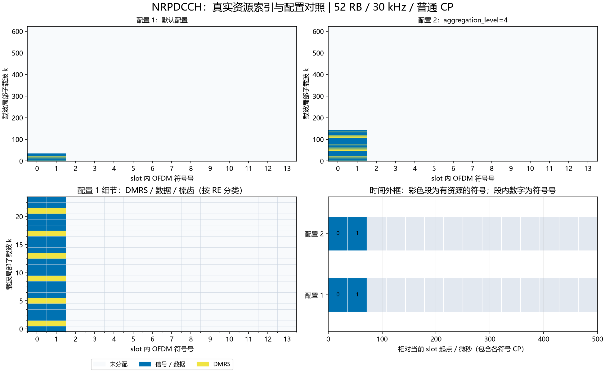

# NRPDCCH：CORESET及显式候选

## Python绘图图例



上图使用实际资源索引：上排对照两组配置，左下放大配置1的频域细节，右下按NRCell精确CP长度换算时间。配置未显式列出的字段使用类默认值；彩色时间段表示整个符号内有分配，不表示全部子载波均占用。多层坐标取并集；同RE上的端口叠加不按图层数量重复计面积。

生成脚本：[plot_NRChannel_documentation.py](../../examples/common/plot_NRChannel_documentation.py)。图为平台运行结果及教学示例，不构成新增MATLAB验证。


## 新手导读：生成、时频位置与接收

先看[统一坐标、时间换算和图例](../../documentation/channel_walkthrough.md)。本节使用固定基线：TS38.211 V15.2.0 §7.3.2、§7.4.1.3；TS38.212 V15.2.0 §7.3.2～4。以下示意图和数量计算为依据这些章节的辅助推导，不是新增协议原表。详细字段范围、公式变量和支持边界见本文原有参考节。

### 信号怎样生成

DCI比特经CRC24C/RNTI掩码、Polar和速率匹配、加扰、QPSK后映射到所选CCE候选，另生成DMRS。CRC掩码RNTI和物理数据加扰RNTI是分别配置的用途，不应混成一个自动推断参数。

### 时间与频率上放在哪里

CORESET由6 RB组构成的frequency_resources和1～3符号duration定义。start_symbol指定首符号。一个REG是一个RB×一个符号，一个CCE包含6 REG。聚合等级AL为1/2/4/8/16，实际候选占6AL个REG，不一定占满整个CORESET。

```text
每REG的12个子载波偏移：0 1 2 3 4 5 6 7 8 9 10 11
                      D R D D D R D D D R D  D
```

每REG是9数据点+3DMRS；AL=4时24 REG，216个QPSK数据点、72个DMRS点、编码长度432位。非交织按规则连续映射REG束；交织会把候选分散到CORESET频率位置，因此候选未必是单一矩形。增大AL增加候选资源与编码冗余，不增加原始DCI位数。cce_start决定显式候选；本类不实现SearchSpace哈希、盲候选监测或CORESET0调度。

### 接收机怎样恢复

OFDM解调后按所选候选提取REG。每REG用3个DMRS做平坦LS估计，对9个数据点跨Rx进行MRC，形成QPSK软值并解扰，再Polar SC译码、检查RNTI掩码CRC。当前需要知道候选位置、DCI长度和CRC RNTI；不是同时搜索全部长度/RNTI的盲解码器。

### 如何检查自己的配置

位置检查优先读取资源类的`indices()`，每行是逻辑端口/层、slot符号、载波局部子载波。不要把逻辑端口轴当接收天线。频域点数乘子载波间隔给出计数带宽；精确时域样点由NRCell当前slot逐符号CP加FFT长度累加，算法见统一指南。

发射图先看映射网格，再看IFFT/CP波形；接收图先确认提取/参考匹配，再看均衡或相关及最终判决。已知CFO/时延补偿来自调用者，不是自动同步估计。所有复幅度为平台归一化量，不是dBm。图例本身不扩展MATLAB验证范围。

逐步收发接口见[NRPDCCHTransmitter](NRPDCCHTransmitter.md)、[NRPDCCHReceiver](NRPDCCHReceiver.md)。


[源码](NRPDCCH.py)。固定TS38.211 V15.2.0 §7.3.2、原表7.3.2.1-1，§7.4.1.3。单逻辑端口2000，QPSK；每CCE含6REG，每REG含一RB一符号的12RE，其中1/5/9为DMRS，9个数据RE。每CCE编码长度108bit。

| 字段/默认值 | 含义、范围、单位及示例 |
|---|---|
| cell | NRCell；例NRCell(n_size_grid=24,n_rx_antennas=2)；首版BWP起点须6CRB对齐 |
| frequency_resources=(0,1) | 有序唯一tuple，元素0..44；每元素表示相对BWP起点的六RB组，支持不连续组，例(0,2)；须在BWP内 |
| duration=2 | CORESET符号数1..3；R15持续3符号时必须dmrs_type_a_position=3 |
| start_symbol=0 | slot内起始符号0..symbols_per_slot-duration |
| aggregation_level=1 | 聚合等级L=1/2/4/8/16，CCE数，原表7.3.2.1-1 |
| cce_start=0 | 已选择候选的首CCE，0..n_cce-L且L对齐；不是候选序号 |
| mapping_type='noninterleaved' | 'noninterleaved'或'interleaved' |
| reg_bundle_size=6 | REG束大小；duration1允许2/6，duration2/3允许duration/6；非交织实际强制使用6 |
| interleaver_size=2 | R为2/3/6，交织时n_regs/(bundle*R)须整数 |
| shift_index=0 | 显式交织移位0..274；CORESET0的PCI回退须由调用方提供，本类不隐式调度CORESET0 |
| scrambling_id=1 | DMRS与数据加扰ID，0..65535；回退PCI时显式传cell.n_cell_id |
| scrambling_rnti=1 | 物理数据加扰RNTI，0..65535；公共搜索空间按规范传0，不与CRC掩码RNTI混同 |
| dmrs_reference_rb=0 | DMRS频率原点CRB，0..CORESET最低CRB；通常0，PBCH/SIB1场景显式传最低CRB |
| dmrs_type_a_position=2 | 固定R15 CORESET持续3符号的配置约束字段2/3 |

构造/__post_init__检查字段和候选边界，不实现TS38.213 SearchSpace候选哈希、监测周期、CORESET0表或DCI字段语义。调用方负责当前候选的发送许可及ID规则。n_regs=6*组数*duration，n_cce=n_regs/6，coded_length=108*L，均整数标量。

regs()返回按符号、频率排序的6L个(symbol,carrier_local_RB)元组，REG编号内部按时间优先。indices(dmrs=False)严格bool，返回int[RE,3]（端口0、slot符号、载波局部子载波），数据54L行、DMRS18L行；排序同映射序列。scrambling()返回int[E] Gold序列。generate(bits)校验整数二进制[E]，加扰QPSK输出complex[54L]单位模。dmrs()返回complex[18L]，按实际CRB原点截取Gold QPSK。map_to_grid(grid,bits,beta=1)要求同cell单端口NRGrid，beta有限非负线性幅度，原子写owner=PDCCH，无返回值。

公式PDCCH-1/2为文档自编号，依据固定§7.3.2.2/§7.3.2.3及§7.4.1.3：

$$
f(j)=[(j\bmod R)C+\lfloor j/R\rfloor+n_{shift}]\bmod(N_{REG}/B),\quad C=N_{REG}/(BR),\quad c_{data}=(n_{RNTI}2^{16}+N_{ID})\bmod2^{31}.\tag{PDCCH-1}
$$

$$
c_{DMRS}=[2^{17}(14n_{slot}+l+1)(2N_{ID}+1)+2N_{ID}]\bmod2^{31}.\tag{PDCCH-2}
$$

j为输入REG束号0..N_REG/B-1，B为束大小2/3/6，R为交织大小2/3/6，C为正整数列数，f为输出束号；n_shift为shift_index。非交织f(j)=j且B=6。N_REG为CORESET REG数，n_RNTI/N_ID为上述数据RNTI/加扰ID，种子为0..2^31-1整数。n_slot为帧内slot，l为slot内DMRS符号；DMRS初始化使用规范固定14因子。所有变量均无量纲整数；QPSK幅度归一化，无绝对瓦特标定。

```python
from cell import NRCell
from pdcch import NRPDCCH
r=NRPDCCH(NRCell(n_size_grid=24),frequency_resources=(0,1,2,3),aggregation_level=4)
assert r.coded_length==432 and len(r.regs())==24
```

当前DMRS仅映射候选内REG（sameAsREG-bundle）；无allContiguousRBs全CORESET参考、动态波束、多层、非6CRB对齐BWP或SearchSpace盲搜。数据前导/CRC由NRDCICode独立处理。

### 可复现的位置对照

以下为当前实现运行得到的派生示例，不是协议原表：小区52 RB、30 kHz、普通CP，BWP与载波同起点，其余使用类默认值。统计是不同(符号,k)的并集，不把多层重复坐标当成额外时频面积；k范围是首末占用点，不表示中间每个RE都占用。SSB只统计非零信号的830个RE，零位置另保留。

| 构造时额外参数 | 实际占用slot符号号 | 载波局部k最小～最大 | 不同占用RE数 |
|---|---|---|---:|
| `{}` | [0, 1] | 0～35 | 72 |
| `{'aggregation_level': 4}` | [0, 1] | 0～143 | 288 |

```python
from cell import NRCell
from pdcch import NRPDCCH
cell = NRCell(n_size_grid=52, subcarrier_spacing_khz=30)
r = NRPDCCH(cell)
idx = r.indices()
print("坐标形状：", idx.shape, "前3行：", idx[:3])
```

这里只打印少量坐标。要查看频率和持续时间，使用统一指南READ-1/2换算；改变slot或CP后重新计算，不能照抄表中位置。

## 逐变量说明

以下变量对应本文已有公式或算法表达式；规范基线和章节沿用对应公式处的引用。每行只定义一个变量，同名符号只在该公式上下文有效。

| 变量 | 含义与用途 | 范围/约束 | 单位 | 维度/类型 |
|---|---|---|---|---|
| j | 交织前REG bundle号，选择候选映射输入 | 0..N_REG/B−1 | bundle索引 | 整数标量 |
| f(j) | 交织后的bundle号，定位实际REG | 0..N_REG/B−1 | bundle索引 | 整数标量 |
| B | 一个REG bundle包含的REG数 | 2/3/6，须满足duration与映射约束 | REG数 | 整数标量 |
| R | 交织器行数 | 2/3/6，非交织不使用该置换 | 行数 | 整数标量 |
| C | 交织器列数，用于行列变换 | N_REG/(BR)，须为正整数 | 列数 | 整数标量 |
| N_REG | CORESET全部REG数，约束候选及交织 | 6×频率组数×duration | REG数 | 正整数标量 |
| n_shift | 交织后的循环移位 | shift_index为整数0..274，最终按bundle数取模 | bundle偏移 | 整数标量 |
| n_RNTI | 物理数据加扰RNTI，参与数据Gold种子 | 0..65535；公共搜索空间按规则显式传0 | ID | 整数标量 |
| N_ID | 该式加扰ID，初始化数据/DMRS序列 | 0..65535，由scrambling_id提供 | ID | 整数标量 |
| c_data | 数据Gold初始化种子 | 模2^31后0..2^31−1 | 无量纲 | 整数标量 |
| c_DMRS | DMRS Gold初始化种子 | 模2^31后0..2^31−1 | 无量纲 | 整数标量 |
| n_slot | 帧内slot号，确定参考随时间变化 | 0..cell.slots_per_frame−1 | slot索引 | 整数标量 |
| l | slot内DMRS符号号，用于参考初始化 | start_symbol..start_symbol+duration−1 | 符号索引 | 整数标量 |
