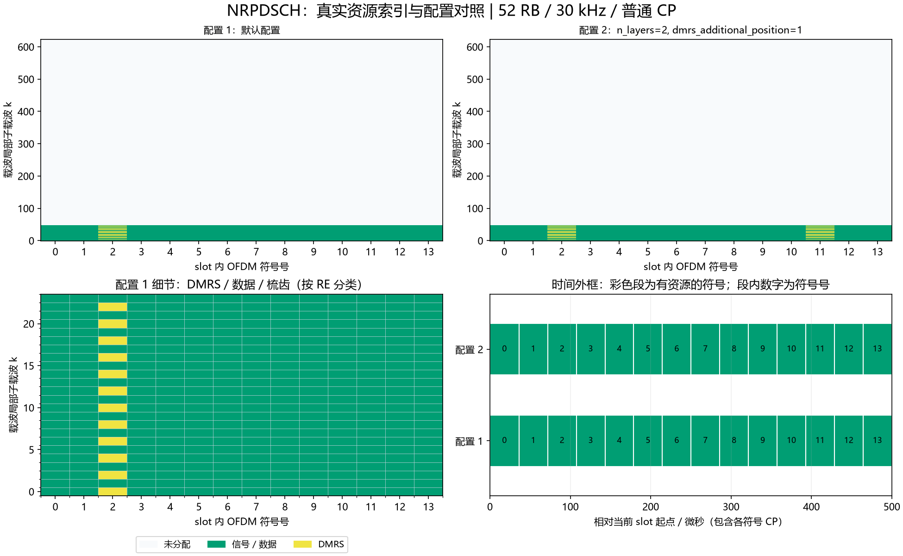

# NRPDSCH：1～4层PDSCH、DMRS端口与OCC

## Python绘图图例



上图使用实际资源索引：上排对照两组配置，左下放大配置1的频域细节，右下按NRCell精确CP长度换算时间。配置未显式列出的字段使用类默认值；彩色时间段表示整个符号内有分配，不表示全部子载波均占用。多层坐标取并集；同RE上的端口叠加不按图层数量重复计面积。

生成脚本：[plot_NRChannel_documentation.py](../../examples/common/plot_NRChannel_documentation.py)。图为平台运行结果及教学示例，不构成新增MATLAB验证。


## 新手导读：生成、时频位置与接收

先看[统一坐标、时间换算和图例](../../documentation/channel_walkthrough.md)。本节使用固定基线：TS38.211 V15.2.0 §7.3.1及§7.4.1.1；TS38.212 V15.2.0 §7.2。以下示意图和数量计算为依据这些章节的辅助推导，不是新增协议原表。详细字段范围、公式变量和支持边界见本文原有参考节。

### 信号怎样生成

下行共享信道承载业务传输块：CRC → LDPC → 速率匹配/RV → 数据加扰 → QAM → 1～4层映射 → DMRS与数据RE映射 → 普通OFDM。编码位数由可用数据RE、层数与调制阶数决定，不能用整个RB矩形面积直接计算。当前传输块长度和目标码率显式输入，不自动执行MCS/TBS调度。

### 时间与频率上放在哪里

prb为BWP局部首RB，n_prbs为连续RB数；start_symbol与n_symbols决定slot内连续时间区间。Type-A DMRS位置由dmrs_type_a_position、分配结束位置、单/双符号和additional_position组合决定，实际读取dmrs_symbols；不能假定永远只有符号2。

```text
单层Type1、端口0、单DMRS符号、仅保留一个CDM组的一个RB：
DMRS符号： R D R D R D R D R D R D
其他符号： D D D D D D D D D D D D
```

R为该端口DMRS；保留更多CDM组时原本的D可变为禁止放数据的位置，不代表其他端口的数据。Type2每组为成对子载波，不能沿用Type1奇偶梳齿。多端口在相同RE上通过频域/时域OCC分离，indices第一列是层，不是物理接收天线。

增加n_layers不扩大时频外框，但增加空间维度和编码容量；需要足够接收维度及满秩信道。增加DMRS减少数据容量；调制阶数增加改变每数据RE携带位数，资源位置保持相同。

### 接收机怎样恢复

接收端补偿给定同步量后OFDM解调。逐RB将各层DMRS的实际频域/时域OCC组成联合设计矩阵，LS估计[Rx,层,RB]信道；假定同一RB及分配时间内近似恒定。逐RB检查信道秩与条件数，用伪逆ZF分离各层；按发送顺序还原调制符号，计算距离软值、解扰、LDPC速率恢复/迭代译码并检查CRC。ZF不是MMSE，病态信道可能放大噪声；均衡失败不会仅凭DMRS检测通过就宣称业务恢复成功。

### 如何检查自己的配置

位置检查优先读取资源类的`indices()`，每行是逻辑端口/层、slot符号、载波局部子载波。不要把逻辑端口轴当接收天线。频域点数乘子载波间隔给出计数带宽；精确时域样点由NRCell当前slot逐符号CP加FFT长度累加，算法见统一指南。

发射图先看映射网格，再看IFFT/CP波形；接收图先确认提取/参考匹配，再看均衡或相关及最终判决。已知CFO/时延补偿来自调用者，不是自动同步估计。所有复幅度为平台归一化量，不是dBm。图例本身不扩展MATLAB验证范围。

逐步收发接口见[NRPDSCHTransmitter](NRPDSCHTransmitter.md)、[NRPDSCHReceiver](NRPDSCHReceiver.md)。


[源码](NRPDSCH.py)。固定TS38.211 V15.2.0 §5.1/5.2.1、§7.3.1.1～5、表7.3.1.3-1及§7.4.1.1、原表7.4.1.1.2-1～5。单码字q=0、1～4层CP-OFDM、连续非交织RB；支持Type-A、DMRS Type1/2、单/双符号及附加位置。逻辑层端口通过dmrs_ports对应协议端口1000+p，不把层号当作接收天线号。

| 字段/属性 | 含义、范围、单位、示例 |
|---|---|
| cell | NRCell，例NRCell(n_size_grid=12,n_rx_antennas=4) |
| prb=0 | BWP局部首RB号，定位资源频域起点；范围：整数0..bwp_size−n_prbs，默认0；单位：RB索引；维度：整数标量 |
| n_prbs=4 | 连续RB数量，控制分配带宽；范围：整数1..bwp_size且完整装入BWP，默认4；单位：RB；维度：整数标量 |
| start_symbol=0 | slot零基起始符号，0..min(3,slot符号数-n_symbols) |
| n_symbols=14 | 连续符号数4..slot符号数；扩展CP需显式指定≤12 |
| rnti=1 | 已选RNTI，整数0..65535 |
| data_scrambling_id=None | 数据ID0..1023，None解析PCI；例731 |
| dmrs_scrambling_id=None | 已选DMRS ID0..65535，None解析PCI；例271 |
| n_scid=0 | DMRS初始化选择0/1，ID由调用方提供相应值 |
| dmrs_type_a_position=2 | 第一DMRS的slot符号2/3，必须在分配中 |
| cdm_groups_without_data=None | 自动取覆盖已用端口所需组数；显式值须覆盖全部已用组，Type1最多2、Type2最多3 |
| modulation='QPSK' | QPSK/16QAM/64QAM/256QAM |
| n_layers=1 | 单码字层数，整数1..4；5～8层/双码字不支持 |
| dmrs_configuration_type=1 | DMRS类型1或2 |
| dmrs_length=1 | 单/双符号1或2 |
| dmrs_additional_position=0 | 单符号0..3；双符号0/1；Type-A位置3不能配附加位置3 |
| dmrs_ports=None | 恰有n_layers个不重复相对端口的tuple；None取tuple(range(n_layers))；例(0,4,1,5) |
| modulation_order | Qm=2/4/6/8 |
| coded_length | G=每层数据RE数*层数*Qm，编码位数 |
| dmrs_symbol_starts | 每个DMRS单/双符号组的slot内起始索引int[J] |
| dmrs_symbols | 展开的全部slot内DMRS符号int[D]，双符号各组含start及start+1 |

构造及__post_init__检查上述字段、端口数量/唯一性、CDM组覆盖、DMRS是否完全位于分配内，冻结配置。Type-A原表的duration使用start_symbol+n_symbols，不能仅使用n_symbols。非法配置明确抛异常。

| 类型 | 单符号相对端口 | 双符号相对端口 | 每RB每端口DMRS点数 | 原表 |
|---|---|---|---|---|
| Type1 | 0..3 | 0..7 | 每符号6 | TS38.211 V15.2.0表7.4.1.1.2-1/-5 |
| Type2 | 0..5 | 0..11 | 每符号4 | 同版本表7.4.1.1.2-2/-5 |

port_parameters(port)为内部表映射，返回(group,frequency_sign,time_sign)。令S=4（Type1）或6（Type2），group=(p%S)//2、frequency_sign=p%2、time_sign=p//S，分别是CDM组、频域OCC和时域OCC索引。相对p对应规范端口1000+p。port_subcarriers(port)返回该端口在整个分配带宽内的相对频率索引int[Dk]：Type1为2m+group；Type2为6n+2group+k_prime，k_prime=0/1。

indices(dmrs=False)返回int[RE,3]，列为本地层号、slot符号、载波局部子载波；严格bool选择数据或DMRS。排序为层在外、符号其次、频率在内。所有层使用相同数据RE几何，DMRS频率位置由对应端口决定；DMRS符号上全部配置CDM组都禁止数据，即使某个组没有实际发送端口。

scrambling()返回Gold int[G]，种子RNTI*2^15+q*2^14+dataID，q=0。constellation()复用common/_qam.py，返回归一化QAM点complex[2^Qm]及整数比特标签[2^Qm,Qm]。generate(coded_bits)严格校验整数二进制[G]并拒绝bool，加扰/QAM后按原表轮流把码字调制符号分给各层；返回按层优先展平的complex[n_layers*Nd]，reshape(n_layers,Nd)可查看各层，Nd为每层数据RE数。单层保持原先一维返回格式。

dmrs()返回按层、DMRS符号、频率排序的complex数组，与indices(True)逐项对应；各层数量相同。每OFDM符号独立生成Gold-QPSK，CRB0为频率原点；Type1起点6*(bwp_start+prb)、Type2起点4*(bwp_start+prb)。再乘端口的频域OCC和双符号时域OCC。单码字数据加扰和DMRS序列是不同伪随机流。

map_to_grid(grid,coded_bits,beta=1)要求同cell且grid.n_ports=n_layers。beta有限非负线性幅度，每层数据/DMRS同幅，合并坐标后原子写owner=PDSCH，返回跨全部层的映射RE数量。n_layers是逻辑层数，不自动从cell.n_tx_antennas推导；示例使用单位预编码，每层一条Tx波形，通过外部有效MIMO信道映射到Rx。

```python
from cell import NRCell
from pdsch import NRPDSCH
r = NRPDSCH(NRCell(n_size_grid=12,n_rx_antennas=4),n_layers=4,
             dmrs_configuration_type=2,dmrs_length=2,
             dmrs_ports=(1,7,4,10),dmrs_additional_position=1)
assert r.cdm_groups_without_data == 3
```

附加位置按原表7.4.1.1.2-3/-4：例如单符号duration12/位置3为[2,5,8,11]；双符号duration14/附加1且起点2为[2,3,10,11]。Type-A位置3加附加3被拒绝。

文档自编号PDSCH-M1，依据上述层映射及DMRS端口表：

$$
x_{v,i}=d_{Vi+v},\qquad
r_{p,l,m}=r_l[m](-1)^{f_p(m\bmod2)+t_pl'},\quad
f_p=p\bmod2,\quad t_p=\lfloor p/S\rfloor.\tag{PDSCH-M1}
$$

| 变量 | 含义、范围、单位与维度 |
|---|---|
| V | 发送层数；取值范围/约束：1..4；单位：层数；维度/类型：整数标量 |
| v | 当前层索引，选择层映射输出行；取值范围/约束：0..V−1；单位：层索引；维度/类型：整数标量 |
| i | 每层数据RE位置，遍历该层符号；取值范围/约束：0..Nd−1；单位：RE索引；维度/类型：整数标量 |
| d | 码字QAM序列，作为轮流层映射输入；取值范围/约束：有限星座复数；单位：归一化复幅度；维度/类型：complex[V×Nd] |
| x | 层映射结果，供各层RE映射；取值范围/约束：有限星座复数；单位：归一化复幅度；维度/类型：complex[V,Nd] |
| p | 相对DMRS端口，选择CDM组和OCC；取值范围/约束：Type1单符号0..3/双符号0..7，Type2单符号0..5/双符号0..11；单位：无量纲；维度/类型：整数标量 |
| S | 单符号DMRS类型的端口基数，用于端口分组；取值范围/约束：Type1为4，Type2为6；单位：无量纲；维度/类型：整数标量 |
| f_p | 端口的频域OCC索引，决定相邻参考的符号；取值范围/约束：0/1；单位：无量纲；维度/类型：整数标量 |
| t_p | 端口的时域OCC索引，决定双符号参考的符号；取值范围/约束：0/1，单符号时为0；单位：无量纲；维度/类型：整数标量 |
| l | slot内DMRS符号号，用于时域映射和种子；取值范围/约束：实际dmrs_symbols集合中的值；单位：符号索引；维度/类型：整数标量 |
| l_prime | 一个DMRS组内相对时间号，用于时域OCC；取值范围/约束：0..dmrs_length−1；单位：符号索引；维度/类型：整数标量 |
| m | 基础参考序列的频率点索引；取值范围/约束：0..该符号生成参考点数−1；单位：序列点索引；维度/类型：整数标量 |
| r_l | 该符号的基础Gold-QPSK参考，供端口加权；取值范围/约束：每点单位模复数；单位：归一化复幅度；维度/类型：一维复序列 |
| r_p | 施加端口OCC后的参考，映射到该端口的DMRS RE；取值范围/约束：每点单位模复数；单位：归一化复幅度；维度/类型：一维复序列 |

Gold初始化PDSCH-1（文档自编号），依据同版本§7.4.1.1.1：

$$
c_{\rm init}=\bigl[2^{17}(N_{\rm symb}^{\rm slot}n_{\rm slot}+l+1)(2N_{\rm ID}+1)+2N_{\rm ID}+n_{\rm SCID}\bigr]\bmod2^{31}.\tag{PDSCH-1}
$$

其中c_init为0..2^31-1整数；N_symb_slot为14/12，n_slot为帧内slot，l为上述DMRS符号，N_ID为已选DMRS ID0..65535，n_SCID为0/1；均无量纲标量。

边界：无5～8层/双码字、Type-B、VRB交织、动态预编码/码本、PTRS、SSB/PBCH/CORESET预留RE速率匹配、MCS/TBS/Nref自动选择或PDCCH调度。接收联合估计假设每RB整个分配内近似恒定，附加DMRS用于联合观测，不等于已实现时变信道插值。

### 可复现的位置对照

以下为当前实现运行得到的派生示例，不是协议原表：小区52 RB、30 kHz、普通CP，BWP与载波同起点，其余使用类默认值。统计是不同(符号,k)的并集，不把多层重复坐标当成额外时频面积；k范围是首末占用点，不表示中间每个RE都占用。SSB只统计非零信号的830个RE，零位置另保留。

| 构造时额外参数 | 实际占用slot符号号 | 载波局部k最小～最大 | 不同占用RE数 |
|---|---|---|---:|
| `{}` | [0, 1, 2, 3, 4, 5, 6, 7, 8, 9, 10, 11, 12, 13] | 0～47 | 672 |
| `{'n_layers': 2, 'dmrs_additional_position': 1}` | [0, 1, 2, 3, 4, 5, 6, 7, 8, 9, 10, 11, 12, 13] | 0～47 | 672 |

```python
from cell import NRCell
from pdsch import NRPDSCH
cell = NRCell(n_size_grid=52, subcarrier_spacing_khz=30)
r = NRPDSCH(cell)
idx = r.indices()
print("坐标形状：", idx.shape, "前3行：", idx[:3])
```

这里只打印少量坐标。要查看频率和持续时间，使用统一指南READ-1/2换算；改变slot或CP后重新计算，不能照抄表中位置。
