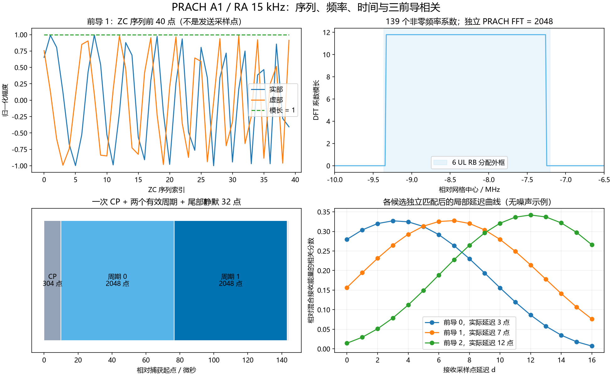
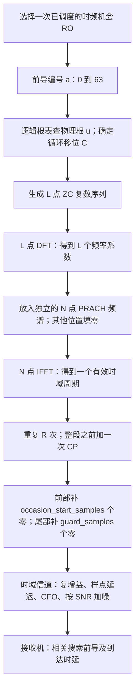

# NRPRACH：R15显式时机的PRACH资源与前导

## Python绘图图例



上图由实际资源类及收发算法生成：左上为ZC序列，右上为独立PRACH频谱，左下为CP与有效周期时间轴，右下为三个候选分别匹配后的局部时延曲线。相关峰较宽来自有限占用带宽，不能把它误读成单点冲激。

生成脚本：[plot_NRChannel_documentation.py](../../examples/common/plot_NRChannel_documentation.py)。图为平台运行结果及教学示例，不构成新增MATLAB验证。


[源码](NRPRACH.py)。以NRCell提供上行BWP、采样率、天线信息；生成TS38.211 V15.2.0 §6.3.3.1的839/139点Zadoff–Chu前导，按§6.3.3.2及§5.3.2映射频率和独立PRACH时序。支持非受限集合的64个前导、13种格式、循环移位与跨根分配。PRACH端口为4000，单个发送波形；多Rx由外部信道生成。

本类描述**一个调用方已调度的发送时机**，不自动解析ConfigurationIndex、帧周期、TDD有效符号、SSB关联、msg1-FDM或功率控制。指定格式B2/B3表示调用方已从混合A/B时机中选中B格式。收到的前导编号不是C-RNTI，也不标识已接入UE；同一时机相同前导碰撞无法区分用户。

## 新手导读：先从一次“敲门”理解 PRACH

PRACH（Physical Random Access Channel，物理随机接入信道）用于让尚未完成上行定时对齐的 UE 发出可被基站识别的前导。基站在约定的时间和频率上寻找前导，获得前导编号和相对到达时延，再由更高层继续处理随机接入。这里的前导是已知结构的复数序列，不携带普通业务传输块，也不经过 LDPC、Polar 或 QAM 数据调制。

建议按本节的“生成 → 时间 → 频率 → 配置”顺序阅读，再阅读[发射机逐步说明](NRPRACHTransmitter.md#从序列到时域数组逐步对应)和[接收机逐步说明](NRPRACHReceiver.md#从接收数组到前导编号逐步解释)。原有字段、公式与 API 参考保留在后半部分。

### 先分清五种“长度”

| 名称 | 是什么 | 默认示例：52 RB、UL 30 kHz、PRACH A1/15 kHz |
|---|---|---|
| ZC 序列长度 L | 生成前导使用的复数点数，也是非零 PRACH 频率点数 | 139 点；长前导则是 839 点 |
| PRACH FFT 长度 N | 将 PRACH 频谱转换成时域的一周期采样点数 | 2048 点；不是 139，也不是小区普通 OFDM 的 1024 点 |
| 重复数 R | 同一有效时域周期连续发送几遍 | 2 遍；两个周期使用相同前导，不是两个前导编号 |
| CP 长度 | 有效周期之前的循环前缀，用来容纳传播时延等影响 | 当前起点为 0 时为 304 个采样点 |
| 输出数组长度 T | 前部静默 + CP + R 个周期 + 尾部静默 | 不加偏移和 guard 时为 4400 点；demo 的 guard=32，故为 4432 点 |

本表是依 TS38.211 V15.2.0 §5.3.2、§6.3.3.1 原表6.3.3.1-2以及平台采样率规则计算的**派生示例**，不是规范原表。采样率为 30.72 MS/s，每点约 32.5521 ns；全部示例长度以复数基带采样点计，不是文件字节数。

### 信号究竟怎样生成



1. **确定序列身份**：`root_sequence_index` 是查表起点，`preamble_index` 是该时机内的前导编号，不能直接把二者当作物理根 `u`。非受限集合先用同一根的循环移位，再换到下一个逻辑根。
2. **生成 ZC**：每个点位于复平面的单位圆上。循环移位改变同一根序列的起始位置，使多个前导能够在合适的时延窗口内区分。
3. **做 L 点 DFT**：得到 139 或 839 个频率系数。这一步得到的 `symbols` 还不是可直接送入信道的时域信号。
4. **频域放置**：用 PRACH 自己的子载波间隔和 FFT，把这些系数放到配置的位置；其余 FFT bin 为零。
5. **IFFT、重复、CP**：得到实际可发送的波形。PRACH 是一次前缀加连续有效周期，不能套用普通 OFDM 每个符号各加一次 CP 的方式。

生成依据为 TS38.211 V15.2.0 §6.3.3.1、§6.3.3.2、§5.3.2；具体归一化和索引见后文 PRACH-1/2/3。

### 时域位置：从哪里开始，持续多久

RO 是 Random Access Occasion，即一次随机接入时频机会。必须区分以下两个层次：

- **协议调度层**：`prach-ConfigurationIndex` 联合频段和频谱类型选择配置表行，确定允许的无线帧/子帧、PRACH 时隙、起始符号、时域机会数和持续长度等。依据 TS38.211 V15.2.0 §6.3.3.2 原表6.3.3.2-2/-3/-4及§5.3.2；还需要外部过程检查实际发送许可。
- **当前平台波形层**：调用者已经选好一次 RO，只把其 CP 首点在捕获数组中的位置传给 `occasion_start_samples`。本类没有 `configuration_index` 配置字段，不自动选帧、不自动判断 TDD 发送许可。

以默认 A1/15 kHz、52 RB/UL 30 kHz、数组起点物理时间为 0、尾部 guard=32 为例，下面区间均为左闭右开：

```text
数组采样索引   0              304                   2352                  4400 4432
               |----- CP -----|------ 有效周期 0 ------|------ 有效周期 1 ------|静默|
数组内时间     0          9.895833 us            76.562500 us        143.229167 us
               <---------------- 活动前导：4400 点 ----------------->
```

两个有效周期各 2048 点，即 66.666667 us。CP 304 点即 9.895833 us。尾部 32 点约 1.041667 us，不属于前导本身；它只是本平台为延迟后的尾部留出的捕获空间，不代表规范规定的 RO 保护时间。

如果 `occasion_start_samples=1000`，数组前面出现 1000 个零；此例起点不在半毫秒边界上且前导没有跨下一个边界，CP 变成 288 点，活动长度变成 4384 点。不要把旧的 304 点 CP 直接平移过去。短格式 CP 与物理时间位置有关，计算依据是 TS38.211 V15.2.0 §5.3.2，见 PRACH-3。

```text
数组索引       0           1000       1288               3336              5384 5416
               |前部静默    | CP 288点 | 有效周期 0：2048点 | 有效周期 1：2048点 |尾部|
```

`time_origin_samples` 另有用途：它表示捕获数组第 0 点所对应的物理时间，参与 CP 半毫秒边界计算，**不会插入零样点**。例如保持 `occasion_start_samples=0`，把 `time_origin_samples` 设为 1000，CP 同样为 288 点，但波形从数组第 0 点开始。

以下为本文自编号 PRACH-GUIDE-1，根据上述标准时序和平台数组约定推导：

$$
 t_{\mathrm{CP}}=\frac{t_0+s}{F_s},\qquad
 T_u=\frac{N}{F_s}=\frac{1}{\Delta f_{RA}},\qquad
 T_{\mathrm{active}}=\frac{C_{CP}+RN}{F_s},\qquad
 T=s+C_{CP}+RN+G.\tag{PRACH-GUIDE-1}
$$

| 变量 | 含义、范围、单位、维度 |
|---|---|
| t0 | 捕获数组第0点的物理时间原点；影响CP边界计数；取值范围/约束：time_origin_samples为非负整数；不会插入前部静默；单位：采样点；维度/类型：整数标量 |
| s | CP首点在数组中的索引，决定发送前静默；范围：非负整数，等于occasion_start_samples；单位：采样点；维度：整数标量 |
| Fs | 小区采样率；在样点和秒之间换算；取值范围/约束：Fs=cell.n_fft×cell子载波间隔Hz，正数；单位：Hz，即sample/s；维度/类型：实标量 |
| Delta_f_RA | PRACH子载波间隔；决定PRACH周期及频率bin间距；取值范围/约束：格式0～2为1250，格式3为5000，短格式15000/30000/60000/120000；单位：Hz；维度/类型：正实标量 |
| N | 独立PRACH FFT长度，决定一个有效周期的采样数；取值范围/约束：Fs/Delta_f_RA，正整数；单位：采样点；维度/类型：整数标量 |
| R | 有效周期重复数，决定重复发送次数；取值范围/约束：原表允许1/2/4/6/12；单位：次数；维度/类型：整数标量 |
| C_CP | 实际CP长度，用于时域前缀和延迟容限；取值范围/约束：正整数，含适用短格式边界扩展；单位：采样点；维度/类型：整数标量 |
| G | 输出尾部静默点数，给延迟尾部留捕获空间；取值范围/约束：G=guard_samples，整数≥0；单位：采样点；维度/类型：整数标量 |
| T | 捕获数组总长度，用于分配波形数组；取值范围/约束：T=s+C_CP+RN+G，正整数；单位：采样点；维度/类型：整数标量 |
| t_CP | CP首点物理时间，定位发送机会；取值范围/约束：(t0+s)/Fs，≥0；单位：s；维度/类型：实标量 |
| T_u | 单个有效周期持续时间，决定PRACH符号尺度；取值范围/约束：N/Fs=1/Delta_f_RA，>0；单位：s；维度/类型：实标量 |
| T_active | CP加所有有效周期持续时间，不含前后静默；取值范围/约束：(C_CP+RN)/Fs，>0；单位：s；维度/类型：实标量 |

CP 从有效波形尾部循环复制。C2 可能需要超过一个有效周期的 CP，因此实现使用取模循环，而不是只复制一次尾部。CP 不增加新的前导编号，也不作为新的信息符号解调。

### 频域位置：放在哪里，占多少

`frequency_start` 的单位是**上行 BWP 的 RB**。一个 UL RB 的宽度为 12 × 小区 UL 子载波间隔；PRACH 的每个频率点宽度则按 PRACH 子载波间隔计算。两个间隔可能不同。

以 52 RB、UL 30 kHz 为例，载波网格宽 18.72 MHz，中心设为基带 0 Hz，网格左边界为 −9.36 MHz。A1/15 kHz 查原表6.3.3.2-1，得到 `n_prbs=6`、`k_bar=2`：

```text
频率向右增大 →
载波网格： |<---------------------- 52 UL RB：18.72 MHz ---------------------->|
            -9.36 MHz                            0 Hz                  +9.36 MHz
第一个 RO：|<-- 6 UL RB：2.16 MHz -->|
频率系数：   ●●●●● ... 139 个连续 PRACH 频率点 ... ●
            -9.330 MHz                       -7.260 MHz（最后一个点中心）
```

图为示意，不按比例。139 个频率点以 15 kHz 间隔排列，其计数带宽为 139 × 15 kHz = 2.085 MHz；首末中心频率之差为 138 × 15 kHz = 2.070 MHz。调度占用是 6 个 UL RB，即 2.160 MHz。三者描述不同对象；实际波形的旁瓣也不会被限制在理想矩形边界内。

以下为本文自编号 PRACH-GUIDE-2，基于 TS38.211 V15.2.0 §5.3.2、§6.3.3.2 原表6.3.3.2-1，限定本平台单 numerology、频率原点为载波网格中心：

$$
 b=(N_{BWP}^{start}-N_{grid}^{start})+n_{start}+n_{RA}N_{RB}^{RA},
 \qquad f_{\mathrm{first}}=(12b-6N_{grid}^{size})\Delta f_{UL}+\bar k\Delta f_{RA},
$$

$$
 f_{\mathrm{last}}=f_{\mathrm{first}}+(L-1)\Delta f_{RA},\qquad
 B_{\mathrm{alloc}}=12N_{RB}^{RA}\Delta f_{UL},\qquad
 B_{\mathrm{tones}}=L\Delta f_{RA}.\tag{PRACH-GUIDE-2}
$$

| 变量 | 含义、范围、单位、维度 |
|---|---|
| N_BWP_start | BWP起始CRB；把BWP局部位置换到公共频率坐标；取值范围/约束：非负整数且BWP整体位于载波内；单位：CRB索引；维度/类型：整数标量 |
| N_grid_start | 载波网格起始CRB；转换到载波局部坐标时减去它；取值范围/约束：NRCell范围0..2199，且满足BWP包含约束；单位：CRB索引；维度/类型：整数标量 |
| N_grid_size | 载波资源块数量；确定网格频宽与中心；取值范围/约束：当前平台整数1..275；单位：RB；维度/类型：整数标量 |
| N_RB_RA | 单个PRACH频域机会占用的上行RB数；决定相邻频域机会间隔；取值范围/约束：由RA/UL间隔组合查原表6.3.3.2-1；单位：UL RB；维度/类型：正整数标量 |
| n_start | 首个频域RO相对BWP的RB偏移；取值范围/约束：非负整数且分配装入BWP；单位：UL RB；维度/类型：整数标量 |
| n_RA | 当前频域RO序号，选择并排机会；取值范围/约束：平台0..7，许可由外部FDM调度决定；单位：机会索引；维度/类型：整数标量 |
| b | 当前RO的载波局部首RB号，确定频率原点；取值范围/约束：BWP_start−grid_start+n_start+n_RA×N_RB_RA；单位：UL RB；维度/类型：整数标量 |
| Delta_f_UL | 小区上行子载波间隔；确定一个UL RB的物理宽度；取值范围/约束：与NRCell一致，须通过R15 RA/UL组合校验；单位：Hz；维度/类型：正实标量 |
| Delta_f_RA | PRACH子载波间隔；决定PRACH周期及频率bin间距；取值范围/约束：格式0～2为1250，格式3为5000，短格式15000/30000/60000/120000；单位：Hz；维度/类型：正实标量 |
| k_bar | 频率表指定的PRACH起始微调；给首个RA频率点加偏移；取值范围/约束：按原表6.3.3.2-1所选RA/UL组合取值；单位：PRACH频率bin；维度/类型：非负整数标量 |
| L | ZC长度，决定序列DFT及非零频率点数量；范围：长前导839、短前导139；单位：ZC序列点；维度：整数标量 |
| f_first | 第一个非零PRACH频率点中心；定位频谱左端；取值范围/约束：由频率映射式计算，可为负、零或正；单位：相对网格中心的Hz；维度/类型：实标量 |
| f_last | 最后一个非零PRACH频率点中心；定位频谱右端；取值范围/约束：f_first+(L−1)×Delta_f_RA；单位：相对网格中心的Hz；维度/类型：实标量 |
| B_alloc | 调度分配的PRACH频域外框宽度；检查RB占用；取值范围/约束：12×N_RB_RA×Delta_f_UL，正数；单位：Hz；维度/类型：实标量 |
| B_tones | 按非零频率点数计的带宽；区别于首末中心差；取值范围/约束：L×Delta_f_RA，正数；不表示99%射频占用带宽；单位：Hz；维度/类型：实标量 |

`frequency_bins` 返回的是以 **PRACH 间隔**为单位的整数 bin，频率等于该数组乘 PRACH 间隔；负数表示低于中心频率。写入 NumPy FFT 顺序时使用 `% n_fft`，绘图时再 `fftshift`，避免把负频率错误解释成很高的正频率。

例如 `frequency_start=1, frequency_index=1` 时，A1/15 kHz 的载波局部 RB 起点为 1+1×6=7，占用 RB7～12，首末频率点中心变为 −6.810 / −4.740 MHz。改变频域时机只移动频率位置，不自动改变时域起点。

### 不同配置分别改变什么

| 改动项 | 时域影响 | 频域/序列影响 |
|---|---|---|
| `preamble_index` | CP、起点、重复数和活动长度保持相同 | 改变循环移位，必要时跨根；频率占用位置不变 |
| `root_sequence_index` / `zero_correlation_zone` | 时频资源外框不变；可区分的时延窗口会改变 | 改变根/移位及每根可生成的前导数 |
| `preamble_format` | 改变 CP、重复数，可能改变序列长度；须匹配允许的 RA SCS | 格式本身不决定绝对频域起点；长短格式影响 L |
| PRACH `subcarrier_spacing_khz` | 改变一周期时间、FFT 和短格式 CP | 改变频率点间隔、查表 RB 占用及 k_bar |
| 小区 SCS/采样率 | 改变采样点与秒的换算；需重新计算所有样点长度 | 改变 UL RB 宽度，重新查频率组合表 |
| `frequency_start` / `frequency_index` | 不改变时域起点 | 按 UL RB 移动所选频域 RO；本类不检查 msg1-FDM 调度许可 |
| `occasion_start_samples` | 改变数组内起点和总长度；可能触发 CP 变化 | 不改变频率位置 |
| `time_origin_samples` | 改变物理时间原点，可能触发 CP 变化；不补前部零 | 不改变频率位置 |
| `guard_samples` | 只延长数组尾部静默 | 不改变前导和频率占用 |

下表均使用 52 RB/UL30 kHz/Fs30.72 MS/s、BWP 与载波同起点、`time_origin_samples=occasion_start_samples=0`、`frequency_start=frequency_index=guard_samples=0`。是**由原表6.3.3.1-1/-2、6.3.3.2-1与§5.3.2推导的平台示例**，不是完整合法 RO 调度表。

| 格式 / RA SCS | L | N | R | CP/采样点 | CP+有效段/采样点 | 活动时间/us | UL RB数 | 首～末频率点中心/MHz |
|---|---:|---:|---:|---:|---:|---:|---:|---|
| A1 / 15 kHz | 139 | 2048 | 2 | 304 | 4400 | 143.229167 | 6 | −9.330～−7.260 |
| A1 / 30 kHz | 139 | 1024 | 2 | 160 | 2208 | 71.875000 | 12 | −9.300～−5.160 |
| A2 / 15 kHz | 139 | 2048 | 4 | 592 | 8784 | 285.937500 | 6 | −9.330～−7.260 |
| C2 / 15 kHz | 139 | 2048 | 4 | 2064 | 10256 | 333.854167 | 6 | −9.330～−7.260 |
| 0 / 1.25 kHz | 839 | 24576 | 1 | 3168 | 27744 | 903.125000 | 3 | −9.358750～−8.311250 |
| 3 / 5 kHz | 839 | 6144 | 4 | 3168 | 27744 | 903.125000 | 12 | −9.310～−5.120 |

长格式0的活动段接近0.903 ms，不能硬塞入UL30 kHz的单个0.5 ms时隙。`NRCell` 的 slot 长度不限定 PRACH 输出长度；PRACH 使用独立时序。

若要从实际 `prach-ConfigurationIndex` 得到位置，应先按频段/频谱类型查对应原表，选择有效帧/子帧和时域 RO，再按§5.3.2将起始符号换算为物理起点，最后设置本类两个时间字段。不能简单用“符号号 × 平均符号长度”，因为 CP 不是处处相同；也不能用 UL30 kHz 的普通符号编号去代替 RA15 kHz 的参考符号编号。

### 多用户为什么能够使用同一块时频资源

默认短序列 L=139、NCS=15，每根提供 floor(139/15)=9 个前导。逻辑根0对应物理根1，因此前导0/1/2使用同一根，循环移位分别为0/15/30；前导8为该根的最后一个移位，前导9切换到下一逻辑根（物理根138），移位重新为0。

```text
同一 RO 的时频外框：
频率 ↑      ┌──────────────────────────────────┐
            │ UE0：前导0，根1，循环移位0         │
            │ UE1：前导1，根1，循环移位15        │  三路信号在这里相加
            │ UE2：前导2，根1，循环移位30        │  接收机靠序列区分
            └──────────────────────────────────┘ → 时间
```

循环移位不表示 UE0/1/2 分别被调度到相邻的三个发送时隙，也不是 PRACH 有固定的12个检测窗。当前接收机对**每个候选前导分别去掉其序列特征后**，都在 0～D 个采样点内找传播时延；各候选曲线局部横轴相同，曲线峰值可以分别为3、7、12。更详细的窗口和峰值解释见[接收机文档](NRPRACHReceiver.md#循环移位窗口和真实到达时延)。

### 可运行的配置对照

在项目虚拟环境、已安装本项目的情况下运行；不生成图片文件：

```python
from cell import NRCell
from prach import NRPRACH

cell = NRCell(n_size_grid=52, subcarrier_spacing_khz=30)
for fmt, ra_scs in [('A1', 15), ('A1', 30), ('A2', 15), ('C2', 15), ('0', 1.25)]:
    r = NRPRACH(cell, preamble_format=fmt, subcarrier_spacing_khz=ra_scs)
    f_mhz = r.frequency_bins[[0, -1]] * ra_scs / 1000
    print(fmt, ra_scs, 'FFT=', r.n_fft, 'CP=', r.cp_samples,
          'active_us=', r.active_samples / cell.sample_rate_hz * 1e6,
          'RB=', r.n_prbs, 'first/last_MHz=', f_mhz)
```

需要看真实中间波形时运行[三UE示例](../../examples/prach/NRPRACH_demo.py)。阶段图的读法见[发射机](NRPRACHTransmitter.md#各阶段图应该看什么)和[接收机](NRPRACHReceiver.md#接收阶段图与结果的读法)；图直接显示，不保存。

要在相同采样率下比较长、短格式，或固定 A1 比较 15、30、60、120 kHz 的 PRACH 间隔，可用[格式与间隔时域对照](../../examples/prach/README.md#对照-13-种-prach-格式的时域波形)。该示例同时标出 CP、重复段边界和接收相关峰。

## 配置字段

配置冻结；构造/`__post_init__`检查类型、R15组合、BWP边界、FFT/CP整数采样可表示性。调用方负责判断这个时机是否允许发送。

| 字段、默认值 | 含义、范围、单位与示例 |
|---|---|
| cell | NRCell；例NRCell(n_size_grid=52,subcarrier_spacing_khz=30,n_rx_antennas=2)；含采样率和BWP |
| preamble_format='A1' | 字符串0/1/2/3/A1/A2/A3/B1/B2/B3/B4/C0/C2；长格式例'0' |
| subcarrier_spacing_khz=15 | PRACH SCS，kHz；格式0～2固定1.25，3固定5，短格式15/30/60/120；不继承cell的SCS |
| root_sequence_index=0 | 配置逻辑根起点；长0..837、短0..137，整数；例137用于检验短根回绕 |
| zero_correlation_zone=8 | NCS表索引0..15；默认短NCS=15点，非NCS本身；例0表示每根只取一个前导 |
| frequency_start=0 | 首个频域时机相对BWP PRB0的RB偏移，非负整数；例1 |
| frequency_index=0 | 当前频域时机序号0..7；例1偏移一个PRACH占用带宽；必须与frequency_start一起装入BWP，未验证msg1-FDM许可 |
| occasion_start_samples=0 | CP首点在输出捕获数组中的索引，非负整数采样点；例1000；不是slot内符号号 |
| guard_samples=0 | 活动前导后追加静默采样点数，非负整数；例32为信道延迟留尾部空间；不自动套用配置表的RO保护间隔 |
| time_origin_samples=0 | 捕获数组首点的物理时间位置，非负整数采样点，用于半毫秒CP边界；例Fs/8000表示125微秒，**不在波形前插零** |
| restricted_set='unrestricted' | 仅该字符串有效；受限集合Type A/B显式拒绝，不以非受限算法代替 |

`time_origin_samples + occasion_start_samples`共同给出CP开始的时间。time_origin_samples只影响CP边界计数，外部CFO初相由调用方按捕获窗口提供。cell.n_frame/n_slot不是PRACH调度输入，本类不从其隐式计算时机。

## 固定协议表

以下为TS38.211 **V15.2.0原表6.3.3.1-1/-2**的参数转写。CP列是以Ts为单位的基值；短格式须乘15/SCS_RA，Ts=64Tc，CP扩展另按§5.3.2。不是实际采样点数。

| 格式 | L_RA | 有效周期重复数R | CP基值/Ts | PRACH SCS/kHz |
|---|---|---|---|---|
| 0 | 839 | 1 | 3168 | 1.25 |
| 1 | 839 | 2 | 21024 | 1.25 |
| 2 | 839 | 4 | 4688 | 1.25 |
| 3 | 839 | 4 | 3168 | 5 |
| A1/A2/A3 | 139 | 2/4/6 | 288/576/864 | 15/30/60/120 |
| B1/B2/B3/B4 | 139 | 2/4/6/12 | 216/360/504/936 | 15/30/60/120 |
| C0/C2 | 139 | 1/4 | 1240/2048 | 15/30/60/120 |

`_tables.py`的NCS按同版本原表6.3.3.1-5/-6/-7非受限列，索引0..15。长根表`_root_table.json`逐项来自原表6.3.3.1-3（PDF第38页，838项排列）；短根公式按原表6.3.3.1-4交替为1,138,2,137,…,69,70。未采用R16新增L_RA=571/1151或更高SCS。

以下来自同版本**原表6.3.3.2-1**，值为(占用上行RB数,k_bar)；空白组合拒绝。SCS均kHz。

| RA SCS | UL15 | UL30 | UL60 | UL120 |
|---|---|---|---|---|
| 1.25 | (6,7) | (3,1) | (2,133) | — |
| 5 | (24,12) | (12,10) | (6,7) | — |
| 15 | (12,2) | (6,2) | (3,2) | — |
| 30 | (24,2) | (12,2) | (6,2) | — |
| 60 | — | — | (12,2) | (6,2) |
| 120 | — | — | (24,2) | (12,2) |

## 生成公式与变量

下列PRACH-1/2/3均为**本文自编号**，不是原文式号。PRACH-1依据固定TS38.211 V15.2.0 §6.3.3.1及根/NCS原表：

$$
M=\begin{cases}\lfloor L/N_{CS}\rfloor&N_{CS}>0\\1&N_{CS}=0\end{cases},\quad
j=(i_0+\lfloor a/M\rfloor)\bmod(L-1),\quad C=(a\bmod M)N_{CS},
$$

$$
x_{u,C}[n]=\exp\!\left(-j_{\rm im}\pi u\frac{q(q+1)}L\right),\quad q=(n+C)\bmod L,\quad
Y[k]=\sum_{n=0}^{L-1}x_{u,C}[n]e^{-j_{\rm im}2\pi kn/L}.\tag{PRACH-1}
$$

| 变量 | 含义、范围、单位、维度 |
|---|---|
| L | ZC序列长度，决定生成和DFT长度；取值范围/约束：139或839；单位：ZC序列点；维度/类型：整数标量 |
| N_CS | 每根的循环移位间隔，区分同根前导；取值范围/约束：NCS原表非受限列，0..L−1；单位：ZC序列点；维度/类型：整数标量 |
| M | 每个物理根提供的前导数，决定何时切换根；取值范围/约束：NCS>0取floor(L/NCS)，否则1；单位：前导数；维度/类型：整数标量 |
| i_0 | 配置的逻辑根起点，起始查表位置；取值范围/约束：0..L−2；单位：索引；维度/类型：整数标量 |
| a | 待发送前导编号，选择根与移位组合；取值范围/约束：0..63；单位：索引；维度/类型：整数标量 |
| j | 实际逻辑根编号，由前导跨根及回绕得到；取值范围/约束：0..L−2；单位：索引；维度/类型：整数标量 |
| u | 物理ZC根，由逻辑根原表转换得到；取值范围/约束：1..L−1；单位：根ID；维度/类型：整数标量 |
| C | 序列提前的循环移位点数，区分同根前导；取值范围/约束：0..L−1，实际由前导与NCS导出；单位：ZC序列点；维度/类型：整数标量 |
| n | 移位序列输出点索引；取值范围/约束：0..L−1；单位：序列点索引；维度/类型：整数标量 |
| q | 循环提前后的根序列取点位置；取值范围/约束：(n+C)modL，0..L−1；单位：序列点索引；维度/类型：整数标量 |
| k | L点DFT输出频率索引；取值范围/约束：0..L−1；单位：DFT bin索引；维度/类型：整数标量 |
| x | 循环移位后的ZC时域生成序列，作为DFT输入；取值范围/约束：每点模长1；单位：归一化复幅度；维度/类型：complex[L] |
| Y | 未归一化DFT结果，写入独立PRACH频谱；取值范围/约束：每点模长sqrt(L)，允许数值舍入误差；单位：归一化复幅度；维度/类型：complex[L] |

数值实现先将整数相位u*q*(q+1)模2L，避免大角度浮点损失。64个前导先增加循环移位，再递增逻辑根；逻辑根按L-1回绕，不能把u直接加1。

PRACH-2依据同版本§5.3.2/§6.3.3.2，限定单numerology的NRCell，k0_mu=0：

$$
N=F_s/\Delta f_{RA},\quad K=\Delta f_{UL}/\Delta f_{RA},\quad
b=N_{BWP}^{start}-N_{grid}^{start}+n_{start}+n_{RA}N_{RB}^{RA},
$$

$$
f_k=(12b-6N_{grid}^{size})K+\bar k+k,\quad
S[f_k\bmod N]=Y[k],\quad
z[n]=\sqrt{K/L}\,\operatorname{IFFT}_N(S)[n].\tag{PRACH-2}
$$

| 变量 | 含义、范围、单位、维度 |
|---|---|
| Fs | 小区采样率；在样点和秒之间换算；取值范围/约束：Fs=cell.n_fft×cell子载波间隔Hz，正数；单位：Hz，即sample/s；维度/类型：实标量 |
| Delta_f_RA | PRACH子载波间隔，决定独立频率bin和周期；取值按格式为1250/5000或15000/30000/60000/120000 Hz；正实标量。 |
| Delta_f_UL | 小区上行子载波间隔，换算UL RB到RA频率bin；与NRCell一致且RA/UL组合必须在原表6.3.3.2-1中；Hz，正实标量。 |
| K | 上行间隔与RA间隔之比，转换两种频率坐标；范围：K=Delta_f_UL/Delta_f_RA>0，组合须在R15原表中；单位：无量纲；维度：实标量 |
| N | PRACH FFT点数，构造时域有效周期；取值范围/约束：N=Fs/Delta_f_RA，正整数；单位：采样点；维度/类型：整数标量 |
| b | RO载波局部起始RB，定位分配外框；取值范围/约束：非负整数且RO在BWP内；单位：UL RB；维度/类型：整数标量 |
| f_k | L个非零频率点的中心bin，写入谱时取模；取值范围/约束：连续L个整数，可为负；单位：PRACH bin；维度/类型：int[L] |
| N_BWP_start | BWP起始CRB；把BWP局部位置换到公共频率坐标；取值范围/约束：非负整数且BWP整体位于载波内；单位：CRB索引；维度/类型：整数标量 |
| N_grid_start | 载波起始CRB，转换为载波局部坐标时减去；NRCell范围0..2199，CRB索引，整数标量。 |
| N_grid_size | 载波网格RB数，决定网格宽度及中心；NRCell范围1..275，RB，整数标量。 |
| n_start | 首个PRACH频域机会相对BWP起点的RB偏移；取值范围/约束：非负整数且全部选择的资源装入BWP；单位：UL RB；维度/类型：整数标量 |
| n_RA | 当前频域PRACH机会序号；选择并排的第几个机会；取值范围/约束：平台整数0..7，且分配须装入BWP；调度FDM许可外部负责；单位：机会索引；维度/类型：整数标量 |
| N_RB_RA | 单个PRACH频域机会占用的上行RB数；决定相邻频域机会间隔；取值范围/约束：由RA/UL间隔组合查原表6.3.3.2-1；单位：UL RB；维度/类型：正整数标量 |
| k_bar | 频率表指定的PRACH起始微调；给首个RA频率点加偏移；取值范围/约束：按原表6.3.3.2-1所选RA/UL组合取值；单位：PRACH频率bin；维度/类型：非负整数标量 |
| S | 独立PRACH频谱，未分配bin填0；取值范围/约束：有限复数，恰有L个已映射频率点；单位：归一化复幅度；维度/类型：complex[N] |
| z | IFFT归一化后的一有效时域周期；取值范围/约束：有限复数，含工程归一化系数；单位：归一化复幅度；维度/类型：complex[N] |
| n | 周期内时域采样索引；取值范围/约束：0..N−1；单位：采样点索引；维度/类型：整数标量 |

IFFT使用NumPy的1/N归一化。sqrt(K/L)是本平台为与MATLAB nrPRACHOFDMModulate幅度一致采用的**工程归一化约定**，不冒充规范强制幅度；额外发送beta再线性缩放，无绝对瓦特/dBm标定。PRACH长格式的N可为12/24倍cell.n_fft，不强制为2的幂。频谱必须用PRACH自己的间隔，不能直接塞入普通NRGrid后调用NROFDM。

PRACH-3依据同版本§5.3.2，短格式CP增加跨半毫秒边界的16Ts：

$$
H=F_s/2000,\quad s=t_0+s_{RO},\quad
B=\left\lfloor\frac{s+C_0+RN-1}{H}\right\rfloor-\left\lfloor\frac{s-1}{H}\right\rfloor,\quad
C_{CP}=C_0+B\frac{1024}{T_{c/sample}}.\tag{PRACH-3}
$$

| 变量 | 含义、范围、单位、维度 |
|---|---|
| H | 半毫秒包含的采样点数，作为CP扩展边界间隔；取值范围/约束：H=Fs/2000，正整数；单位：采样点；维度/类型：整数标量 |
| s | CP物理起点的采样坐标，计算跨边界数量；取值范围/约束：s=t0+s_RO，非负整数；单位：采样点；维度/类型：整数标量 |
| t0 | 捕获首点的物理时间原点，不增加数组前导零；取值范围/约束：time_origin_samples，非负整数；单位：采样点；维度/类型：整数标量 |
| s_RO | CP首点的数组索引，决定前部静默长度；取值范围/约束：occasion_start_samples，非负整数；单位：采样点；维度/类型：整数标量 |
| C0 | 原表CP换算到当前Fs后的基值，正整数样点 |
| R | 有效周期重复次数，决定活动段长度；取值范围/约束：1/2/4/6/12；单位：次数；维度/类型：整数标量 |
| N | PRACH FFT点数，决定有效周期样点数；取值范围/约束：Fs/Delta_f_RA，正整数；单位：采样点；维度/类型：整数标量 |
| B | 基准活动区间内半毫秒边界数量，决定CP增加量；取值范围/约束：非负整数，区间见PRACH-3；单位：边界计数；维度/类型：整数标量 |
| C_CP | 实际循环前缀长度；用于截取和时延预算；取值范围/约束：正整数；由格式、采样率及短格式边界扩展计算；单位：接收采样点；维度/类型：整数标量 |
| Tc/sample | 每采样点包含的Tc数；转换协议时间和样点数；取值范围/约束：cell.tc_per_sample，正整数；单位：Tc/sample；维度/类型：整数标量 |

长前导不应用此扩展。C2的CP可能大于一个周期，必须按周期循环取前缀。MATLAB会把C2的一个完整CP周期表示成额外网格符号；对齐验证比较完整CP+活动波形，不能只比较两个实现的CP字段。

## 属性与方法

| 接口 | 返回、用途和示例 |
|---|---|
| sequence_length | ZC序列长度，决定生成与DFT点数；范围：139或839，默认短格式139；单位：ZC序列点；维度：整数标量 |
| repetitions | 同一有效周期的重复次数；范围：按格式取1/2/4/6/12，默认A1为2；单位：次数；维度：整数标量 |
| n_cs | 同根循环移位间隔，控制移位与时延隔离；范围：NCS原表所选非受限值，默认短格式索引8为15；单位：ZC序列点；维度：非负整数标量 |
| n_prbs | 一次频域RO的调度占用宽度；范围：RA/UL组合查表，默认RA15/UL30为6；单位：上行RB；维度：正整数标量 |
| k_bar | 频率表指定的PRACH起始微调；给首个RA频率点加偏移；取值范围/约束：按原表6.3.3.2-1所选RA/UL组合取值；单位：PRACH频率bin；维度/类型：非负整数标量 |
| n_fft | PRACH有效周期FFT长度，供独立IFFT；范围：Fs/Delta_f_RA，默认52RB/UL30/RA15为2048；单位：采样点；维度：正整数标量 |
| base_cp_tc | 未加短格式半毫秒扩展的CP时长；范围：格式原表CP换算，默认A1/RA15为18432；单位：Tc数；维度：正整数标量 |
| cp_samples | 含适用边界扩展后的CP长度；范围：正整数，默认起点0时A1/RA15为304；单位：采样点；维度：整数标量 |
| active_samples | CP与R个有效周期的总长度；范围：cp_samples+repetitions×n_fft，默认4400；单位：采样点；维度：正整数标量 |
| waveform_samples | 整段捕获长度，用于分配输出数组；范围：occasion_start_samples+active_samples+guard_samples；单位：采样点；维度：正整数标量 |
| frequency_bins | 以载波中心为0的int[L]频率bin，可为负；默认第0点为-622 |
| preamble_parameters(a) | (实际逻辑根,u,C)；默认a=1返回(0,1,15) |
| sequence(a) | complex[L]移位ZC；例sequence(1)，单位模 |
| generate(a) | complex[L]未归一化DFT；例generate(1) |
| spectrum(a) | complex[N] FFT顺序，未占用bin为0；例spectrum(1) |
| useful_waveform(a) | complex[N]一有效周期；例useful_waveform(1)，未乘beta |

```python
from cell import NRCell
from prach import NRPRACH
r = NRPRACH(NRCell(n_size_grid=52,subcarrier_spacing_khz=30),
            preamble_format='A1',subcarrier_spacing_khz=15,
            zero_correlation_zone=8,guard_samples=32)
assert r.preamble_parameters(1) == (0,1,15)
assert r.n_fft == 2048 and r.cp_samples == 304
```


边界：非受限集合、整数采样、单小区单numerology、显式时机。无受限集合、多numerology k0偏移、完整ConfigurationIndex调度、RAR/Msg3、接入冲突解决、自动频偏搜索或PRACH功率爬坡。参见[MATLAB验证](../../documentation/validation/NRPRACH_validation.md)。
