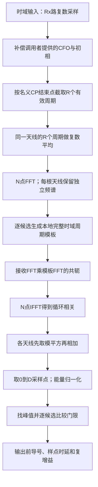

# NRPRACHReceiver：前导检测及采样点时延

[源码](NRPRACHReceiver.py)。参考生成严格使用TS38.211 V15.2.0 §6.3.3.1/§6.3.3.2、§5.3.2；接收算法为本项目工程算法。接收真实[Rx,T]时域信号，在已知时机及可选已知CFO补偿后，按PRACH独立FFT进行相关，搜索前导及非负样点延迟。

| 字段 | 含义、范围、单位、示例 |
|---|---|
| resource | NRPRACH，包含所有公共时频参数与当前捕获长度，不包含待检出的前导号 |
| preamble_indices=tuple(range(64)) | 非空不重复tuple，每元素整数0..63；例(0,1,2)缩小搜索，不必把真实发送编号告诉接收机 |
| max_delay_samples=16 | 整数采样点D；0..min(CP,Nfft-1)，NCS非零时还须D<NCS*Nfft/L；例16；默认并非所有NCS/SCS均适用，需按时延预算设置 |
| detection_threshold=.2 | 有限实数0..1，相关归一化能量比严格大于门限才检测；不是dB或规范强制值 |
| plot_config=None | 可选NRPlotConfig，None关闭；例NRPlotConfig(enabled=True,channel='PRACH') |

构造/`__post_init__`校验所有字段。D不得跨相邻循环移位的等效时延间隔，避免把同一根的另一前导误当作传播延迟；此实现采用保守的公共窗口，即使候选前导列表稀疏也不自动放宽。NCS=0时每个前导使用不同根，不应用该移位间隔限制。

`receive(waveform,*,known_frequency_offset_hz=0,known_initial_phase_rad=0,plotter=None)`输入有限complex[Rx,T]，Rx严格等于cell.n_rx_antennas，T严格等于resource.waveform_samples。已知CFO单位Hz、初相单位rad，取负补偿；plotter为可选共享NRStagePlotter。接收机不接收真实信道、实际前导编号或真实时延，后两者均由相关估计。

## 接收公式与变量

下述PRACH-RX-1/2为文档自编号。算法使用上述固定R15生成参考；相关、合并及门限均为项目定义，不是3GPP接收机强制实现。

先按名义CP结束点取R段N点有效周期，跨重复相干平均，跨Rx非相干累加：

$$
v_r[n]=\frac1R\sum_{h=0}^{R-1}y_r[s+C_{CP}+hN+n],\qquad
c_{a,r}[d]=\operatorname{IFFT}_N\{\operatorname{FFT}_N(v_r)\operatorname{FFT}_N(z_a)^*\}[d].\tag{PRACH-RX-1}
$$

$$
E_y=\sum_{r,n}|v_r[n]|^2,\quad E_a=\sum_n|z_a[n]|^2,\quad
m_a[d]=\frac{\sum_r|c_{a,r}[d]|^2}{E_a E_y},\quad
\widehat d_a=\arg\max_{0\le d\le D}m_a[d],\quad
\widehat H_{a,r}=c_{a,r}[\widehat d_a]/E_a.\tag{PRACH-RX-2}
$$

| 变量 | 含义、范围、单位、维度 |
|---|---|
| a | 候选前导编号，选择匹配模板；取值范围/约束：0..63并属于preamble_indices；单位：前导索引；维度/类型：整数标量 |
| r | 接收天线分支号，选择接收观测；取值范围/约束：0..Rx−1；单位：Rx索引；维度/类型：整数标量 |
| h | 重复周期号，用于相干平均；取值范围/约束：0..R−1；单位：周期索引；维度/类型：整数标量 |
| n | 单周期时域点号；取值范围/约束：0..N−1；单位：采样点索引；维度/类型：整数标量 |
| d | 待搜索非负传播延迟；取值范围/约束：0..D；单位：采样点；维度/类型：整数标量 |
| s | CP首点在数组中的位置，确定提取起点；取值范围/约束：s≥0；单位：采样点；维度/类型：整数标量 |
| C_CP | CP长度，确定名义有效段起点；取值范围/约束：C_CP>0；单位：采样点；维度/类型：整数标量 |
| N | 有效周期FFT长度，确定相关周期；取值范围/约束：N=Fs/Delta_f_RA>0；单位：采样点；维度/类型：整数标量 |
| R | 有效段重复次数，用于相干平均；取值范围/约束：1/2/4/6/12；单位：次数；维度/类型：整数标量 |
| D | 最大搜索延迟，限定相关检测窗；取值范围/约束：0..min(C_CP,N−1)，NCS>0还须D<NCS×N/L；单位：采样点；维度/类型：整数标量 |
| y | 原始接收波形，已按给定CFO/相位补偿；取值范围/约束：有限复数；单位：归一化复幅度；维度/类型：complex[Rx,T] |
| v | R个名义有效周期的复数平均，作为匹配滤波输入；取值范围/约束：有限复数；单位：归一化复幅度；维度/类型：complex[Rx,N] |
| z_a | 候选a本地有效周期模板，包含频域位置和序列；取值范围/约束：有限复数；单位：归一化复幅度；维度/类型：complex[N] |
| c | 循环相关complex[候选,Rx,N]的概念值；实现逐候选计算，只保留窗口内功率，不存整个三维数组 |
| E_y | 周期平均后的所有Rx总能量，归一化分母；取值范围/约束：≥0，零输入时为0；单位：归一化幅度平方的采样求和；维度/类型：实标量 |
| E_a | 本地模板单周期能量，归一化和增益估计分母；取值范围/约束：>0，非零本地模板；单位：归一化幅度平方的采样求和；维度/类型：实标量 |
| m | 候选每个时延的归一化相关分数，用于检测；取值范围/约束：0..1；单位：无量纲；维度/类型：float[候选,D+1] |
| d_hat | 候选的最大分数位置，作为最强径延迟估计；取值范围/约束：整数0..D，未检出返回None；单位：采样点；维度/类型：每候选整数/None |
| H_hat | 峰值相关除模板能量的每Rx复增益估计；取值范围/约束：有限复数，未检出返回None；单位：归一化复增益；维度/类型：complex[Rx]/None |

零能量时分数为0；数值计算后clip到[0,1]。每个候选独立满足m_peak>门限且接收能量>1e-20才报告。时延按sample/Fs得到秒，按sample*cell.tc_per_sample得到Tc数。这里报告**窗口内最强相关峰的相对传播延迟**，不是首次到达路径、绝对网络时间、距离或已量化的MAC TA命令。

多用户可以共享同一时频时机、同一根、不同循环移位；接收功率是所有用户之和，归一化分母也含所有用户和噪声。三个近似等功率且正交用户各自分数约1/3，不能期望每人都为1。弱用户可能被门限掩盖，threshold=.2不是通用虚警率或多用户容量保证。相同前导碰撞无法识别多个UE。

## 输出

| 字段 | 含义、单位与维度 |
|---|---|
| detected | 至少一个候选通过门限，bool |
| detections | 仅通过门限的候选dict列表；顺序同preamble_indices，不按分数重排 |
| candidates | 所有候选dict列表，包含失败者及其分数 |
| best_preamble_index | 最大峰分数的候选编号0..63；无人通过时None |
| delay_profiles | float[候选数,D+1]归一化分数，行严格对应preamble_indices |
| delay_axis_samples | int[D+1]，0..D采样点；不是12个循环移位窗或ZC索引 |

每个候选dict包含：preamble_index为整数编号；detected为bool；metric为0..1峰分数；delay_samples为非负整数样点；delay_seconds为秒；delay_tc为Tc数；channel_estimates为complex[Rx]归一化平坦复增益。未检出时后三种delay及channel_estimates均为None，metric仍返回诊断值。增益包含发送beta；多用户/多径泄漏会产生偏差，不能当作精确多径估计。

绘图阶段`rx.average`、`rx.frequency`、`rx.delay_profiles`、`rx.metrics`。默认只显示不保存，关闭不导入Matplotlib。profiles图分支顺序与候选列表一致；候选不连续时以结果的preamble_indices对应行，不将绘图行号当真实编号。

```python
import numpy as np
from cell import NRCell
from channel import NRChannel
from prach import NRPRACH, NRPRACHTransmitter, NRPRACHReceiver
cell = NRCell(n_rx_antennas=2)
r = NRPRACH(cell,guard_samples=32)
wave = NRPRACHTransmitter(r).transmit(7)['waveform']
wave = np.array([1,.7j])[:,None]*wave
wave = NRChannel(cell).timing_advance(wave,-7)  # 延迟7个采样点
out = NRPRACHReceiver(r).receive(wave)
assert out['best_preamble_index']==7
assert out['detections'][0]['delay_samples']==7
```

边界：已知RO、整数非负延迟、延迟不超过CP及移位间隔、跨重复信道/相位近似恒定。重复相干平均要求残余CFO足够小；当前只补偿给定CFO，没有盲CFO搜索。参考相同导致的碰撞、受限集合、高速多普勒、连续多RO扫描、分数采样插值、复杂多径首径识别、SIC和恒虚警自适应门限均未实现。原理和MATLAB验证边界见[验证报告](../../documentation/validation/NRPRACH_validation.md)。

## 从接收数组到前导编号：逐步解释

本节是上述PRACH-RX-1/2的逐步读法。参考波形遵循TS38.211 V15.2.0 §6.3.3.1、§6.3.3.2、§5.3.2；检测、归一化、重复合并和峰值选择均为本项目接收算法，规范没有要求基站必须采用这一实现。

接收机已经知道一次RO的名义起点、格式、频率位置、公共根配置和NCS，但不知道哪个候选前导真的发出，也不知道它的传播时延。这里的“已知RO”意味着在正确的捕获窗口搜索，不能理解成在任意长度录波里自动找到所有PRACH机会。



1. **补偿CFO**。用已知频偏和初相的相反数去旋转接收波形。`known_frequency_offset_hz=731`表示调用者提供了731 Hz补偿信息，接收机没有自行估出731 Hz。残余频偏会使不同重复周期产生相位差，影响后面的平均。
2. **名义去CP**。以`occasion_start_samples + cp_samples`为首点，取连续R×N点，整理为`[Rx,R,N]`。即使实际波形延迟d点，只要满足CP和搜索窗口约束，这个名义窗口内仍可形成带循环延迟的有效周期。算法不先用真实时延去移动窗口，否则会泄漏待估真值。
3. **重复相干平均**。沿R维做复数平均，得到`[Rx,N]`。同相的重复信号保留，独立噪声会减弱；理想独立噪声下噪声方差降为单周期的1/R。若存在明显残余CFO、快速时变信道或重复间相位变化，则信号也可能被平均削弱。
4. **匹配滤波**。为每个候选a生成完整本地`useful_waveform(a)`，包含该候选的根、循环移位和频率位置。计算接收FFT与模板FFT共轭的乘积，再N点IFFT，得到每根天线的循环相关。它同时去掉了候选的序列特征；不是只对接收频谱直接IFFT。
5. **天线能量合并**。每根天线相关结果先取模平方，再相加。不同天线的未知复增益可能相位相反，直接复数求和会抵消；能量相加避免这种抵消。这里没有进行波束权重估计。
6. **局部找峰**。只保留d=0～D，除以模板能量与接收总能量的乘积。选择最大值作为该候选分数，最大值位置作为时延；门限使用严格大于。仅能量大于1e-20且分数超过门限才通过。
7. **形成结果**。通过者全部写入`detections`，因此可以同时报告多个前导。`best_preamble_index`只标识分数最高者，不代表只检测到一个用户。复增益由该峰相关值除模板能量获得，没有估计完整多径冲激响应。

### 循环移位窗口和真实到达时延

一个前导的序列循环移位是“身份的一部分”，传播时延是“这个身份到达晚了多少”。本实现先针对每个身份做匹配，然后在其局部延迟轴上找峰。

```text
三UE示例：同一个时频RO，候选模板已分别包含循环移位0/15/30

前导0匹配后： d=0 ... 3▲ .............. 16    → 估计延迟3采样点
前导1匹配后： d=0 ....... 7▲ .......... 16    → 估计延迟7采样点
前导2匹配后： d=0 ............ 12▲ .... 16    → 估计延迟12采样点

这些是三条独立的“去掉候选移位后的局部相关曲线”，不是共用全局轴上的三个窗。
```

如果只使用某一个根的统一参考而不分别去掉候选移位，不同循环移位会落在不同的循环延迟位置；位置的正负、回绕和缩放取决于序列移位定义、DFT/IFFT和相关约定。它不能直接画成“每个候选固定相隔NCS个接收采样点”：NCS的单位是ZC序列点，而相关轴的单位是Fs下的时域采样点。

本文自编号PRACH-RX-3，依据TS38.211 V15.2.0 §6.3.3.1的非受限循环移位以及§5.3.2的时域合成，表达本平台采用的保守搜索约束：

$$
 D\le\min(C_{CP},N-1),\qquad
 D<\frac{N_{CS}N}{L}\quad(N_{CS}>0).\tag{PRACH-RX-3}
$$

| 变量 | 含义、范围、单位、维度 |
|---|---|
| D | `max_delay_samples`；非负整数标量，接收采样点 |
| C_CP | 实际循环前缀长度；用于截取和时延预算；取值范围/约束：正整数；由格式、采样率及短格式边界扩展计算；单位：接收采样点；维度/类型：整数标量 |
| N | PRACH FFT长度，决定循环相关长度；范围：Fs/Delta_f_RA，正整数；单位：接收采样点；维度：整数标量 |
| N_CS | 非受限循环移位间隔；控制同一根可分配的前导与延迟隔离；取值范围/约束：按固定NCS表选择；0表示每根仅一个前导；单位：ZC序列点；维度/类型：非负整数标量 |
| L | ZC序列长度，换算移位间隔到接收样点；范围：139或839；单位：ZC序列点；维度：整数标量 |
| N_CS N/L | 相邻循环移位的等效时延间隔；正实数标量，接收采样点，未必为整数 |

默认配置的间隔约为15×2048/139=221.007个采样点，D=16明显小于它。本例CP=304点，因此真正更严格的是移位间隔约束；不能因为CP允许304点就直接把D设置成304。NCS=0时每根只生成一个前导，不应用第二个不等式。平台仍按公共保守窗口校验，不因只搜索稀疏候选而自动放宽。

传播时延3/7/12采样点在Fs30.72 MS/s下分别约0.097656/0.227865/0.390625 us。报告的是局部最强峰的相对到达延迟，不能直接作为网络下发的TA命令；`NRChannel.timing_advance(wave,-7)`表示把波形延迟7点，接收机则报告正的7。

### 相关峰为什么不一定等于1

单UE、理想平坦信道、无噪声且模板匹配时，归一化峰可接近1。多个不同前导叠加时，分母用的是全部接收能量，其他UE也计入分母：理想正交且等功率的3个UE，每个峰约为1/3；不是每个都接近1。12个等功率用户即使理想可分，每个分数也约为1/12，默认0.2门限可能使它们全部不通过。

噪声、非理想正交、有限延迟窗、多径、频偏和近远效应都会改变分数。因此`metric`不是概率、SNR、RSRP或固定虚警率，不能把“0.3”读成“30%解调正确率”。当前接收机不输出SNR/RSSI/RSRP，也不做CFAR或逐用户干扰消除。

同一RO里两个UE使用相同前导时，它们属于同一候选的叠加。即便相关曲线上有多个峰，当前实现每个候选只返回一个最大峰；不会自动把它们拆成两个UE。

### 接收阶段图与结果的读法

| stage | 数据/坐标 | 应该观察什么 |
|---|---|---|
| `rx.average` | complex[Rx,N]；横轴为单周期内采样点 | 相干平均后的周期；不是输入的完整CP+重复波形 |
| `rx.frequency` | complex[Rx,N]；FFT原始顺序bin | 接收频谱，用于匹配滤波；该阶段未fftshift，负频率在数组后半段 |
| `rx.delay_profiles` | float[候选数,D+1]；横轴0～D采样点 | 每条曲线是该候选模板匹配后的局部时延功率，峰位置用于时延估计 |
| `rx.metrics` | 每候选最大分数；标签是实际前导号 | 哪些候选超过门限；可同时出现多个通过者 |

候选列表为`(7,20,63)`时，`delay_profiles[0]`对应前导7，不对应前导0。阶段曲线的通用分支显示名可能按行编号，判断实际前导时以`preamble_indices`或`candidates`为准。零输入的曲线全0，最大值索引虽然可机械得到0，结果仍应为未检测且时延None。

[三UE示例](../../examples/prach/NRPRACH_demo.py)的预期是`{0:3, 1:7, 2:12}`；其25 dB是信道按混合波形添加噪声的配置，不是接收机测量的每UE SNR。示例图默认显示；可用`NRPlotConfig(enabled=True, channel='PRACH', stages=('rx.*','channel.*'))`集中查看接收结果。
