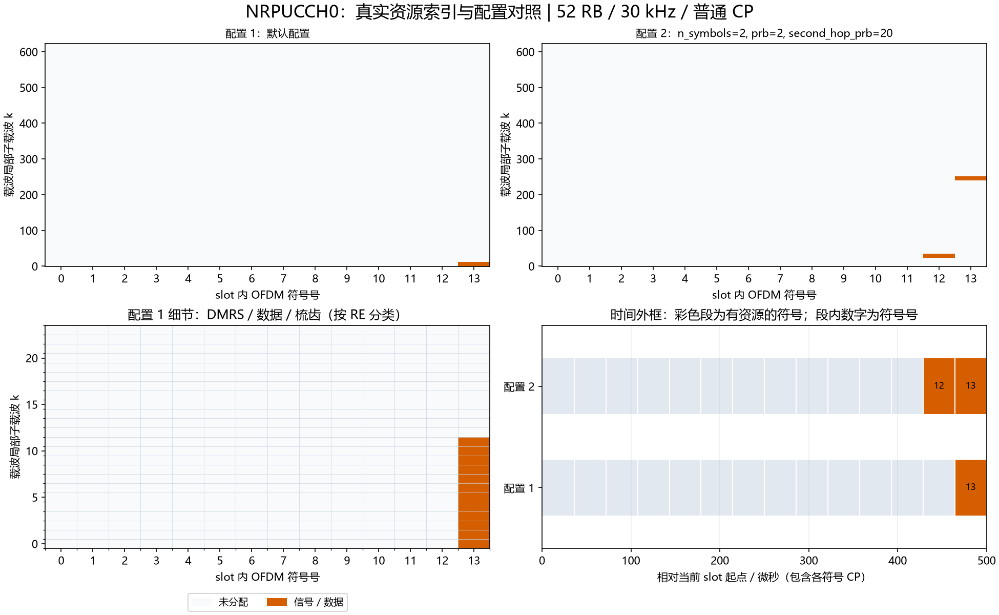

# NRPUCCH0：R15 Format 0资源与序列

## Python绘图图例



上图使用实际资源索引：上排对照两组配置，左下放大配置1的频域细节，右下按NRCell精确CP长度换算时间。配置未显式列出的字段使用类默认值；彩色时间段表示整个符号内有分配，不表示全部子载波均占用。多层坐标取并集；同RE上的端口叠加不按图层数量重复计面积。

生成脚本：[plot_NRChannel_documentation.py](../../examples/common/plot_NRChannel_documentation.py)。图为平台运行结果及教学示例，不构成新增MATLAB验证。


## 新手导读：生成、时频位置与接收

先看[统一坐标、时间换算和图例](../../documentation/channel_walkthrough.md)。本节使用固定基线：TS38.211 V15.2.0 §6.3.2.2/3及§5.2；UCI移位依据TS38.213 V15.3.0 §9.2。以下示意图和数量计算为依据这些章节的辅助推导，不是新增协议原表。详细字段范围、公式变量和支持边界见本文原有参考节。

### 信号怎样生成

F0用一条12点低PAPR序列的循环移位表示HARQ-ACK/SR，不先把UCI做Polar编码或QPSK数据映射。每个符号的最终移位还包含initial_cyclic_shift及Gold跳变量，因此同一UCI在不同符号上未必具有相同相位斜坡。负SR-only为DTX，不占RE。

生成顺序：UCI假设 → 查m_cs → 生成基序列 → 加逐点相位斜坡 → 每符号映射一个RB → OFDM。没有独立DMRS：整条已知结构的序列用于候选相关。

### 时间与频率上放在哪里

单RB、1或2个符号。普通CP下默认start_symbol=None会放到slot末尾：一符号为13，两符号为12、13；扩展CP分别为11及10、11。prb相对BWP，second_hop_prb仅在两符号配置下把第二符号移到另一RB。

```text
normal CP，两符号例：        l=12       l=13
第一跳PRB p                [12点序列]    .
第二跳PRB q                 .         [12点序列]
```

无跳频时两列都在同一个PRB。资源为12×S个RE，S是1/2符号；改变初始循环移位不改变这些RE位置。

### 接收机怎样恢复

对每种允许的HARQ/SR候选生成完整参考，逐Rx、逐符号对12点做复相关，再把相关模平方跨符号/天线合并，选最强假设并检查检测门限。无需先估计每个符号的未知复信道；这也意味着相关后的复点仍可包含信道相位。多用户时必须合理规划候选移位，避免不同用户的UCI集合重叠。

### 如何检查自己的配置

位置检查优先读取资源类的`indices()`，每行是逻辑端口/层、slot符号、载波局部子载波。不要把逻辑端口轴当接收天线。频域点数乘子载波间隔给出计数带宽；精确时域样点由NRCell当前slot逐符号CP加FFT长度累加，算法见统一指南。

发射图先看映射网格，再看IFFT/CP波形；接收图先确认提取/参考匹配，再看均衡或相关及最终判决。已知CFO/时延补偿来自调用者，不是自动同步估计。所有复幅度为平台归一化量，不是dBm。图例本身不扩展MATLAB验证范围。

逐步收发接口见[NRPUCCH0Transmitter](NRPUCCH0Transmitter.md)、[NRPUCCH0Receiver](NRPUCCH0Receiver.md)。


[NRPUCCH0.py](NRPUCCH0.py)表示单个UE在当前NRCell时隙上的一个PUCCH Format 0资源，生成HARQ-ACK/SR对应的循环移位序列，并通过NRGrid映射。只有一个逻辑端口：协议端口2000对应数组端口0；物理发送天线数不决定逻辑端口数。

固定基线：**TS38.211 V15.2.0 §5.2.1、§5.2.2.2表5.2.2.2-2、§6.3.2.2/3**；UCI到循环移位映射依据 **TS38.213 V15.3.0 §9.2.3、§9.2.4、§9.2.5.1**。下面F0-1至F0-3是本文自编号，不是规范原公式号。变量约定见[指南](../../documentation/formula_reference.md#conventions)。

## 功能边界

支持0..2 HARQ-ACK位、可选单个SR、1/2个OFDM符号、单RB、normal/extended CP、组跳变与2符号时隙内跳频。normal/extended均按固定R15的14*slot循环移位寻址。显式提供PRB/符号分配，不实现DCI资源指示、HARQ码本拼装、SR机会调度、TDD许可、闭环功控、跨slot重复或交织；格式1/2/3/4已通过对应独立资源及收发类实现。

`group_hopping='disable'`意味着开启序列跳变，可能得到v=1；12点基序列在§5.2.2只定义v=0，因此当前F0配置明确拒绝该模式。`neither`和`enable`均支持；不是把disable静默当neither。

## 每个字段

冻结slots dataclass，无其他隐藏状态/类常量。

| 字段 | 用途 | 范围/单位/维度 | 示例 |
|---|---|---|---|
| cell | 当前小区、BWP、slot、CP与采样率来源 | 必须NRCell，不可None | `NRCell(n_size_grid=24)` |
| prb=0 | 第一跳RB号，相对活动BWP | Python int，0..cell.bwp_size-1；RB索引标量 | BWP CRB12起，prb1对应CRB13 |
| start_symbol=None | 首个slot局部符号号 | None解析为L-n_symbols；0..L-n_symbols | 2符号normal默认12 |
| n_symbols=1 | F0持续符号数 | Python int 1/2；符号计数标量 | 2 |
| initial_cyclic_shift=0 | 初始移位m0 | Python int 0..11，无量纲移位号 | 5 |
| hopping_id=None | Gold/基序列组使用的ID | None解析为cell.n_cell_id；显式0..1023 | 731，不要求等于PCI |
| group_hopping='neither' | 基序列组跳变 | 'neither'/'enable' | 'enable' |
| second_hop_prb=None | 第二符号跳到的BWP局部RB | None不跳频；非None需n_symbols=2，0..BWP_size-1 | 17；允许与第一跳相同RB |

整数拒绝bool、浮点及NumPy整数，沿用项目严格Python int规则。cell类型错误TypeError；数值范围、CP内符号越界及不支持的配置报ValueError。

## HARQ-ACK/SR原表

输入HARQ比特按给定顺序；0=NACK，1=ACK。sr=None表示本次不传SR，sr=0/1表示负/正SR。下面是原表数值的辅助汇总，不重新定义协议。

| HARQ-ACK | 无SR/负SR时m_cs | 正SR时m_cs | 规范原章节与表号 |
|---|---|---|---|
| [0] | 0 | 3 | TS38.213 V15.3.0 §9.2.3表9.2.3-3；§9.2.5.1表9.2.5-1 |
| [1] | 6 | 9 | 同上 |
| [0,0] | 0 | 1 | 同版本§9.2.3表9.2.3-4；§9.2.5.1表9.2.5-2 |
| [0,1] | 3 | 4 | 同上 |
| [1,1] | 6 | 7 | 同上 |
| [1,0] | 9 | 10 | 同上 |
| 无HARQ | 负SR为DTX，不发送 | 0 | 同版本§9.2.4正文，无独立原表 |

例：[1,0]+正SR的m_cs=10，不能把[1,0]当二进制2再乘3。空HARQ且sr=None没有可发送信息，报ValueError。负SR-only的generate返回空数组，映射不占用任何RE；负SR与HARQ同时存在时仍发送HARQ。

## 序列与映射公式

**F0-1**，依据TS38.211 V15.2.0 §6.3.2.2.1/2、§5.2.1：

$$
t=14n_{slot}+l_0+l',\quad n_{cs}(t)=\sum_{m=0}^{7}2^m c(8t+m),\quad
s_{l'}=(m_0+m_{cs}+n_{cs}(t))\bmod12,\quad \alpha_{l'}=2\pi s_{l'}/12.
$$

| 变量 | 含义 | 范围/单位 | 维度 |
|---|---|---|---|
| n_slot | 帧内slot索引；选择当前slot的Gold序列片段；示例：n_slot=1表示本帧第2个slot，帧首重新从0计数 | 整数0..10×2^mu−1；mu取cell numerology；30 kHz为0..19；单位：slot索引，无量纲 | 整数标量 |
| l0 | 资源首个slot局部符号号；定位PUCCH开始及PRBS地址；示例：l0=12、S=2占符号12和13 | 整数0..L−S；普通CP、S=2时为0..12；单位：符号索引 | 整数标量 |
| l_prime | 资源内相对符号号；遍历本资源而非整个slot；示例：实际slot符号号为l0+l_prime | 整数0..S−1；S=1仅0，S=2为0/1；单位：符号索引 | 整数标量 |
| S | 当前F0分配的OFDM符号数；决定输出序列长度和合法起点；示例：S=2时输出24个复数RE | 只能1或2；单位：符号数 | 整数标量 |
| L | 小区每slot的OFDM符号数；用于资源边界检查；示例：L=12、S=2时l0最大10；不改变R15的14×n_slot寻址常数 | normal CP为14，extended CP为12；单位：符号/slot | 整数标量 |
| t | 当前符号的R15 PRBS寻址位置；决定读取哪8个Gold比特；示例：n_slot=1、l0=12、l_prime=0时t=26 | t=14×n_slot+l0+l_prime，非负整数；实际合法符号由L约束；单位：符号寻址索引，不是秒 | 每资源符号一个整数，合并为[S] |
| m | 8位跳变量的二进制位权索引；给第m位乘2^m；示例：m=0是最低位，m=7是最高位；不是m0或m_cs | 整数0..7；单位：比特位索引 | 求和中的整数标量 |
| c | 由hopping_id初始化的Gold伪随机比特序列；提供逐符号跳变；示例：t=26时读取c(208)到c(215)，并非随机重新抽取8位 | 每个c(i)只能0或1；本式读i=8t..8t+7；单位：bit | 一维比特序列；每次读取8点 |
| n_cs | 8个Gold比特按低位在前组成的跳变量；使移位随slot/符号变化；示例：比特依次为1,0,1,0,0,0,0,0时n_cs=5 | 整数0..255；参与后续mod12，不是直接0..11；单位：无量纲整数 | 每符号一个值，数组[S] |
| m0 | 配置的初始循环移位；区分资源的基础序列签名；示例：m0=2表示在UCI及伪随机偏移之前加入2 | 整数0..11；对应initial_cyclic_shift；单位：循环移位编号，无量纲 | 整数标量，对S个符号共用 |
| m_cs | 由HARQ-ACK/SR映射表确定的偏移；编码本次UCI状态；示例：单HARQ且无SR时ACK1映射6，NACK0映射0 | 有效发送值来自前述原表，属于0..11的子集；不能任意选择；DTX时无移位；单位：循环移位编号，无量纲 | 整数标量，对S个符号共用 |
| s | 最终循环移位编号；将配置、UCI和伪随机跳变合并；示例：m0=2、m_cs=6、n_cs=5时s=1；此处s不是符号号 | s=(m0+m_cs+n_cs)mod12；整数0..11；单位：循环移位编号，无量纲 | 每符号一个值，数组[S] |
| alpha | 序列相邻点增加的相位；把最终移位编号转成exp(j×alpha×n)相位斜坡；示例：s=1时alpha=π/6，序列第n点旋转nπ/6；不是所有点统一旋转π/6 | alpha=2πs/12，只能取0、π/6、…、11π/6；0≤alpha<2π；单位：rad/序列点 | 每符号实标量，数组[S] |

循环移位Gold种子为hopping_id，每帧重置。组跳变采用另一种子floor(hopping_id/30)，在跳段n_hop=0/1处读取8bit，u=(fgh+hopping_id)mod30；无跳频两个符号的n_hop都为0，第二符号不是默认第二跳。更细寻址及返回值见[NRCommon](../common/NRCommon.md)。

**F0-2**，依据同版本§5.2.2.2表5.2.2.2-2、§6.3.2.3.1：

$$
x(12l'+n)=\exp(j\varphi_{u_{l'}}(n)\pi/4)\exp(j\alpha_{l'}n),\quad n=0,\ldots,11.
$$

| 变量 | 含义 | 范围/单位 | 维度 |
|---|---|---|---|
| x | 未乘beta的F0序列，先频率后符号排列 | 单点模长1，归一化复幅度 | [12*S] |
| u | 低PAPR基序列组号；选择12点相位表中的一行；示例：u=3选第3号组，改变参考相位而不改变RE位置 | 整数0..29；由hopping_id及组跳变确定；单位：序列组ID，无量纲 | 每符号整数，数组[S] |
| v | 组内序列号；选择同组中的序列；示例：不能把长序列允许的v=1直接套给F0 | 本F0的12点基序列仅允许v=0；单位：无量纲 | 每符号整数，数组[S] |
| phi_u | 固定原表的相位系数 | -3/-1/1/3，乘pi/4得到rad | 原表[30,12]；选中行[12] |
| n | 单RB内序列点及子载波相对索引；计算相位斜坡并定位RE；示例：n=11是该RB最后一个子载波 | 整数0..11；单位：子载波/序列点索引 | 整数标量 |
| l_prime | 资源内符号索引；选择该符号的u和alpha；示例：l_prime=1是2符号资源的第二个符号 | 整数0..S−1；单位：符号索引 | 整数标量 |
| j | 虚数单位；使实相位转换为单位模复指数；示例：exp(jπ/2)=j | 固定j²=−1，不是求和索引；单位：无量纲 | 复常量 |
| alpha | 当前符号的逐序列点相位步长；生成循环移位；示例：第n点相位增量是alpha×n | 2πs/12，s为整数0..11；离散值0..11π/6；单位：rad/序列点 | 每符号实标量，整体[S] |

**F0-3**，依据同版本§6.3.2.3.2及§4.4.4.4/§4.4.5：

$$
k=12(N_{BWP}^{start}-N_{grid}^{start}+PRB_{l'})+n,\quad
l=l_0+l',\quad a_{k,l}^{(2000)}=\beta x(12l'+n).
$$

| 变量 | 含义 | 范围/单位 | 维度 |
|---|---|---|---|
| N_BWP_start | BWP起始CRB；把BWP局部位置换到公共频率坐标 | 非负整数且BWP整体位于载波内；单位：CRB索引 | 整数标量 |
| N_grid_start | 载波网格起始CRB；转换到载波局部坐标时减去它 | NRCell范围0..2199，且满足BWP包含约束；单位：CRB索引 | 整数标量 |
| PRB_l_prime | 当前跳的BWP局部RB号 | 0..BWP_size-1 | 每符号一个整数 |
| k | 载波局部子载波号，定位本RE频率 | 整数0..K−1；单位：子载波索引 | 每RE整数标量 |
| l | slot局部符号号，定位本RE时间 | 整数0..L−1；本资源取l0+l_prime；单位：符号索引 | 每RE整数标量 |
| n | 一个RB内部的序列点号，计算频率偏移 | 整数0..11；单位：子载波索引 | 整数标量 |
| beta | 发送线性幅度因子；整体缩放复数信号 | 有限实数≥0；0表示零幅度；单位：归一化线性幅度，不是dB | 实标量 |
| a | beta缩放后的实际RE，写入发送网格 | 本式有效发送点模长beta，DTX不映射；单位：归一化复幅度 | complex[1,L,K]网格元素 |
| x | 未缩放的F0生成序列，作为映射输入 | 有效发送时每点模长1；DTX为空；单位：归一化复幅度 | complex[12S]或空数组 |

## 每个方法及返回值

| 方法 | 参数、返回与示例 |
|---|---|
| 自动__init__、__post_init__ | 初始化上表字段，解析None，校验1RB资源完全在BWP与slot内 |
| cyclic_shift_offset(harq_ack=(),sr=None) | 静态映射UCI到m_cs，返回int或None(DTX)；`NRPUCCH0.cyclic_shift_offset([1,0],1)==10` |
| sequence_parameters(m_cs=0) | 返回u/v/hop/n_cs/cyclic_shift/alpha字典，每个值[S]新数组；alpha为rad，其余int64 |
| generate(harq_ack=(),sr=None) | 新complex128[12*S]；负SR-only为空[0]；每个元素未乘beta |
| indices() | 新int64[12*S,3]，列为[端口0,slot符号,载波局部k]；配置资源坐标与负SR是否实际发送无关 |
| map_to_grid(grid,harq_ack=(),sr=None,beta=1) | grid须同cell且仅1端口；owner='PUCCH'，调用NRGrid原子映射；返回实际写入RE数；冲突报ValueError |
| to_dict() | JSON兼容字典，包含已解析配置及antenna_port=2000；不是MATLAB配置对象 |
| 内部_harq_ack(bits) | 一维tuple/list/整数ndarray→tuple，长度0..2、值0/1；拒绝bool/float/二维，不改变HARQ位序 |

## 可运行示例

```python
from cell import NRCell
from grid import NRGrid
from pucch import NRPUCCH0

cell=NRCell(n_size_grid=24,bwp_start=2,bwp_size=20)
resource=NRPUCCH0(cell,prb=1,start_symbol=10,n_symbols=2,second_hop_prb=17)
grid=NRGrid(cell)
assert resource.map_to_grid(grid,[1,0],sr=1)==24
assert resource.generate([1,0],1).shape==(24,)
assert resource.indices()[0,2]==36
```

[发射机](NRPUCCH0Transmitter.md)、[接收机](NRPUCCH0Receiver.md)、[完整示例](../../examples/pucch/README.md)。[实际MATLAB比对与扩展CP适配说明](../../documentation/validation/NRPUCCH0_validation.md)。

### 可复现的位置对照

以下为当前实现运行得到的派生示例，不是协议原表：小区52 RB、30 kHz、普通CP，BWP与载波同起点，其余使用类默认值。统计是不同(符号,k)的并集，不把多层重复坐标当成额外时频面积；k范围是首末占用点，不表示中间每个RE都占用。SSB只统计非零信号的830个RE，零位置另保留。

| 构造时额外参数 | 实际占用slot符号号 | 载波局部k最小～最大 | 不同占用RE数 |
|---|---|---|---:|
| `{}` | [13] | 0～11 | 12 |
| `{'n_symbols': 2, 'prb': 2, 'second_hop_prb': 20}` | [12, 13] | 24～251 | 24 |

```python
from cell import NRCell
from pucch import NRPUCCH0
cell = NRCell(n_size_grid=52, subcarrier_spacing_khz=30)
r = NRPUCCH0(cell)
idx = r.indices()
print("坐标形状：", idx.shape, "前3行：", idx[:3])
```

这里只打印少量坐标。要查看频率和持续时间，使用统一指南READ-1/2换算；改变slot或CP后重新计算，不能照抄表中位置。
