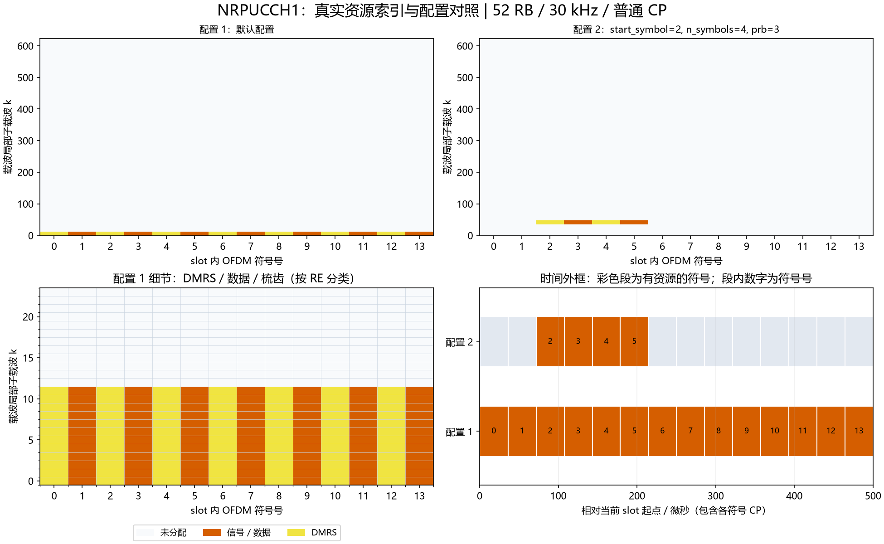

# NRPUCCH1：Format 1资源、数据与DMRS

## Python绘图图例



上图使用实际资源索引：上排对照两组配置，左下放大配置1的频域细节，右下按NRCell精确CP长度换算时间。配置未显式列出的字段使用类默认值；彩色时间段表示整个符号内有分配，不表示全部子载波均占用。多层坐标取并集；同RE上的端口叠加不按图层数量重复计面积。

生成脚本：[plot_NRChannel_documentation.py](../../examples/common/plot_NRChannel_documentation.py)。图为平台运行结果及教学示例，不构成新增MATLAB验证。


## 新手导读：生成、时频位置与接收

先看[统一坐标、时间换算和图例](../../documentation/channel_walkthrough.md)。本节使用固定基线：TS38.211 V15.2.0 §6.3.2.4及§6.4.1.3.1，原表6.3.2.4.1-1/-2。以下示意图和数量计算为依据这些章节的辅助推导，不是新增协议原表。详细字段范围、公式变量和支持边界见本文原有参考节。

### 信号怎样生成

F1把1/2个UCI比特调成一个BPSK/QPSK符号，再乘12点低PAPR参考、循环移位和时域OCC进行扩展。参考和数据跨多个符号发送，DMRS用于消除未知信道。OCC不是给UCI增加新比特，而是为资源复用提供可区分的签名。

### 时间与频率上放在哪里

一个RB、4～14个符号，须装入当前slot；扩展CP最多12符号。start_symbol是slot局部起点，资源相对偶数符号为DMRS，奇数符号为数据。例start_symbol=2、n_symbols=4：

```text
slot符号        2       3       4       5
同一PRB        R       D       R       D
资源相对符号    0       1       2       3
```

跳频按资源划分跳段，每段使用其对应PRB和参考。n_symbols改变数据/DMRS与OCC长度；time_domain_occ改变扩展签名，不移动时频外框。

### 接收机怎样恢复

先OFDM解调和提取12点序列，乘包含循环移位/OCC的参考共轭并沿频率平均，得到每符号解扩值。每个跳段用DMRS估计每Rx复增益，再跨该段数据符号和天线合并、均衡，按BPSK实部或QPSK实虚部符号判比特。接收机假设跳段内信道足够稳定，不是任意快时变多径估计器。

### 如何检查自己的配置

位置检查优先读取资源类的`indices()`，每行是逻辑端口/层、slot符号、载波局部子载波。不要把逻辑端口轴当接收天线。频域点数乘子载波间隔给出计数带宽；精确时域样点由NRCell当前slot逐符号CP加FFT长度累加，算法见统一指南。

发射图先看映射网格，再看IFFT/CP波形；接收图先确认提取/参考匹配，再看均衡或相关及最终判决。已知CFO/时延补偿来自调用者，不是自动同步估计。所有复幅度为平台归一化量，不是dBm。图例本身不扩展MATLAB验证范围。

逐步收发接口见[NRPUCCH1Transmitter](NRPUCCH1Transmitter.md)、[NRPUCCH1Receiver](NRPUCCH1Receiver.md)。


[源码](NRPUCCH1.py)。固定TS38.211 V15.2.0 §5.1、§6.3.2.2、§6.3.2.4及§6.4.1.3.1。输入是已确定资源上的1/2个UCI位；不实现SR资源选择、跨slot重复、调度或功控。逻辑端口0对应协议端口2000。

## 字段

| 字段/默认值 | 含义、范围、单位 | 示例 |
|---|---|---|
| cell | NRCell，小区/当前slot/CP/采样配置 | NRCell(n_size_grid=6) |
| prb=0 | BWP局部RB索引，0..bwp_size-1 | 1 |
| start_symbol=0 | slot内零基符号索引，0..symbols_per_slot-n_symbols | 1 |
| n_symbols=14 | 连续资源符号数，4..slot符号数 | extended CP需显式指定12或更少 |
| initial_cyclic_shift=0 | 初始移位，整数0..11 | 3 |
| hopping_id=None | 序列身份0..1023；None解析为PCI | 731 |
| group_hopping='neither' | neither或enable；当前不接受disable | enable |
| second_hop_prb=None | None关闭跳频，否则为第二跳BWP局部RB；即使等于prb也启用跳频 | 4 |
| time_domain_occ=0 | 时域OCC索引，必须小于每跳数据及DMRS各自最小符号数 | 1 |
| hops属性 | 每资源符号跳号，整数[L]，0/1；L=n_symbols | 14符号跳频时前7为0、后7为1 |

## 方法与映射

构造及`__post_init__`校验字段，非法范围抛ValueError，错误小区类型抛TypeError。冻结dataclass不允许修改配置。

`modulate(bits)`静态方法：1/2个整数位，拒绝bool和非二进制值；返回单位能量复标量。1bit BPSK的两个点为±(1+j)/√2；2bit QPSK实部由第0位、虚部由第1位决定，0对应正、1对应负。无量纲归一化幅度。

`reference()`返回complex[L,12]，轴为资源相对符号l、RB内子载波n；包含逐符号循环移位和OCC，尚未乘UCI。公共Gold寻址固定14*slot，扩展CP物理slot仍为12符号。`generate(bits)`返回同形状数据与DMRS：相对偶数符号0/2/4…为DMRS，奇数符号1/3/5…乘调制符号d。

`indices()`返回int[12L,3]，列为端口0、slot符号、载波局部子载波，频率先变化。跳频分界为floor(L/2)，与数据/DMRS全局奇偶保持一致。

`map_to_grid(grid,bits,beta=1)`要求同cell、单端口NRGrid；beta为有限非负线性幅度，无量纲；全部数据/DMRS同幅写入owner=PUCCH，返回12L。错误网格抛ValueError，重叠映射遵守NRGrid冲突规则。

OCC依据TS38.211 V15.2.0表6.3.2.4.1-1/-2，DMRS依据表6.4.1.3.1.1-1。数据/DMRS在每一跳分别计数并重新开始OCC索引。N=4使用原表Walsh顺序，不能用4点DFT代替。其余N=1/2/3/5/6/7对应原表复指数码。

下面为文档自编号F1-1，概括上述规范章节的序列构造，不冒充原文公式编号：

$$
x_{l,n}=w_i(m_l)r_l[n]\begin{cases}1,&l\text{为偶数},\\d,&l\text{为奇数}.\end{cases}\tag{F1-1}
$$

| 变量 | 含义、范围、单位、维度 |
|---|---|
| l | 资源内符号索引，定位DMRS或数据；取值范围/约束：0..L−1；单位：符号索引；维度/类型：整数标量 |
| n | 一个RB内的序列点索引，生成低PAPR序列；取值范围/约束：0..11；单位：序列点索引；维度/类型：整数标量 |
| i | 时域OCC编号，选择正交扩展权；取值范围/约束：0..对应跳段数据/DMRS可用OCC长度−1；单位：OCC索引；维度/类型：整数标量 |
| m_l | 当前跳内同类型符号序号，索引OCC权；取值范围/约束：0..该跳同类型符号数−1；单位：符号索引；维度/类型：整数标量 |
| w_i | 单位模时域覆盖码，complex[N]；N为该跳该类型符号数，1..7 |
| r_l | 已加循环移位的基础序列，complex[12]，归一化单位模 |
| d | 单位能量BPSK/QPSK复标量 |
| x | 数据/DMRS资源序列，complex[L,12]，归一化幅度 |

```python
from cell import NRCell
from pucch import NRPUCCH1
r = NRPUCCH1(NRCell(n_size_grid=6), prb=1, n_symbols=12,
             second_hop_prb=4, time_domain_occ=1)
symbols = r.generate([0, 1])
```

[实际MATLAB验证](../../documentation/validation/NRPUCCH1_validation.md)。

### 可复现的位置对照

以下为当前实现运行得到的派生示例，不是协议原表：小区52 RB、30 kHz、普通CP，BWP与载波同起点，其余使用类默认值。统计是不同(符号,k)的并集，不把多层重复坐标当成额外时频面积；k范围是首末占用点，不表示中间每个RE都占用。SSB只统计非零信号的830个RE，零位置另保留。

| 构造时额外参数 | 实际占用slot符号号 | 载波局部k最小～最大 | 不同占用RE数 |
|---|---|---|---:|
| `{}` | [0, 1, 2, 3, 4, 5, 6, 7, 8, 9, 10, 11, 12, 13] | 0～11 | 168 |
| `{'start_symbol': 2, 'n_symbols': 4, 'prb': 3}` | [2, 3, 4, 5] | 36～47 | 48 |

```python
from cell import NRCell
from pucch import NRPUCCH1
cell = NRCell(n_size_grid=52, subcarrier_spacing_khz=30)
r = NRPUCCH1(cell)
idx = r.indices()
print("坐标形状：", idx.shape, "前3行：", idx[:3])
```

这里只打印少量坐标。要查看频率和持续时间，使用统一指南READ-1/2换算；改变slot或CP后重新计算，不能照抄表中位置。
