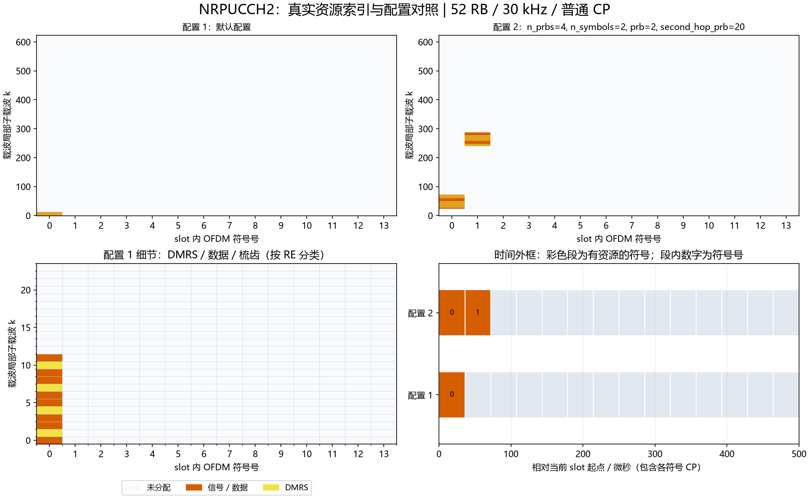

# NRPUCCH2：Format 2物理资源与序列

## Python绘图图例



上图使用实际资源索引：上排对照两组配置，左下放大配置1的频域细节，右下按NRCell精确CP长度换算时间。配置未显式列出的字段使用类默认值；彩色时间段表示整个符号内有分配，不表示全部子载波均占用。多层坐标取并集；同RE上的端口叠加不按图层数量重复计面积。

生成脚本：[plot_NRChannel_documentation.py](../../examples/common/plot_NRChannel_documentation.py)。图为平台运行结果及教学示例，不构成新增MATLAB验证。


## 新手导读：生成、时频位置与接收

先看[统一坐标、时间换算和图例](../../documentation/channel_walkthrough.md)。本节使用固定基线：TS38.211 V15.2.0 §6.3.2.5及§6.4.1.3.2；TS38.212 V15.2.0 §6.3.1。以下示意图和数量计算为依据这些章节的辅助推导，不是新增协议原表。详细字段范围、公式变量和支持边界见本文原有参考节。

### 信号怎样生成

F2承载编码UCI：NRUCICode按载荷长度选择小块码/Polar等对应流程，输出速率匹配位；再数据加扰、QPSK，与独立Gold QPSK DMRS一起映射。参考信号不承载UCI，接收端用它估计信道。输入位数、编码长度和分配资源必须匹配，不能仅修改n_bits而保留不足的资源。

### 时间与频率上放在哪里

1/2个符号，连续1～16个RB；start_symbol和prb指定起点，第二符号可跳到second_hop_prb。每RB每符号中DMRS偏移为1、4、7、10，另外8点是数据：

```text
RB内k偏移  0 1 2 3 4 5 6 7 8 9 10 11
           D R D D R D D R D D R  D
```

每符号P个RB时数据8P点、DMRS4P点；S个符号QPSK速率匹配长度为16PS位。扩大P增加频宽，扩大S增加持续符号数；扰码ID/RNTI改变序列，不改变外框。

### 接收机怎样恢复

每个Rx、每个符号、每个RB用4个DMRS平均LS估计一个平坦复增益；对该RB的8个数据点做MRC，生成QPSK软值、解扰，再调用NRUCICode译码。DMRS拟合比例用于检测，不是CRC；短载荷没有CRC时不能把无CRC误写成CRC成功验证。频选到单RB内部严重变化时，当前均值估计会产生误差。

### 如何检查自己的配置

位置检查优先读取资源类的`indices()`，每行是逻辑端口/层、slot符号、载波局部子载波。不要把逻辑端口轴当接收天线。频域点数乘子载波间隔给出计数带宽；精确时域样点由NRCell当前slot逐符号CP加FFT长度累加，算法见统一指南。

发射图先看映射网格，再看IFFT/CP波形；接收图先确认提取/参考匹配，再看均衡或相关及最终判决。已知CFO/时延补偿来自调用者，不是自动同步估计。所有复幅度为平台归一化量，不是dBm。图例本身不扩展MATLAB验证范围。

逐步收发接口见[NRPUCCH2Transmitter](NRPUCCH2Transmitter.md)、[NRPUCCH2Receiver](NRPUCCH2Receiver.md)。


[源码](NRPUCCH2.py)。固定TS38.211 V15.2.0 §6.3.2.5、§6.4.1.3.2、§5.1。单端口2000，接口逻辑端口0；连续RB、不使用交织或扩频OCC。编码由[NRSmallBlockCode](../common/NRSmallBlockCode.md)负责，资源类generate接收编码位，不把编码位冒称UCI原始位。

| 字段/属性 | 含义、范围、单位与示例 |
|---|---|
| cell | NRCell，当前slot/网格/CP；例NRCell(n_size_grid=12) |
| prb=0 | 第一跳BWP局部起始RB，0..bwp_size-n_prbs，例1 |
| n_prbs=1 | 连续RB数量1..min(16,bwp_size)，例3 |
| start_symbol=0 | slot内零基符号0..slot符号数-n_symbols，例8 |
| n_symbols=1 | 符号数1/2，例2 |
| rnti=1 | 无线网络标识，整数0..65535，例4321 |
| data_scrambling_id=None | 数据加扰ID，0..1023；None解析为PCI，例731 |
| dmrs_scrambling_id=None | DMRS ID，0..65535；None解析为PCI，例271 |
| second_hop_prb=None | None关闭，否则第二跳起始RB，范围同prb且要求两符号；同RB也视为开启 |
| coded_length | E=16*n_prbs*n_symbols，编码位数，无量纲整数 |

构造/`__post_init__`校验字段，冻结配置不可修改。`indices(dmrs=False)`返回int[RE,3]：逻辑端口、slot符号、载波局部子载波。dmrs必须bool；每RB内DMRS位置1/4/7/10，其余8点是数据；数据与DMRS分别先频率、后符号排列。第二个符号映射第二跳（若配置）。

`scrambling()`返回int[E] Gold序列，初始化rnti*2^15+data_scrambling_id。`qpsk(bits)`为内部QPSK映射辅助：调用方提供偶数长度二进制数组；偶数索引映实部，奇数索引映虚部，0对应正号，输出complex[N/2]单位能量。公共generate负责输入二进制校验。

`dmrs()`返回complex[4*n_prbs*n_symbols]单位模DMRS，按固定R15 Gold初始化及CRB0频率原点截取。`generate(coded_bits)`严格要求E个整数0/1，拒绝bool，返回complex[E/2]加扰QPSK数据，不含DMRS。`map_to_grid(grid,coded_bits,beta=1)`要求同小区单端口NRGrid，beta为有限非负线性幅度；合并数据和DMRS后一次写入owner=PUCCH，返回12*n_prbs*n_symbols。非法范围/输入抛校验异常；网格冲突由NRGrid拒绝。

以下F2-1为文档自编号，依据上述规范章节，不冒充原文公式编号：

$$
c_{\mathrm{init}}=\bigl[2^{17}(14n_{\mathrm{slot}}+l+1)(2N_0+1)+2N_0\bigr]\bmod2^{31},\quad
r[m]=\frac{1-2c[2m]+j(1-2c[2m+1])}{\sqrt2}.\tag{F2-1}
$$

| 变量 | 含义、范围、单位、维度 |
|---|---|
| n_slot | 帧内slot号，用于DMRS初始化；取值范围/约束：0..cell.slots_per_frame−1；单位：slot索引；维度/类型：整数标量 |
| l | slot内实际符号号，用于DMRS初始化；取值范围/约束：0..cell.symbols_per_slot−1；单位：符号索引；维度/类型：整数标量 |
| N_0 | DMRS身份0..65535，整数标量 |
| c_init | Gold生成器初值，确定参考比特流；取值范围/约束：整数0..2^31−1；单位：初始化种子；维度/类型：整数标量 |
| c | Gold比特序列，用于QPSK或加扰；取值范围/约束：每点0/1；单位：bit；维度/类型：一维比特数组 |
| m | 从CRB0开始的DMRS序列索引，目标起点4*(bwp_start+当前跳prb) |
| r | DMRS单位模复序列，归一化幅度 |
| j | 虚数单位，无量纲 |

```python
from cell import NRCell
from pucch import NRPUCCH2
r = NRPUCCH2(NRCell(n_size_grid=12), n_prbs=3, n_symbols=2, second_hop_prb=6)
assert r.coded_length == 96
```

普通CP已MATLAB实测；扩展CP物理链路已Python测试，固定14*slot寻址尚无本模块MATLAB独立扩展CP向量。资源分配/maxCodeRate选择由调度层负责，当前收发类额外限制UCI/E≤0.6。

### 可复现的位置对照

以下为当前实现运行得到的派生示例，不是协议原表：小区52 RB、30 kHz、普通CP，BWP与载波同起点，其余使用类默认值。统计是不同(符号,k)的并集，不把多层重复坐标当成额外时频面积；k范围是首末占用点，不表示中间每个RE都占用。SSB只统计非零信号的830个RE，零位置另保留。

| 构造时额外参数 | 实际占用slot符号号 | 载波局部k最小～最大 | 不同占用RE数 |
|---|---|---|---:|
| `{}` | [0] | 0～11 | 12 |
| `{'n_prbs': 4, 'n_symbols': 2, 'prb': 2, 'second_hop_prb': 20}` | [0, 1] | 24～287 | 96 |

```python
from cell import NRCell
from pucch import NRPUCCH2
cell = NRCell(n_size_grid=52, subcarrier_spacing_khz=30)
r = NRPUCCH2(cell)
idx = r.indices()
print("坐标形状：", idx.shape, "前3行：", idx[:3])
```

这里只打印少量坐标。要查看频率和持续时间，使用统一指南READ-1/2换算；改变slot或CP后重新计算，不能照抄表中位置。
