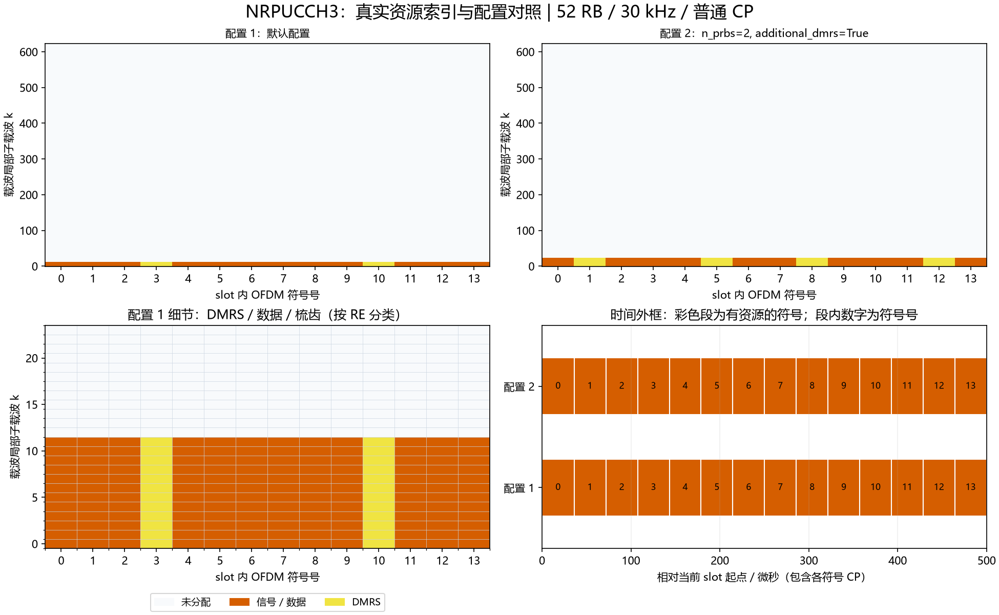

# NRPUCCH3：Format 3资源、DFT预编码与DMRS

## Python绘图图例



上图使用实际资源索引：上排对照两组配置，左下放大配置1的频域细节，右下按NRCell精确CP长度换算时间。配置未显式列出的字段使用类默认值；彩色时间段表示整个符号内有分配，不表示全部子载波均占用。多层坐标取并集；同RE上的端口叠加不按图层数量重复计面积。

生成脚本：[plot_NRChannel_documentation.py](../../examples/common/plot_NRChannel_documentation.py)。图为平台运行结果及教学示例，不构成新增MATLAB验证。


## 新手导读：生成、时频位置与接收

先看[统一坐标、时间换算和图例](../../documentation/channel_walkthrough.md)。本节使用固定基线：TS38.211 V15.2.0 §6.3.2.6及§6.4.1.3.3，原表6.4.1.3.3.2-1；TS38.212 V15.2.0 §6.3.1。以下示意图和数量计算为依据这些章节的辅助推导，不是新增协议原表。详细字段范围、公式变量和支持边界见本文原有参考节。

### 信号怎样生成

F3先UCI编码/速率匹配，再加扰，选择QPSK或π/2-BPSK；每个数据符号做12×n_prbs点单位化DFT预编码，再映射连续频率资源。这里的DFT预编码和之后的载波IFFT是两个不同操作，接收端必须在均衡后做IDFT恢复调制符号。

### 时间与频率上放在哪里

4～14个符号，1～16个连续RB，须满足实现允许的DFT长度和slot边界。DMRS占整符号，其余符号用于数据。例14符号、start_symbol=0、不跳频、additional_dmrs=False：

```text
相对l   0 1 2 3 4 5 6 7 8 9 10 11 12 13
        D D D R D D D D D D R  D  D  D
```

additional_dmrs=True时14符号DMRS变为1、5、8、12。4符号无跳频DMRS为1，跳频时为0、2。其他长度查原表或读取dmrs_symbols，不能固定套用3/10。起点非0时给相对位置加start_symbol。跳频在资源相对n_symbols//2处切换PRB。数据RE数为12P×数据符号数；编码位数再乘调制阶数。

### 接收机怎样恢复

按跳段将DMRS去参考后在频率和参考符号间平均，估计每Rx一个平坦增益；MRC合并每个数据符号，再做单位化IDFT。QPSK取实虚部软值，π/2-BPSK先去交替相位旋转，再解扰并UCI译码。当前估计假设每跳占用带宽内近似平坦，不提供任意频选信道的逐子载波插值。

### 如何检查自己的配置

位置检查优先读取资源类的`indices()`，每行是逻辑端口/层、slot符号、载波局部子载波。不要把逻辑端口轴当接收天线。频域点数乘子载波间隔给出计数带宽；精确时域样点由NRCell当前slot逐符号CP加FFT长度累加，算法见统一指南。

发射图先看映射网格，再看IFFT/CP波形；接收图先确认提取/参考匹配，再看均衡或相关及最终判决。已知CFO/时延补偿来自调用者，不是自动同步估计。所有复幅度为平台归一化量，不是dBm。图例本身不扩展MATLAB验证范围。

逐步收发接口见[NRPUCCH3Transmitter](NRPUCCH3Transmitter.md)、[NRPUCCH3Receiver](NRPUCCH3Receiver.md)。


[源码](NRPUCCH3.py)。固定TS38.211 V15.2.0 §5.1/5.2.2、§6.3.2.2、§6.3.2.6及§6.4.1.3.3。单端口2000，数组逻辑端口0。编码由公共NRUCICode处理；本类generate接收已编码位[E]。不同于F1，没有时域OCC；不同于F2，数据在每符号上作单位能量DFT预编码，DMRS占完整符号。

| 字段/属性 | 含义、范围、单位、示例 |
|---|---|
| cell | NRCell，例NRCell(n_size_grid=24) |
| prb=0 | 第一跳BWP局部起始RB，0..bwp_size-n_prbs，例1 |
| n_prbs=1 | 带宽，允许1/2/3/4/5/6/8/9/10/12/15/16，且须在BWP内；例3 |
| start_symbol=0 | slot内零基起始符号，0..slot符号数-n_symbols，例1 |
| n_symbols=14 | 符号数4..slot符号数；扩展CP需显式指定≤12 |
| rnti=1 | 0..65535整数，例4321 |
| data_scrambling_id=None | 数据ID0..1023，None解析PCI，例731 |
| hopping_id=None | DMRS序列ID0..1023，None解析PCI，例271 |
| group_hopping='neither' | neither/enable/disable；disable为序列跳变，仅长度≥72可能v=1 |
| second_hop_prb=None | 第二跳BWP局部起始RB；None关闭，同RB也启用跳频 |
| additional_dmrs=False | 严格bool，开启额外DMRS；长度<10时按原表位置不额外增加 |
| modulation='QPSK' | QPSK或pi/2-BPSK |
| dmrs_symbols | 相对DMRS符号int[D]，原表6.4.1.3.3.2-1，范围0..n_symbols-1 |
| data_symbols | 非DMRS相对符号int[S]，S=n_symbols-D |
| coded_length | E=Qm*12*n_prbs*S，编码位数；Qm=2或1 |

构造/`__post_init__`校验上述类型/范围，冻结配置。`indices(dmrs=False)`返回int[RE,3]：端口0、slot符号、载波局部子载波；dmrs必须bool，选择数据或DMRS；先频率后符号。跳频分界floor(n_symbols/2)，DMRS位置仍按全资源相对符号。4符号时无跳频DMRS=[1]，跳频=[0,2]；其余全部位置依据原表，非经验插入。

`scrambling()`按RNTI*2^15+dataID生成Gold int[E]。`generate(coded_bits)`校验严格整数二进制[E]，加扰后QPSK或π/2-BPSK调制，再按每数据符号12*n_prbs点单位化DFT，返回complex[S*12*n_prbs]。π/2-BPSK的交替相位索引沿连续数据调制符号计数，不随跳频或DMRS重置。

`dmrs()`返回complex[D*12*n_prbs]。12/24点使用固定相位表，≥36使用最大较小素数的Zadoff–Chu扩展；逐符号Gold循环移位m0=0、m_cs=0，按每跳的组/序列跳变生成u/v。未将DMRS进行额外DFT；参考已经定义于频域。24点共享表在common/_low_papr_24.json，数值与已有SRS原表相同。

`map_to_grid(grid,coded_bits,beta=1)`要求同小区单端口NRGrid；beta为有限非负线性幅度，数据/DMRS同幅；合并坐标后原子写owner=PUCCH，返回12*n_prbs*n_symbols。冲突遵守NRGrid检查。错误输入/范围抛相应校验异常。

文档自编号F3-1，依据TS38.211 V15.2.0 §6.3.2.6.4：

$$
z_{s,k}=\frac1{\sqrt M}\sum_{m=0}^{M-1}d_{s,m}e^{-j2\pi mk/M},\qquad M=12P.\tag{F3-1}
$$

| 变量 | 含义、范围、单位、维度 |
|---|---|
| P | 连续分配RB数，控制带宽；取值范围/约束：1..16且满足DFT资源约束；单位：RB；维度/类型：整数标量 |
| M | 每数据符号DFT长度，控制预编码分块；取值范围/约束：M=12P，12..192；单位：DFT点数；维度/类型：整数标量 |
| s | 数据符号索引，选择DFT块；取值范围/约束：0..S−1；单位：符号索引；维度/类型：整数标量 |
| m | DFT输入点索引，遍历调制符号；取值范围/约束：0..M−1；单位：序列点索引；维度/类型：整数标量 |
| k | DFT输出点索引，定位映射频率点；取值范围/约束：0..M−1；单位：频率点索引；维度/类型：整数标量 |
| d | QPSK或π/2-BPSK调制符号，DFT输入；取值范围/约束：有限调制星座复数；单位：归一化复幅度；维度/类型：complex[S,M] |
| z | 单位化DFT预编码输出，作为频域映射符号；取值范围/约束：有限复数，不必落在原QPSK星座上；单位：归一化复幅度；维度/类型：complex[S,M] |
| j | 虚数单位；单位化DFT保持各符号总能量 |

```python
from cell import NRCell
from pucch import NRPUCCH3
r = NRPUCCH3(NRCell(n_size_grid=24), n_prbs=3, n_symbols=12,
             second_hop_prb=12, additional_dmrs=True)
assert r.coded_length == 576
```

### 可复现的位置对照

以下为当前实现运行得到的派生示例，不是协议原表：小区52 RB、30 kHz、普通CP，BWP与载波同起点，其余使用类默认值。统计是不同(符号,k)的并集，不把多层重复坐标当成额外时频面积；k范围是首末占用点，不表示中间每个RE都占用。SSB只统计非零信号的830个RE，零位置另保留。

| 构造时额外参数 | 实际占用slot符号号 | 载波局部k最小～最大 | 不同占用RE数 |
|---|---|---|---:|
| `{}` | [0, 1, 2, 3, 4, 5, 6, 7, 8, 9, 10, 11, 12, 13] | 0～11 | 168 |
| `{'n_prbs': 2, 'additional_dmrs': True}` | [0, 1, 2, 3, 4, 5, 6, 7, 8, 9, 10, 11, 12, 13] | 0～23 | 336 |

```python
from cell import NRCell
from pucch import NRPUCCH3
cell = NRCell(n_size_grid=52, subcarrier_spacing_khz=30)
r = NRPUCCH3(cell)
idx = r.indices()
print("坐标形状：", idx.shape, "前3行：", idx[:3])
```

这里只打印少量坐标。要查看频率和持续时间，使用统一指南READ-1/2换算；改变slot或CP后重新计算，不能照抄表中位置。
