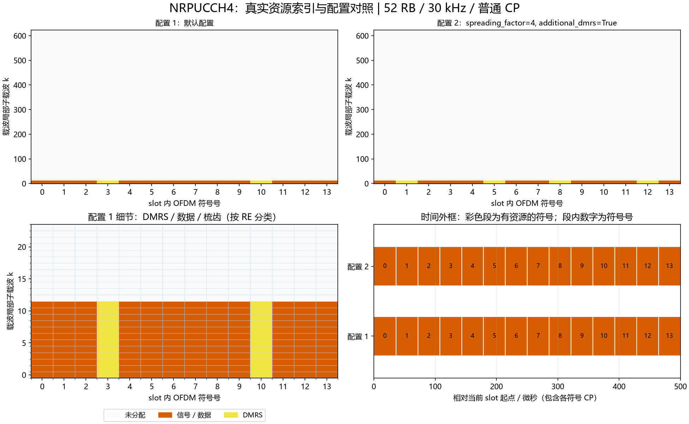

# NRPUCCH4：Format 4资源、频域OCC与DMRS

## Python绘图图例



上图使用实际资源索引：上排对照两组配置，左下放大配置1的频域细节，右下按NRCell精确CP长度换算时间。配置未显式列出的字段使用类默认值；彩色时间段表示整个符号内有分配，不表示全部子载波均占用。多层坐标取并集；同RE上的端口叠加不按图层数量重复计面积。

生成脚本：[plot_NRChannel_documentation.py](../../examples/common/plot_NRChannel_documentation.py)。图为平台运行结果及教学示例，不构成新增MATLAB验证。


## 新手导读：生成、时频位置与接收

先看[统一坐标、时间换算和图例](../../documentation/channel_walkthrough.md)。本节使用固定基线：TS38.211 V15.2.0 §6.3.2.6.3/4及§6.4.1.3.3，原表6.3.2.6.3-1/-2与6.4.1.3.3.2-1。以下示意图和数量计算为依据这些章节的辅助推导，不是新增协议原表。详细字段范围、公式变量和支持边界见本文原有参考节。

### 信号怎样生成

F4在编码/加扰和QPSK或π/2-BPSK之后，增加长度2/4的OCC扩展，形成每数据符号12点，再做12点DFT预编码。OCC用于同资源用户复用；不是把一个用户移到其他RB。

### 时间与频率上放在哪里

固定一个RB、4～14符号，DMRS时间位置沿用F3对应规则；start_symbol、prb和second_hop_prb决定时频位置。14符号默认DMRS为3/10，额外DMRS为1/5/8/12，均为资源相对符号号。

```text
每数据符号：12/SF个调制符号 → SF份OCC扩展 → 12点DFT → 1 RB
SF=2：6个调制符号；SF=4：3个调制符号
```

SF为spreading_factor，只能2/4；occ_index在0..SF−1选择签名。SF增加减少每用户可携带符号数，时频占用仍是同一个RB。编码长度为调制阶数×12/SF×数据符号数。

### 接收机怎样恢复

先按跳段用DMRS估计平坦增益、跨Rx合并，再12点IDFT；乘本用户OCC共轭，重排为[SF,12/SF]并沿SF维平均，恢复每用户调制符号，然后解调软值、解扰和UCI译码。配置不同OCC是可分离的必要设计之一，实际分离仍受信道时频变化、同步误差和近远效应影响。

### 如何检查自己的配置

位置检查优先读取资源类的`indices()`，每行是逻辑端口/层、slot符号、载波局部子载波。不要把逻辑端口轴当接收天线。频域点数乘子载波间隔给出计数带宽；精确时域样点由NRCell当前slot逐符号CP加FFT长度累加，算法见统一指南。

发射图先看映射网格，再看IFFT/CP波形；接收图先确认提取/参考匹配，再看均衡或相关及最终判决。已知CFO/时延补偿来自调用者，不是自动同步估计。所有复幅度为平台归一化量，不是dBm。图例本身不扩展MATLAB验证范围。

逐步收发接口见[NRPUCCH4Transmitter](NRPUCCH4Transmitter.md)、[NRPUCCH4Receiver](NRPUCCH4Receiver.md)。


[源码](NRPUCCH4.py)。固定TS38.211 V15.2.0 §6.3.2.6、表6.3.2.6.3-1/-2、§6.4.1.3.3、表6.4.1.3.3.1-1及6.4.1.3.3.2-1。单逻辑端口0对应协议端口2000，带宽固定1RB；编码复用NRUCICode，几何和基础DMRS复用NRPUCCH3。F4是在调制后、12点DFT之前进行OCC扩频，不是对DFT后的RE直接乘OCC。

| 字段/属性 | 含义、范围、单位与示例 |
|---|---|
| cell | NRCell，例NRCell(n_size_grid=6) |
| prb=0 | BWP局部起始RB，0..bwp_size-1，例1 |
| start_symbol=0 | slot内零基符号，0..slot符号数-n_symbols，例1 |
| n_symbols=14 | 占用连续符号数4..slot符号数，扩展CP需显式指定≤12 |
| rnti=1 | 数据加扰RNTI，整数0..65535，例4321 |
| data_scrambling_id=None | 数据ID0..1023，None解析PCI，例731 |
| hopping_id=None | DMRS ID0..1023，None解析PCI，例271 |
| group_hopping='neither' | neither/enable/disable；1RB短序列的disable不产生长序列v跳变 |
| second_hop_prb=None | 第二跳BWP局部RB，范围同prb，None关闭；同RB也启用跳频 |
| additional_dmrs=False | 严格bool，按原表选择额外DMRS位置 |
| modulation='QPSK' | QPSK或pi/2-BPSK |
| spreading_factor=2 | SF，整数2或4 |
| occ_index=0 | OCC索引整数0..SF-1，例SF4的3 |
| n_prbs | 只读属性，固定返回1，不能作为构造参数 |
| dmrs_symbols | DMRS相对符号集合，定位信道估计参考；范围：每元素0..n_symbols−1，按R15表选择；单位：符号索引；维度：int[D] |
| data_symbols | 数据相对符号集合，定位扩频数据；范围：0..n_symbols−1中除DMRS外的元素；单位：符号索引；维度：int[S] |
| coded_length | E=Qm*12*S/SF，位数；Qm=2/1，π/2-BPSK且SF4时可能为奇数 |

构造及`__post_init__`通过共享几何检查字段、解析默认ID，并检查SF/OCC；非法输入抛相应校验异常。配置冻结，不允许后续修改。`base_resource()`返回n_prbs=1的NRPUCCH3共享配置，只用于几何、DMRS基础序列；不能直接用其coded_length代替F4的E。

`indices(dmrs=False)`返回int[RE,3]，列为端口0、slot符号、载波局部子载波；先频率后符号。dmrs必须bool。跳频分界floor(n_symbols/2)；4符号时无跳频DMRS为[1]、跳频为[0,2]，其余位置来自固定原表。`scrambling()`返回int[E]，Gold种子为rnti*2^15+data_scrambling_id。

`occ()`返回complex[12]，按下面原表的短块重复展开，每个短块长度为12/SF。所有元素单位模，不引入1/sqrt(SF)幅度缩放。

| SF | OCC索引 | 每个连续块的系数 | 原文依据 |
|---|---|---|---|
| 2 | 0 | 1、1 | TS38.211 V15.2.0表6.3.2.6.3-1 |
| 2 | 1 | 1、-1 | 同上 |
| 4 | 0 | 1、1、1、1 | TS38.211 V15.2.0表6.3.2.6.3-2 |
| 4 | 1 | 1、-j、-1、j | 同上；注意虚数相位顺序 |
| 4 | 2 | 1、-1、1、-1 | 同上 |
| 4 | 3 | 1、j、-1、-j | 同上 |

`spread(symbols)`输入有限complex[S,12/SF]，按块复制调制数据并乘OCC，返回complex[S,12]。`despread(symbols)`输入IDFT后的有限complex[S,12]，乘共轭OCC、按SF个连续块合并并除SF，返回complex[S,12/SF]。这两个方法不执行DFT/IDFT，便于单独验证OCC和多用户正交性。

`generate(coded_bits)`严格校验整数二进制[E]、拒绝bool；加扰后QPSK/π/2-BPSK调制，π/2交替相位沿连续数据调制符号计数，OCC复制不推进相位计数；扩频后每数据符号做12点单位化DFT，返回complex[12S]，不含DMRS。

`dmrs()`返回complex[12D]，在基础序列逐符号循环移位上增加OCC对应m0。SF2的m0为[0,6]，SF4为[0,6,3,9]，依据TS38.211 V15.2.0表6.4.1.3.3.1-1。不能把OCC系数直接当成DMRS循环移位，也不能简单用3*occ_index代替原表。

`map_to_grid(grid,coded_bits,beta=1)`要求同cell单端口NRGrid；beta为有限非负线性幅度，数据和DMRS同幅，原子写入owner=PUCCH，返回12*n_symbols。网格冲突由NRGrid检查。

文档自编号F4-1，依据上述固定版本§6.3.2.6.3/4：

$$
y_{s,k}=w_i[k]d_{s,k\bmod K},\quad K=12/F,\quad
z_s=\operatorname{DFT}_{12}(y_s)/\sqrt{12},\quad
\widehat d_{s,m}=\frac1F\sum_{b=0}^{F-1}w_i^*[bK+m]\widehat y_{s,bK+m}.\tag{F4-1}
$$

| 变量 | 含义、范围、单位与维度 |
|---|---|
| F | OCC扩展因子，决定同RE的扩展长度；取值范围/约束：2或4；单位：扩展倍数；维度/类型：整数标量 |
| i | OCC序号，选择用户签名；取值范围/约束：0..F−1；单位：OCC索引；维度/类型：整数标量 |
| K | 每数据符号扩展前调制点数，决定容量；取值范围/约束：K=12/F，F=2取6，F=4取3；单位：调制点数；维度/类型：整数标量 |
| s | 数据符号号，选择处理块；取值范围/约束：0..S−1；单位：零基索引；维度/类型：整数标量 |
| k | 扩展后12点内的索引；取值范围/约束：0..11；单位：零基索引；维度/类型：整数标量 |
| m | 原始调制点索引；取值范围/约束：0..K−1；单位：零基索引；维度/类型：整数标量 |
| b | OCC复制块索引；取值范围/约束：0..F−1；单位：零基索引；维度/类型：整数标量 |
| d | 原始调制符号；取值范围/约束：有限复数；单位：归一化复幅度；维度/类型：complex[S,K] |
| y | 乘OCC并复制后的扩展序列；取值范围/约束：有限复数；单位：归一化复幅度；维度/类型：complex[S,12] |
| z | DFT预编码后的频域序列；取值范围/约束：有限复数；单位：归一化复幅度；维度/类型：complex[S,12] |
| w_i | 单位模OCC，complex[12]；星号为共轭 |
| y_hat | IDFT后12点扩展数据估计；取值范围/约束：有限复数；单位：归一化复幅度；维度/类型：complex[S,12] |
| d_hat | OCC解扩平均后的原始调制符号估计；取值范围/约束：零能量不代表检测成功；单位：归一化复幅度；维度/类型：complex[S,K] |

```python
from cell import NRCell
from pucch import NRPUCCH4
r = NRPUCCH4(NRCell(n_size_grid=6), spreading_factor=4, occ_index=3,
             n_symbols=12, additional_dmrs=True)
assert r.coded_length == 48
```

OCC可用于同资源用户复用，但不同用户需共享兼容几何/基础序列且信道近似平坦，用户间残余频偏/不同步/频率选择性会造成泄漏；类本身不是调度器或联合多用户均衡器。

### 可复现的位置对照

以下为当前实现运行得到的派生示例，不是协议原表：小区52 RB、30 kHz、普通CP，BWP与载波同起点，其余使用类默认值。统计是不同(符号,k)的并集，不把多层重复坐标当成额外时频面积；k范围是首末占用点，不表示中间每个RE都占用。SSB只统计非零信号的830个RE，零位置另保留。

| 构造时额外参数 | 实际占用slot符号号 | 载波局部k最小～最大 | 不同占用RE数 |
|---|---|---|---:|
| `{}` | [0, 1, 2, 3, 4, 5, 6, 7, 8, 9, 10, 11, 12, 13] | 0～11 | 168 |
| `{'spreading_factor': 4, 'additional_dmrs': True}` | [0, 1, 2, 3, 4, 5, 6, 7, 8, 9, 10, 11, 12, 13] | 0～11 | 168 |

```python
from cell import NRCell
from pucch import NRPUCCH4
cell = NRCell(n_size_grid=52, subcarrier_spacing_khz=30)
r = NRPUCCH4(cell)
idx = r.indices()
print("坐标形状：", idx.shape, "前3行：", idx[:3])
```

这里只打印少量坐标。要查看频率和持续时间，使用统一指南READ-1/2换算；改变slot或CP后重新计算，不能照抄表中位置。
