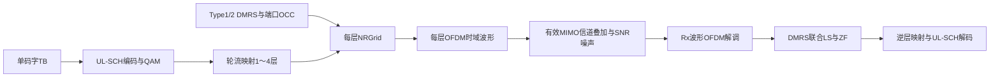

# NRPUSCH：1～4层PUSCH、DMRS端口与OCC

[源码](NRPUSCH.py)。固定TS38.211 V15.2.0 §5.1/5.2.1、§6.3.1.1～5、表6.3.1.3-1及§6.4.1.1、原表6.4.1.1.3-1～5。单码字（层映射记q=0）、1～4层CP-OFDM、连续非交织RB；支持Type-A、DMRS Type1/2、单/双符号及附加位置。逻辑层端口通过dmrs_ports对应协议端口p，不把层号当作接收天线号。

| 字段/属性 | 含义、范围、单位、示例 |
|---|---|
| cell | NRCell，例NRCell(n_size_grid=12,n_rx_antennas=4) |
| prb=0、n_prbs=4 | BWP局部起始RB及连续RB数，起点0..bwp_size-n_prbs，数量1..bwp_size |
| start_symbol=0 | slot零基起始符号，0..min(3,slot符号数-n_symbols) |
| n_symbols=14 | 连续符号数4..slot符号数；扩展CP需显式指定≤12 |
| rnti=1 | 已选RNTI，整数0..65535 |
| data_scrambling_id=None | 数据ID0..1023，None解析PCI；例731 |
| dmrs_scrambling_id=None | 已选DMRS ID0..65535，None解析PCI；例271 |
| n_scid=0 | DMRS初始化选择0/1，ID由调用方提供相应值 |
| dmrs_type_a_position=2 | 第一DMRS的slot符号2/3，必须在分配中 |
| cdm_groups_without_data=None | 自动取覆盖已用端口所需组数；显式值须覆盖全部已用组，Type1最多2、Type2最多3 |
| modulation='QPSK' | QPSK/16QAM/64QAM/256QAM |
| n_layers=1 | 单码字层数，整数1..4；超过4层/多码字不支持 |
| dmrs_configuration_type=1 | DMRS类型1或2 |
| dmrs_length=1 | 单/双符号1或2 |
| dmrs_additional_position=0 | 单符号0..3；双符号0/1；Type-A位置3不能配附加位置3 |
| dmrs_ports=None | 恰有n_layers个不重复相对端口的tuple；None取tuple(range(n_layers))；例(0,4,1,5) |
| modulation_order | Qm=2/4/6/8 |
| coded_length | G=每层数据RE数*层数*Qm，编码位数 |
| dmrs_symbol_starts | 每个DMRS单/双符号组的slot内起始索引int[J] |
| dmrs_symbols | 展开的全部slot内DMRS符号int[D]，双符号各组含start及start+1 |

构造及__post_init__检查上述字段、端口数量/唯一性、CDM组覆盖、DMRS是否完全位于分配内，冻结配置。Type-A原表的duration使用start_symbol+n_symbols，不能仅使用n_symbols。非法配置明确抛异常。

| 类型 | 单符号相对端口 | 双符号相对端口 | 每RB每端口DMRS点数 | 原表 |
|---|---|---|---|---|
| Type1 | 0..3 | 0..7 | 每符号6 | TS38.211 V15.2.0表6.4.1.1.3-1/-5 |
| Type2 | 0..5 | 0..11 | 每符号4 | 同版本表6.4.1.1.3-2/-5 |

port_parameters(port)为内部表映射，返回(group,frequency_sign,time_sign)。令S=4（Type1）或6（Type2），group=(p%S)//2、frequency_sign=p%2、time_sign=p//S，分别是CDM组、频域OCC和时域OCC索引。相对p对应规范端口p。port_subcarriers(port)返回该端口在整个分配带宽内的相对频率索引int[Dk]：Type1为2m+group；Type2为6n+2group+k_prime，k_prime=0/1。

indices(dmrs=False)返回int[RE,3]，列为本地层号、slot符号、载波局部子载波；严格bool选择数据或DMRS。排序为层在外、符号其次、频率在内。所有层使用相同数据RE几何，DMRS频率位置由对应端口决定；DMRS符号上全部配置CDM组都禁止数据，即使某个组没有实际发送端口。

scrambling()返回Gold int[G]，种子RNTI*2^15+dataID。constellation()复用common/_qam.py，返回归一化QAM点complex[2^Qm]及整数比特标签[2^Qm,Qm]。generate(coded_bits)严格校验整数二进制[G]并拒绝bool，加扰/QAM后按原表轮流把码字调制符号分给各层；返回按层优先展平的complex[n_layers*Nd]，reshape(n_layers,Nd)可查看各层，Nd为每层数据RE数。单层保持原先一维返回格式。

dmrs()返回按层、DMRS符号、频率排序的complex数组，与indices(True)逐项对应；各层数量相同。每OFDM符号独立生成Gold-QPSK，CRB0为频率原点；Type1起点6*(bwp_start+prb)、Type2起点4*(bwp_start+prb)。再乘端口的频域OCC和双符号时域OCC。单码字数据加扰和DMRS序列是不同伪随机流。

map_to_grid(grid,coded_bits,beta=1)要求同cell且grid.n_ports=n_layers。beta有限非负线性幅度，每层数据/DMRS同幅，合并坐标后原子写owner=PUSCH，返回跨全部层的映射RE数量。n_layers是逻辑层数，不自动从cell.n_tx_antennas推导；示例使用单位预编码，每层一条Tx波形，通过外部有效MIMO信道映射到Rx。

```python
from cell import NRCell
from pusch import NRPUSCH
r = NRPUSCH(NRCell(n_size_grid=12,n_rx_antennas=4),n_layers=4,
             dmrs_configuration_type=2,dmrs_length=2,
             dmrs_ports=(1,7,4,10),dmrs_additional_position=1)
assert r.cdm_groups_without_data == 3
```

附加位置按原表6.4.1.1.3-3/-4：例如单符号duration12/位置3为[2,5,8,11]；双符号duration14/附加1且起点2为[2,3,10,11]。Type-A位置3加附加3被拒绝。

文档自编号PUSCH-M1，依据上述层映射及DMRS端口表：

$$
x_{v,i}=d_{Vi+v},\qquad
r_{p,l,m}=r_l[m](-1)^{f_p(m\bmod2)+t_pl'},\quad
f_p=p\bmod2,\quad t_p=\lfloor p/S\rfloor.\tag{PUSCH-M1}
$$

| 变量 | 含义、范围、单位与维度 |
|---|---|
| V、v、i | 层数1..4、层号0..V-1、每层RE索引0..Nd-1，整数 |
| d、x | 码字QAM符号complex[V*Nd]、层符号complex[V,Nd]，归一化幅度 |
| p、S、f_p、t_p | 相对端口、每类型单符号端口数4/6、频域/时域OCC索引0/1 |
| l、l_prime、m | slot内DMRS符号、组内时间索引0/1、序列频率点索引；整数 |
| r_l、r_p | 单位模基础Gold-QPSK与端口参考，complex序列；实际频率映射见port_subcarriers |

Gold初始化PUSCH-1（文档自编号），依据同版本§6.4.1.1.1：

$$
c_{\rm init}=\bigl[2^{17}(N_{\rm symb}^{\rm slot}n_{\rm slot}+l+1)(2N_{\rm ID}+1)+2N_{\rm ID}+n_{\rm SCID}\bigr]\bmod2^{31}.\tag{PUSCH-1}
$$

其中c_init为0..2^31-1整数；N_symb_slot为14/12，n_slot为帧内slot，l为上述DMRS符号，N_ID为已选DMRS ID0..65535，n_SCID为0/1；均无量纲标量。

边界：无超过4层/多码字、Type-B、频率跳变、动态TPMI预编码/码本、DFT-s-OFDM、UCI复用、PTRS、SSB/PBCH/CORESET预留RE速率匹配、MCS/TBS自动选择或PDCCH调度。接收联合估计假设每RB整个分配内近似恒定，附加DMRS用于联合观测，不等于已实现时变信道插值。



