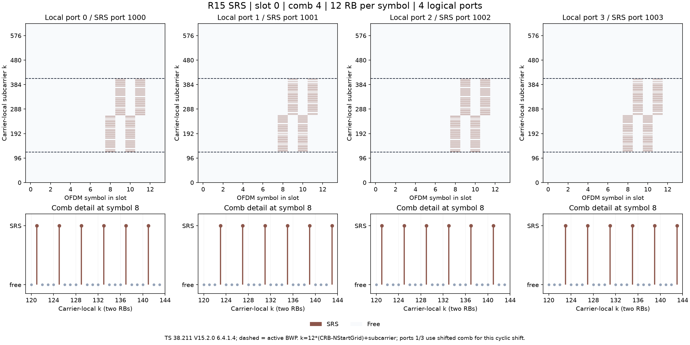

# NRSRS：Release 15 探测参考信号

`NRSRS` 使用 [NRCell](../cell/NRCell.md) 提供小区、帧内时隙、CP 和活动 BWP，产生真正的 SRS 复数序列及 RE 坐标，再映射到 [NRGrid](../grid/NRGrid.md)。源码为 [NRSRS.py](NRSRS.py)，导入方式 `from srs import NRSRS`。

固定基线为 **TS 38.211 V15.2.0 §5.2、§6.4.1.4**，RRC 参数范围为 **TS 38.331 V15.2.1 §6.3.2 SRS-Config / SRS-Resource / SRS-PeriodicityAndOffset**。SRS 是上行参考信号，不携带用户数据。其协议端口为 1000+i，网格轴为本地 i；端口数不从物理收发天线数推断。

实现 1/2/4 端口，1/2/4 连续符号，comb 2/4，64 行全部带宽表、4 个带宽层级，组跳变/序列跳变、频率跳频与重复、周期/半持续/非周期资源的当前时隙合成。没有实现 OFDM 波形、信道传播/估计、闭环功控、DCI/MAC 解码、波束关系、资源集冲突优先级或 UE 射频能力检查。允许的 numerology 来自 NRCell；算法测试中的 numerology 不宣称适用于所有射频频段/设备。

`enabled` 是调用者给出的当前时隙许可。调用者须先处理非周期触发、半持续激活及 TDD 上行/灵活符号许可；默认 True 表示这些前提在本次仿真中已满足。NRCell.duplex_mode 目前仅是元数据，不能据此自动判断是否允许发送。`is_candidate_slot` 只代表周期条件，`is_active` 再与 enabled 相与。非周期资源没有内置未来触发队列。

## 可运行入口

在仓库根目录安装 `pip install -e ".[dev,plots]"` 后运行：

```python
from cell import NRCell
from grid import NRGrid
from srs import NRSRS

cell = NRCell(n_cell_id=42, n_size_grid=52, n_start_grid=10,
              bwp_start=20, bwp_size=24, n_tx_antennas=4, n_rx_antennas=2)
srs = NRSRS(cell, n_ports=4, n_symbols=4, start_position=5,
            c_srs=7, b_srs=1, b_hop=0, k_tc=4, comb_offset=1,
            cyclic_shift=7, frequency_shift=10, sequence_id=42,
            group_seq_hopping="groupHopping")
grid = NRGrid(cell, n_ports=srs.n_ports)
raw = srs.generate()                    # (144,4)，未施加端口功率缩放
indices = srs.indices()                 # (576,3)，[本地端口,符号,载波内子载波]
assert srs.map_to_grid(grid) == 576      # 每 RE 写入 raw/sqrt(4)
assert grid.occupied_re_count == 576
print(srs.sequence_parameters())         # 每符号 u/v、每端口 alpha
```

完整示例：[NRSRS_demo.py](../../examples/srs/NRSRS_demo.py)。所有数值、CSV、日志和图片输出到 `examples/srs/`，详见 [示例说明](../../examples/srs/README.md)。



图中棕色为统一色表的 SRS `#8C564B`；上排为实际 NRGrid 占用，虚线是 BWP，下面是首个 SRS 符号两 RB 的梳齿细节。示例 cyclic_shift=7、comb4、四端口时，端口 1/3 的频域梳齿偏移与端口 0/2 不同。

## 输入字段：19 个

实例为 frozen、slots dataclass。修改使用 `dataclasses.replace`，返回新对象；推进小区时隙后也应重建对应 NRGrid。全部整数要求 Python int，拒绝 bool、float、NumPy int；字符串须使用表中准确拼写。以下是项目 API 对照表，**不是规范原表**；规范依据在最后一列。

| 字段 / 默认值 | 作用、单位与范围 | 独立可运行示例（已导入上述三个类） | 原文定位 |
|---|---|---|---|
| `cell`，必填 | NRCell，不可变小区对象 | `NRSRS(NRCell(n_cell_id=42))` | 38.211 V15.2.0 §4、§6.4.1.4 |
| `n_ports=1` | SRS 逻辑端口数 1/2/4 | `NRSRS(NRCell(), n_ports=2)` | 同版本 §6.4.1.4.1；38.331 V15.2.1 §6.3.2 nrofSRS-Ports |
| `n_symbols=1` | 连续 OFDM 符号数 1/2/4 | `NRSRS(NRCell(), n_symbols=4, start_position=3)` | 38.211 同节；38.331 同节 resourceMapping |
| `start_position=0` | 从时隙末尾反向计数的 l_offset，0..5；至少 n_symbols-1 | `NRSRS(NRCell(), start_position=5).symbol_start` → 8 | 38.211 V15.2.0 §6.4.1.4.1 |
| `c_srs=0` | 带宽配置表行号 0..63 | `NRSRS(NRCell(), c_srs=7).bandwidth_rb` → 24 | 38.211 V15.2.0 §6.4.1.4.3，表 6.4.1.4.3-1 |
| `b_srs=0` | 带宽层级 0..3 | `NRSRS(NRCell(), c_srs=7, b_srs=1).bandwidth_rb` → 12 | 同表，b-SRS |
| `b_hop=0` | 0..3；b_hop < b_srs 开启频率跳频 | `NRSRS(NRCell(), c_srs=7, b_srs=1, b_hop=0)` | 38.211 同节频率位置公式 |
| `k_tc=2` | comb 间隔，单位子载波，只接受 2/4 | `NRSRS(NRCell(), k_tc=4).sequence_length` → 12 | §6.4.1.4.2/3；38.331 transmissionComb |
| `comb_offset=0` | comb 内子载波偏移 0..k_tc-1 | `NRSRS(NRCell(), k_tc=4, comb_offset=3).indices()[0,2]` → 3 | §6.4.1.4.3 k_TC |
| `cyclic_shift=0` | comb2:0..7，comb4:0..11；循环移位编号，不是 rad | `NRSRS(NRCell(), k_tc=4, cyclic_shift=11)` | §6.4.1.4.2；38.331 cyclicShift-n2/n4 |
| `frequency_shift=0` | 本 API 的载波内起始 RB 偏移，0..268，映射 MATLAB FrequencyStart | `NRSRS(NRCell(), frequency_shift=4).indices()[0,2]` → 48 | §6.4.1.4.3 n_shift；38.331 freqDomainShift 范围 |
| `frequency_position=0` | n_RRC，0..67，频域循环位置参数，基本步长 4RB | `NRSRS(NRCell(), c_srs=7, b_srs=1, b_hop=3, frequency_position=3)` | §6.4.1.4.3 n_b；38.331 freqDomainPosition |
| `sequence_id=0` | 独立序列标识 0..1023；**不默认等于 PCI** | `NRSRS(NRCell(n_cell_id=42), sequence_id=19)` | §6.4.1.4.2；38.331 sequenceId 是 10 bit |
| `group_seq_hopping="neither"` | `neither` / `groupHopping` / `sequenceHopping`，互斥 | `NRSRS(NRCell(), c_srs=6, group_seq_hopping="sequenceHopping")` | §6.4.1.4.2，使用 §5.2.1 PRBS |
| `repetition=1` | 1/2/4，且不大于 n_symbols；同一频率位置连续使用 R 个符号，不强制序列 u/v 相同 | `NRSRS(NRCell(), n_symbols=4, start_position=3, repetition=2)` | §6.4.1.4.3 n_SRS；38.331 repetitionFactor |
| `resource_type="periodic"` | `periodic` / `semi-persistent` / `aperiodic` | `NRSRS(NRCell(), resource_type="aperiodic", enabled=True)` | §6.4.1.4.3/4；38.331 resourceType |
| `periodicity=1` | 时隙，固定集合见 PERIODICITIES；非周期必须为 1 | `NRSRS(NRCell(n_slot=3), periodicity=10, slot_offset=3).is_active` → True | §6.4.1.4.4；38.331 SRS-PeriodicityAndOffset |
| `slot_offset=0` | 周期内时隙偏移 0..periodicity-1；非周期必须为 0 | `NRSRS(NRCell(n_slot=2), periodicity=4, slot_offset=1).is_active` → False | 同上 |
| `enabled=True` | 外部提供的触发/激活/上行许可，严格 bool | `NRSRS(NRCell(), enabled=False).generate().shape` → (0,1) | 软件接口；许可边界依据 §6.4.1.4.4 与 38.213 V15.3.0 §11.1 |

`frequency_shift` 使用载波局部坐标，与 MATLAB FrequencyStart 一致。若希望从 BWP 的 PRB 0 开始，传入 `cell.bwp_start-cell.n_start_grid`。若希望从 BWP 内 PRB q 开始，再加 q。它不自动从 BWP 起点加一次偏移，也不直接接收整个 ASN.1 RRC 对象。所有实际 RE 均需在活动 BWP 内；`indices/generate/map_to_grid` 会报错，禁止裁剪/折返。非候选或 disabled 时不分配 RE，不进行当前分配范围检查。

## 常量和派生属性

以下为项目接口/推导表，规范出处见后续公式。

| 名称 | 含义 / 示例 |
|---|---|
| `SPEC_BASELINE` | 两份固定规范版本字符串；`print(srs.SPEC_BASELINE)` |
| `PERIODICITIES` | R15 的 17 种时隙周期：1,2,4,5,8,10,16,20,32,40,64,80,160,320,640,1280,2560；不含后续版本的 128/256/512 等新增项 |
| `symbol_start` | 时隙内 l0；普通 CP start_position=5 得 8；扩展 CP 得 6 |
| `bandwidth_rb` | m_b，单位 RB；C=7/B=1 得 12 |
| `sequence_length` | M，每端口每 OFDM 符号复数个数；C=7/B=1/comb4 得 36 |
| `max_cyclic_shifts` | comb2 为 8、comb4 为 12 |
| `antenna_ports` | 协议端口元组；四端口得 (1000,1001,1002,1003) |
| `absolute_slot` | SFN 周期内 n_frame*slots_per_frame+n_slot；30kHz 的 frame=1/slot=3 得 23 |
| `is_candidate_slot` | 仅周期条件；非周期始终 True，因为实际目标时隙由调用者确定 |
| `is_active` | enabled 且候选时隙；半持续资源只有调用者传入 enabled=True 才视为已激活 |

没有隐藏的可变缓存、随机种子或 logger 成员。`_tables.py` 中的 `PHI_12`、`PHI_24`、`BANDWIDTH_TABLE` 是不可变元组，索引分别为 `[u][n]` 和 `[c_srs][2*b:2*b+2]`。数值逐项对照英文 PDF；不从 MATLAB 输出生成 Python 表。

## 方法、参数、返回和失败行为

| 方法 | 输入 / 返回 / 行为 |
|---|---|
| 自动 `__init__(cell, ...)` | 使用上述全部字段构建冻结配置，随后调用 __post_init__；例如 `NRSRS(NRCell())` |
| `__post_init__()` | 类型、R15 范围、时间位置/重复/周期联合校验；TypeError 表示类型错误，ValueError 表示范围/组合错误；频域实际分配边界延迟到生成时检查 |
| `_frequency_indices()` | 内部无参，返回新数组 `(nb,k0)`，尺寸分别 `(b_srs+1,n_symbols)`、`(n_ports,n_symbols)`，整数；计算频率位置/跳频，不应用 enabled，也不承诺非候选时隙的 n_b 有协议发送含义；仅供验证诊断 |
| `indices()` | 无参，N×3 int64，从零起始 `[port,symbol,subcarrier]`，顺序为端口→SRS符号→序列点；不活跃返回 `(0,3)`；BWP 越界 ValueError。例如 `srs.indices()[:3]` |
| `sequence_parameters()` | 无参，返回 `{"u":(L,), "v":(L,), "alpha":(P,)}` 新数组；alpha 单位 rad；不应用时隙许可，方便配置诊断。例如 `srs.sequence_parameters()["alpha"]` |
| `generate()` | 无参，complex128，形状 `(M*L,P)`，每列一个端口，每符号内频率点递增；原始单位模序列，不含 beta 和 1/√P；不活跃返回 `(0,P)`；先验证实际 BWP 边界 |
| `map_to_grid(grid,beta=1.0,owner="SRS",overwrite=False)` | grid 必须为 NRGrid，同值 NRCell，且端口数≥P；使用前 P 个局部端口。beta 为非负有限 Python int/float 线性幅度，拒绝 bool/NaN/Inf/复数；owner/overwrite 约束继承 NRGrid。返回写入 RE 数；不活跃返回 0。写入 beta/√P*generate().ravel(order="F")；冲突或错误不产生部分写入 |
| `to_dict()` | 全部 19 个输入字段的新字典，cell 为独立 dict，可 JSON 编码。例如 `json.dumps(srs.to_dict())`；无需传入参数 |
| `to_matlab_config()` | nrSRSConfig 字段 dict；禁用全部相关后续扩展，enabled=False 导出 SRSPeriod="off"，非周期启用时为 "on"，周期/半持续为 [T,offset]；carrier 从 cell.to_matlab_config 单独构造。NFrame 与帧内 NSlot 成对输入，不能再把 NSlot 改为 absolute_slot，否则 MATLAB 重复累计帧号 |

`indices()` 与 `generate()` 返回值相互对应：`values=generate().ravel(order="F")`。NRGrid 数组轴是 `[p,l,k]`，MATLAB 下标是 `[k,l,p]`；MATLAB `nrSRSIndices(...,'IndexBase','0based','IndexStyle','subscript')` 列重排 `[3,2,1]` 后与 indices 一致。失败采用 NRGrid 的预检查和原子写入；不会自动覆盖同 owner。

```python
from dataclasses import replace

next_cell = cell.with_slot_offset(1)
next_srs = replace(srs, cell=next_cell, repetition=4)
next_grid = NRGrid(next_cell, next_srs.n_ports)
next_srs.map_to_grid(next_grid, beta=0.5, owner="SRS:UE0")
off = replace(next_srs, enabled=False)
assert off.indices().shape == (0, 3)
```

Gold序列和SRS的u/v获取已移至公共类 [NRCommon](../common/NRCommon.md)：`NRCommon.gold_sequence(c_init,length,offset=0)` 实现 §5.2.1；`NRCommon.srs_sequence_uv(...)` 实现 §6.4.1.4.2。NRSRS.sequence_parameters 委托公共类取得u/v，端口alpha仍在本类计算。模块内仅保留 `_integer(name,value,lower,upper)` 的本类参数校验，以及 `_base_sequence(length,u,v)` 的SRS所需12/24或≥36点基序列实现。

## 表格与公式追溯

以下 S1–S11 均为**本文档自编号，不是 3GPP 原公式号**。本节除 RRC 范围表外统一采用 **TS 38.211 V15.2.0**。

| 内容 | 原文章节 / 原表 | 代码数据 |
|---|---|---|
| 12 点 φ(n)，30 组 | §5.2.2.2，表 5.2.2.2-2 | `_tables.py: PHI_12` |
| 24 点 φ(n)，30 组 | §5.2.2.2，表 5.2.2.2-4 | `_tables.py: PHI_24` |
| 64 行×4 层级的 m_b/N_b | §6.4.1.4.3，表 6.4.1.4.3-1 | `_tables.py: BANDWIDTH_TABLE` |
| 端口、时域符号/起点 | §6.4.1.4.1，无独立表号 | n_ports/n_symbols/start_position |
| 周期、10 bit ID、位置范围 | TS 38.331 V15.2.1 §6.3.2 SRS-Config ASN.1，无独立表号 | PERIODICITIES 与字段校验 |

下表摘录自 **TS 38.211 V15.2.0 §6.4.1.4.3，原表 6.4.1.4.3-1**，不是重新设计的带宽表；完整 64 行见 [_tables.py](_tables.py)。

| C_SRS | m0,N0 | m1,N1 | m2,N2 | m3,N3 |
|---|---|---|---|---|
| 0 | 4,1 | 4,1 | 4,1 | 4,1 |
| 3 | 16,1 | 4,4 | 4,1 | 4,1 |
| 7 | 24,1 | 12,2 | 4,3 | 4,1 |
| 17 | 64,1 | 32,2 | 16,2 | 4,4 |
| 63 | 272,1 | 16,17 | 8,2 | 4,2 |

**S1，§6.4.1.4.1/3：时间起点和序列长度。**

\[
l_0=N_{symb}^{slot}-1-l_{offset},\qquad M=m_{SRS,b}\,12/K_{TC}.
\]

**S2，§6.4.1.4.2：端口循环移位。** 令 P=n_ports，i=p_i-1000。

\[
n_{cs,i}=(n_{cs}+n_{cs,max}i/P)\bmod n_{cs,max},\quad
\alpha_i=2\pi n_{cs,i}/n_{cs,max},\quad n_{cs,max}=8\;(K=2),12\;(K=4).
\]

**S3，§5.2.2、§5.2.2.1/2：基序列及循环移位。** M=12/24 时取对应原表 φ。M≥36 时 N_ZC 为严格小于 M 的最大质数：

\[
r_i(n,l')=e^{j\alpha_i n}\bar r_{u,v}(n),\quad
\bar r_{u,v}(n)=
\begin{cases}e^{j\varphi_u(n)\pi/4},&M=12,24\\
e^{-j\pi q m(m+1)/N_{ZC}},\ m=n\bmod N_{ZC},&M\ge36
\end{cases}
\]
\[
\bar q=N_{ZC}(u+1)/31,\quad q=\lfloor\bar q+1/2\rfloor+v(-1)^{\lfloor2\bar q\rfloor}.
\]

SRS 的原表 m_b 都是 4 的倍数，所以本类不产生 6/18/30 点序列。实现先对整数 ZC 相位模 2π，再取指数；与原式代数等价，但与 MATLAB 直接计算大相位存在可测的浮点舍入差。

**S4，§5.2.1：Gold PRBS。** x1(0)=1，其余前31位为0；x2 的前31位按 c_init=sequence_id 的低位先装载；Nc=1600。

\[
x_1(n+31)=x_1(n+3)\oplus x_1(n),\quad
x_2(n+31)=x_2(n+3)\oplus x_2(n+2)\oplus x_2(n+1)\oplus x_2(n),
\quad c(n)=x_1(n+1600)\oplus x_2(n+1600).
\]

**S5，§6.4.1.4.2：组/序列跳变。** 令 t=n_slot*N_symb_slot+l0+l'，此处使用帧内 slot；每帧重新以 sequence_id 初始化 PRBS。

\[
u=(f_{gh}+n_{ID}^{SRS})\bmod30,\quad
f_{gh}=\begin{cases}\sum_{m=0}^7 c(8t+m)2^m\bmod30,&groupHopping\\0,&其他\end{cases}
\]
\[
v=\begin{cases}c(t),&sequenceHopping\ 且\ M\ge72\\0,&其他\end{cases}.
\]

**S6，§6.4.1.4.3/4：候选时隙和传输计数。** 令 a=n_frame*N_slots_frame+n_slot，T/Toffset 单位为 slot：

\[
(a-T_{offset})\bmod T=0,\quad
n_{SRS}=\begin{cases}\lfloor l'/R\rfloor,&aperiodic\\
((a-T_{offset})/T)(N_{symb}^{SRS}/R)+\lfloor l'/R\rfloor,&periodic/semi\text{-}persistent.
\end{cases}
\]

SFN 从1023回到0时使用回绕后的 NRCell 帧号；本类不额外保存无限递增帧计数。

**S7，§6.4.1.4.3：频率位置。** 无跳频或 b≤b_hop 时 n_b=⌊4n_RRC/m_b⌋ mod N_b。否则：

\[
n_b=(F_b(n_{SRS})+\lfloor4n_{RRC}/m_b\rfloor)\bmod N_b.
\]

在 F_b 的乘积中强制 N_bhop=1。令 D=∏从 b_hop 到 b-1 的 N，z=(n_SRS mod(D*N_b))/D；以下 D/z 是为排版引入的本文符号：

\[
F_b=\begin{cases}(N_b/2)\lfloor z\rfloor+\lfloor z/2\rfloor,&N_b为偶数\\
\lfloor N_b/2\rfloor\lfloor n_{SRS}/D\rfloor,&N_b为奇数.\end{cases}
\]

**S8，§6.4.1.4.3：每端口起点和特殊 comb 偏移。** 当 P=4、基础 n_cs≥n_cs,max/2 且 i=1/3 时，k_TC,i=(comb_offset+K_TC/2) mod K_TC；其他端口 k_TC,i=comb_offset。

\[
k_{0,i}(l')=12n_{shift}+k_{TC,i}+\sum_{b=0}^{B_{SRS}}K_{TC}M_b n_b(l').
\]

**S9，§6.4.1.4.3：RE 映射与幅度。**

\[
k=k_{0,i}+K_{TC}n,\quad l=l_0+l',\quad a_{k,l}^{(i)}=\beta_{SRS}r_i(n,l')/\sqrt{P}.
\]

generate 输出 r；map_to_grid 输出 a。beta 默认1，外部可用其表示功控给定的线性幅度；未实现 TS 38.213 闭环功控计算。beta=0 时 RE 仍标为占用。

**S10，项目坐标推导，依据 §4.4.4.1/3/4/5 与 §6.4.1.4.3。**

\[
k_{BWP,low}=12(bwp\_start-n\_start\_grid),\quad
CRB=n\_start\_grid+\lfloor k/12\rfloor.
\]

**S11，项目绘图/CSV 频率推导，依据 §4.4.4.2 与 §5.3.1。** Δf 为 Hz；Point A 频偏使用 NRCell.subcarrier_offset_hz。这里 carrier center 指 §5.3.1 的 OFDM 居中参考 k=N_grid_size*12/2，不是最低/最高子载波中心的几何平均：

\[
f_{carrier\ center}=(k-N_{grid}^{size}12/2)\Delta f,\quad
f_{PointA}=(12N_{grid}^{start}+k)\Delta f.
\]

这是相对频率，不是绝对 RF 频率，不假定某个中心频点。梳齿间隔为 K_TC*Δf，不能把每个空梳齿当作 SRS 复数序列点。

## 独立验证与边界

[MATLAB 脚本](../../examples/srs/export_NRSRS_reference.m) 独立调用 nrSRS/nrSRSIndices/nrResourceGrid，保存 832 组真实输入与全部向量。已比对 364800 个复数值，坐标零差异，最大序列绝对误差约 1.468e-9；逐点容限 rtol=0、atol=2e-9。详细环境、阈值、测试与限制见 [验证报告](../../documentation/validation/NRSRS_validation.md)。

MATLAB 当前文档包含后续 Release 扩展；适配器和脚本显式关闭定位、频率缩放/部分探测、8端口、comb/cyclic-shift hopping 等功能，且 Python 严格限制 R15 范围。参考：[nrSRS](https://www.mathworks.com/help/5g/ref/nrsrs.html)、[nrSRSIndices](https://www.mathworks.com/help/5g/ref/nrsrsindices.html)、[nrSRSConfig](https://www.mathworks.com/help/5g/ref/nrsrsconfig.html)。

109 个 SRS 单元测试涵盖错误组合、返回副本、端口正交性、手算跳频排列、帧边界、TDD 许可接口、BWP 越界、功率归一化、零幅度占用与原子冲突。单独通过这些测试不代表完整 UE/gNB SRS 协议流程或空口一致性认证。
