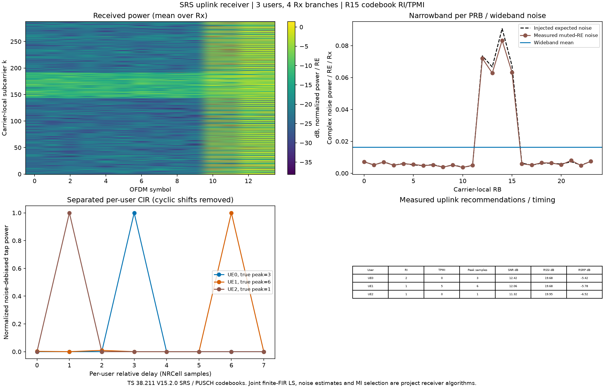

# NRSRSReceiver：SRS解扩、信道估计与上行测量

[NRSRSReceiver.py](NRSRSReceiver.py)接收同一NRCell当前时隙的多用户SRS，返回每用户信道、冲激响应、RI/TPMI、SNR、首径/最强径时延，并测量宽带和逐PRB噪声。导入 `from srs import NRSRSReceiver`。

SRS没有用户数据比特，因此这里的“解调”是已知序列解扩及信道估计。**输入是已经完成OFDM解调和粗同步的频域采样**，轴为 `[接收分支,时隙符号,载波内子载波]`；OFDM调制/解调由[common.NROFDM](../common/NROFDM.md)提供；TA、噪声和已知CFO施加/校正见[channel.NRChannel](../channel/NRChannel.md)，尚未实现盲同步。接收分支是NRCell.n_rx_antennas，不能将NRGrid发送逻辑端口轴当成接收分支轴。

SRS参考按 **TS38.211 V15.2.0 §5.2、§6.4.1.4**，参考字段按 **TS38.331 V15.2.1 §6.3.2**；PUSCH码本按 **TS38.211 V15.2.0 §6.3.1.5**。联合有限FIR最小二乘、噪声估计、检测门限、时延提取及互信息搜索是**项目接收机算法**，规范没有要求使用这一唯一接收算法。

## 处理边界

所有已配置活跃用户一起拟合，允许相同RE上的可辨识CDM/不同已知序列；不会分别用同一接收值相除后各自认领全部功率。采用当前时隙内不随时间变化的、因果整数样点FIR信道，窗口为0..n_delay_taps-1。SRS跳频和序列跳变由NRSRS参考包含。签名完全相同、观测不足或矩阵病态时明确报错；本算法不保证任意用户配置或任意多径都可分离。

返回的`cir/delay_power`已经通过各用户完整参考（含循环移位）分离，横轴是每个用户自己的相对物理延迟0..D-1，因此可以叠画在同一横轴。它不是未分离的公共IFFT延迟谱。当前采用联合LS，不是直接IFFT分窗截取接收机。

对相同基序列、相同频率梳齿/分配去序列后，循环移位会把各端口放到公共IFFT的不同窗。用Nfft/K_TC点IFFT时，CS窗原点为`(-Nfft/K_TC*n_cs/n_cs_max) mod (Nfft/K_TC)`，真实延迟加在该原点后；这是由§6.4.1.4.2的exp(j*alpha*n)与傅里叶移位关系得到的项目推导，不是原文公式编号。用M点IFFT时，IFFT横轴不能直接当NRCell采样点。

当前示例UE0的两个端口CS为0/4，UE1为2/6；UE2为CS0，但comb4/offset1/sequence93，与前两者comb2/offset0/sequence17不同，应放在另一个去序列组中观察，不能硬解释成同一公共谱的第三个CS窗。公共谱及分组见[窗图](../../examples/srs/NRSRSReceiver_cs_windows.png)。有限带宽会带来旁瓣/泄漏，窗隔离还依赖时延扩展和定时偏差。

用户未列入resources、未知干扰、窗口外多径、分数样点时延、快时变信道/CFO都会造成模型误差。当前不实现完整时域同步、射频校准、干扰消除或TA命令生成。信道数组在未直接探测频点是FIR模型外推；RI/TPMI只使用当前用户实际探测的频率集合。

## 构造字段：5个

采用冻结slots dataclass，无内部可变缓存。以下为项目接口表，不是协议原表。

| 字段 | 作用、单位、范围 | 可运行示例 |
|---|---|---|
| cell，必填 | 不可变NRCell；提供Rx数、FFT、采样率、CP、BWP和当前时隙 | `NRSRSReceiver(NRCell(n_size_grid=24,n_rx_antennas=2))` |
| n_delay_taps=8 | 因果FIR系数数D；Python int，1..当前slot最短CP样点数；最大拟合延迟D-1 | `NRSRSReceiver(NRCell(), n_delay_taps=4)` |
| max_condition_number=1e8 | 联合矩阵允许的最大条件数，无量纲，有限实数≥1 | `NRSRSReceiver(NRCell(), max_condition_number=1e6)` |
| min_snr_db=0.0 | 每用户工程检测门限，有限实数，dB；低于门限不给RI/TPMI或时延建议 | `NRSRSReceiver(NRCell(), min_snr_db=3.0)` |
| first_path_relative_power=0.1 | 首径相对最强tap的功率门限，有限实数(0,1]，默认-10dB | `NRSRSReceiver(NRCell(), first_path_relative_power=0.2)` |

整数拒绝bool/float/NumPy int；实数拒绝bool/NaN/Inf。CP样点数来自NRCell的TS38.211 V15.2.0 §5.3.1精确时序；D上限是本接收机的工程限制，也须满足设计矩阵的可辨识性。

## 接口及每个参数

`estimate(rx_grid, resources, *, noise_mask=None, betas=None, selection_options=None)`：

| 参数 | 含义/形状/示例 |
|---|---|
| rx_grid | 有限复数数组`[cell.n_rx_antennas,cell.symbols_per_slot,cell.n_subcarriers]`，归一化复幅度；输入不被修改 |
| resources | 非空`{用户字符串:NRSRS}`，所有资源的NRCell须与接收机同值，例如`{"UE0":srs0,"UE1":srs1}`；inactive资源返回inactive状态 |
| noise_mask | None或bool`[symbol,k]`，True是调用者**确知静默**的RE；须位于活动BWP、非空且不与任何配置SRS重叠。不能仅因某个RE不属于一个用户就将其他用户信号当噪声 |
| betas | None默认每用户1；或`{"UE1":0.7}`，发送时使用的正有限线性幅度，必须与NRSRS.map_to_grid的beta一致；未知beta会与信道增益混淆 |
| selection_options | None或`{"UE0":{"max_rank":1,"allowed_tpmi":{1:[2,4]},"tx_power":1.0}}`；转交[NRUplinkCodebook.select](../common/NRUplinkCodebook.md)，由外部配置限制上行RI/TPMI |

返回新字典及新数组。输入/配置/矩阵不可辨识等错误抛TypeError或ValueError，不修改接收数组/NRGrid；不会用截断伪逆掩盖秩亏。

其他类方法也有明确边界：

| 方法 | 作用 |
|---|---|
| 自动`__init__` | 接收上述5字段，随后运行`__post_init__` |
| `__post_init__()` | 检查类型、CP窗口和有限参数，不进行信道拟合 |
| `_references(resources,betas)` | 内部构建每用户NRGrid，调用NRSRS.map_to_grid（含beta/√P），返回`[L,K,P]`参考字典；betas必须是字典 |
| `_noise(rx,observed,residual,leverage,noise_mask)` | 内部噪声估计，observed为SRS联合占用，residual为LS残差`[观测数,Rx]`，leverage为帽子矩阵对角线；返回下面noise字典 |

没有额外类常量或派生属性。校验函数共用common模块内部`_integer`，不依赖MATLAB运行时。

## 返回结果字段

顶层工程结果表：

| 字段 | 含义 |
|---|---|
| noise | 下述宽带/窄带噪声结果 |
| users | `{用户ID:测量结果}`；每用户见下表 |
| design_condition_number | 联合A的条件数；全inactive时None |
| observation_count / unknown_count | 联合SRS占用的不同`(l,k)`数 / 所有活跃用户端口数×D；不是把重复RE对每用户重复计数 |
| residual_power | 接收采样减去所有用户拟合值的平均复残差功率；无观测时None |
| delay_resolution_s | 1/Fs，一样点的时间分辨率 |
| delay_window_s | (D-1)/Fs，拟合窗口最大延迟 |

noise字典：

| 字段 | 含义、单位 |
|---|---|
| method | `muted_re`为确知静默RE直接测量；`ls_residual`为有限模型LS残差估计 |
| units | `normalized complex power per RE per receive branch`；没有射频标定，不输出dBm |
| wideband_noise_power | 活动BWP的有效测量RE加权平均、再跨Rx平均的复噪声功率/RE |
| wideband_noise_power_per_rx | `[Rx]`每分支宽带结果 |
| narrowband_noise_power | `[载波RB数]`每PRB平均复功率/RE，跨Rx平均；不是每RB的12子载波总和 |
| narrowband_noise_power_per_rx | `[Rx,载波RB数]`完整窄带结果 |
| narrowband_re_count | `[载波RB数]`实际使用的测量RE个数，不含Rx乘数 |
| narrowband_degrees_of_freedom | 每PRB有效复自由度；静默模式等于RE数；残差模式扣除拟合自由度 |

未观测RB及BWP外RB的功率返回NaN、count/dof为0，不能解读为噪声为0。示例JSON将NaN写null。功率是E|n|²，复白噪声I/Q各自方差为功率的一半。静默RE上若有未知干扰，结果包含噪声和干扰；不保证分离纯热噪声。

users的活跃用户结果：

| 字段 | 作用/形状/单位 |
|---|---|
| status | `detected`或`below_threshold`；检测门限是工程规则，没有给出特定虚警概率保证 |
| cir | `[Rx,SRS端口,D]`，去掉已知SRS发送幅度后的信道tap |
| channel | `[Rx,SRS端口,载波k]`，FIR变换后的频率信道 |
| channel_observed_mask | `[载波k]`bool，用户至少有一个参考端口/符号实际探测该频点；其他频率为模型外推 |
| delay_power | `[D]`，跨Rx/port累加的tap功率，扣除白噪声近似系数方差后截到非负 |
| signal_power | 与rsrp相同，保留原字段供现有调用读取；不会因其他用户分配额外RE而被稀释 |
| snr_db | signal_power/宽带噪声的10log10；噪声使用1e-12数值下限，零信号为None；该工程SNR不是标准SINR |
| delay_samples / delay_s / delay_tc | **最强径**的整数tap号、秒、Tc；相对于接收FFT窗口，低于门限为None |
| first_path_delay_samples / first_path_delay_s | 第一个达到相对峰值功率门限的tap及秒；工程首径估计，弱首径可能漏检 |
| delay_window_edge | 最强径在0或D-1边界时True，提示检查窗口；不是窗口外多径被可靠检测的保证 |
| mean_delay_samples | 按delay_power计算平均延迟，样点单位 |
| rms_delay_spread_samples | 按delay_power计算RMS时延扩展，样点单位 |
| ri / tpmi | 后续上行RI/TPMI建议；未检测时None，不是直接发出的DCI |
| selection | 码本选择完整字典（候选分数、原表矩阵、评分归一化等）；未检测时None |

inactive用户只返回`status="inactive",ri=None,tpmi=None,delay_samples=None`。全inactive时可给显式静默mask测量噪声，否则没有LS噪声自由度而报错。

## 接收公式与假设

以下R1–R8全部为本文自编号的**项目接收机公式**。X的序列/映射依据TS38.211 V15.2.0 §6.4.1.4，含规范1/√P；码本矩阵依据该版本§6.3.1.5。LS、噪声及时延估计不标成3GPP原公式。

**R1，联合模型。** 将所有参考占用的不同(l,k)按符号→频率排列为观测q。每用户端口的参考X由NRGrid获得；d是0..D-1样点延迟：

$$
Y_{q,r}=\sum_{u,p,d}X_{u,p}(l_q,k_q)e^{-j2\pi k_q d/N_{FFT}}h_{u,p,d,r}+N_{q,r},\quad A_{q,(u,p,d)}=X_{u,p}(l_q,k_q)e^{-j2\pi k_qd/N_{FFT}}.\tag{R1}
$$

这里k为载波局部子载波，不是CRB或FFT原始bin；坐标原点常相位吸收入信道系数。单位样点延迟的频率相位依据OFDM傅里叶关系和NRCell的Fs=NFFT*Δf（38.211 §5.3.1及平台FFT选择）。

**R2，SVD联合LS与可辨识性。**

$$
A=U\Sigma V^H,\quad \widehat h=A^+Y,\quad E=Y-A\widehat h.\tag{R2}
$$

要求列满秩、条件数≤max_condition_number。列序为用户→port→tap。拒绝完全相同签名/过长FIR导致的秩亏。相同RE的CDM分离依赖有限延迟窗口；没有假设任意频率逐点信道都可从一个混合RE独立恢复。

**R3，宽/窄带噪声。** 静默mask时以|Y|²求平均；残差模式使用帽子矩阵杠杆值g_q=Σ_i|U_qi|²：

$$
\widehat\sigma^2_{r,WB}=\frac{\sum_q|E_{q,r}|^2}{\sum_q(1-g_q)},\quad
\widehat\sigma^2_{r,b}=\frac{\sum_{q\in RB_b}|E_{q,r}|^2}{\sum_{q\in RB_b}(1-g_q)}.\tag{R3}
$$

静默模式将E换成静默Y、每点自由度换成1。宽带值按实际RE/自由度加权，不把样本数不同的PRB均值再简单平均。残差模式只有在信道模型正确且噪声近似白色时有相应无偏解释；强干扰/窗口外多径会混入残差，有色噪声还会跨频率混合，建议使用确知静默RE。

**R4，拟合噪声和检测。** 每用户子矩阵Au、伪逆对应行Bu=A+的u部分；以下均值仅取该用户自身参考占用的观测行，每Rx分别按宽带噪声去偏并截负，再跨Rx平均：

$$
P_u=\mathrm{mean}_r\max\{\mathrm{mean}_q|(A_u\widehat h_u)_{q,r}|^2-\widehat\sigma_r^2\mathrm{mean}_q\sum_j|(A_uB_u)_{q,j}|^2,0\},\quad
SNR_u=10\log_{10}\frac{P_u}{\max(\widehat\sigma^2,10^{-12})}.\tag{R4}
$$

SNR≥min_snr_db且信号功率正才给出检测和推荐。白噪声近似也用于下面tap功率去偏；有色噪声示例不宣称这些去偏量精确无偏。

**R5，tap功率。** 令B的每一对应行方差增益为Σq|B_row,q|²，按Rx/port去偏后求和并截负：

$$
P_d=\max\{\sum_{r,p}|\widehat h_{r,p,d}|^2-R\widehat\sigma^2\sum_p\|B_{p,d,:}\|^2,0\}.\tag{R5}
$$

**R6，时延。** 最强径dpeak=argmax Pd，首径取第一个Pd≥first_path_relative_power*max(Pd)的d；

$$
\tau_{peak}=d_{peak}/F_s,\quad T_c\text{个数}=d_{peak}\,cell.tc\_per\_sample.\tag{R6}
$$

这是残余时延/多径tap位置，不是未同步用户的绝对传播时延、测距或TA量化。分辨率1/Fs，范围0..(D-1)/Fs；SRS梳齿还存在1/(K_TC*Δf)相关时延周期歧义，超窗/分数延迟不保证正确恢复。

**R7，平均/RMS时延。**

$$
\bar d=\frac{\sum_d dP_d}{\sum_dP_d},\quad d_{RMS}=\sqrt{\frac{\sum_d(d-\bar d)^2P_d}{\sum_dP_d}}.\tag{R7}
$$

**R8，RI/TPMI。** 将FIR变换成H，在用户实际探测频点，调用[码本类U1/U2](../common/NRUplinkCodebook.md)。候选按相同UE总功率的平均高斯互信息比较；不是SVD秩直接当RI，也不把任意奇异向量当成有效TPMI。使用宽带标量噪声；尚未对白化空间干扰协方差、每频点噪声协方差或多用户PUSCH干扰联合优化。

## 最小可运行示例

下面明确模拟两条接收分支、两SRS端口之间H=单位阵、无噪声、无时延：

```python
import numpy as np
from cell import NRCell
from grid import NRGrid
from srs import NRSRS, NRSRSReceiver

cell = NRCell(n_size_grid=24, n_rx_antennas=2)
srs = NRSRS(cell, n_ports=2, c_srs=6, n_symbols=4, start_position=3)
tx = NRGrid(cell, 2)
srs.map_to_grid(tx)
rx_grid = tx.data.copy()  # 仅本示例H=I，接收分支与发射端口一对一
muted = ~np.any(tx.occupancy, axis=0)
result = NRSRSReceiver(cell).estimate(rx_grid, {"UE0":srs}, noise_mask=muted)
assert result["users"]["UE0"]["ri"] == 2
assert result["users"]["UE0"]["delay_samples"] == 0
```

[多用户示例](../../examples/srs/NRSRSReceiver_demo.py)构造3用户、4Rx、多径、有色AWGN，保存每用户RI/TPMI/时延及噪声图、JSON/NPZ和调用日志，输入输出结构见 [示例README](../../examples/srs/README.md)。



单元测试覆盖重叠CDM、不可辨识拒绝、真实时延/噪声、beta校准、首径与最强径区别及输入边界。MATLAB独立参考24组/32个用户结果，另72个码本矩阵；详细阈值与限制见 [验证报告](../../documentation/validation/NRSRSReceiver_validation.md)。


## 每UE的SNR、RSSI与RSRP（项目工程测量）

固定R15 [TS38.215 V15.2.0](https://www.etsi.org/deliver/etsi_ts/138200_138299/138215/15.02.00_60/ts_138215v150200p.pdf) §5.1.1/§5.1.2定义SS/CSI-RSRP；§5.2不定义UL SRS-RSRP。本接口的SRS-RSRP、RSSI和SNR为项目接收机指标，不引入后续版本测量定义，也不标称dBm。

以下为项目接口表，公式M1–M3均为本文自编号工程公式，非规范原文公式。令预测信号为联合LS分离后的当前用户复数SRS贡献，G为现有LS噪声增益，N_r为每Rx宽带估计噪声。

- **M1**：`rsrp_per_rx[r] = max(mean(abs(prediction[:,r])**2) - N_r*G, 0)`；仅在该用户实际占用的SRS RE上平均。`rsrp = mean(rsrp_per_rx)`，包含实际发送beta和端口归一化，不反除发送功率。
- **M2**：每个SRS符号取该用户首末SRS子载波之间的闭区间，包含comb空洞；`rssi_per_rx[r]`为此带宽内总接收功率求和后跨SRS符号平均，`rssi=mean(rssi_per_rx)`。跳频时每个符号单独确定边界。RSSI包含其他UE、噪声及相干交叉项，不能简单等于各用户RSRP之和。
- **M3**：`snr_db = 10*log10(rsrp/max(wideband_noise_power,1e-12))`，零信号为None；不是包含干扰协方差的SINR。宽带噪声与用户SRS资源上的局部有色噪声可能不同。

| 返回字段 | 含义和示例 |
|---|---|
| rsrp | 归一化线性功率/实际SRS RE/Rx，例如0.25 |
| rsrp_db | 10log10(rsrp)，例如-6.0206 dB；零功率为None |
| rsrp_per_rx | [Rx]归一化功率，例如[1,0,0,0]；标量是该数组均值 |
| rssi | 归一化带宽总接收功率/Rx，例如含144个单位功率SRS RE时为144 |
| rssi_db | 10log10(rssi)，相对单位功率的dB；零功率为None |
| rssi_per_rx | [Rx]带宽总功率；跨接收支路平均而非求和 |
| rssi_bandwidth_subcarriers | 每个实际SRS符号的测量带宽子载波数量，符号递增排列，例如comb2、144 RE时为[287] |
| measurement_units | 字符串说明归一化功率及dB基准；没有RF标定所以不是瓦特/dBm |

活动UE即使低于检测门限也返回测量功率；非活动UE的snr_db/rssi/rssi_db/rsrp/rsrp_db均为None，不生成每Rx数组和带宽列表。白噪声去偏近似使用每Rx宽带噪声；有色噪声下并非精确无偏。`min_snr_db`继续控制RI/TPMI和时延建议。

运行本文件已有示例后，可读取：

```python
for uid, metrics in result["users"].items():
    print(uid, metrics["snr_db"], metrics["rssi"], metrics["rsrp"])
```

[三用户示例图](../../examples/srs/NRSRSReceiver_overview.png)和同级JSON/日志保存全部指标；实际MATLAB脚本独立计算相同资源口径并逐项比对。
