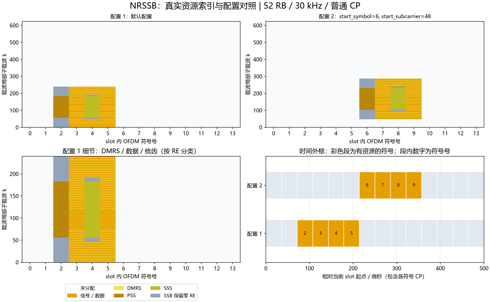

# NRSSB：PSS、SSS、PBCH及关联DMRS

## Python绘图图例



上图使用实际资源索引：上排对照两组配置，左下放大配置1的频域细节，右下按NRCell精确CP长度换算时间。配置未显式列出的字段使用类默认值；彩色时间段表示整个符号内有分配，不表示全部子载波均占用。多层坐标取并集；同RE上的端口叠加不按图层数量重复计面积。

生成脚本：[plot_NRChannel_documentation.py](../../examples/common/plot_NRChannel_documentation.py)。图为平台运行结果及教学示例，不构成新增MATLAB验证。


## 新手导读：生成、时频位置与接收

先看[统一坐标、时间换算和图例](../../documentation/channel_walkthrough.md)。本节使用固定基线：TS38.211 V15.2.0 §7.3.3、§7.4.1.4、§7.4.2/3，原表7.4.3.1-1；TS38.212 V15.2.0 §7.1。以下示意图和数量计算为依据这些章节的辅助推导，不是新增协议原表。详细字段范围、公式变量和支持边界见本文原有参考节。

### 信号怎样生成

SSB组合PSS、SSS、PBCH及PBCH DMRS。PSS/SSS是127点同步序列；原始24位BCH输入加时序字段后载荷交织/加扰、CRC24C、Polar和速率匹配得到864位，再物理加扰及QPSK形成432个PBCH复数。两层加扰用途不同。

### 时间与频率上放在哪里

固定240子载波×4符号。start_subcarrier为载波局部起点，start_symbol为slot局部起点。块内映射示意：

```text
频域区域       块内l=0     l=1       l=2       l=3
0..47             零       B/R       B/R       B/R
48..55            零       B/R       零        B/R
56..182          PSS       B/R      SSS        B/R
183..191          零       B/R       零        B/R
192..239          零       B/R       B/R       B/R
```

B/R表示PBCH与DMRS交错，DMRS偏移PCI mod4、间隔4。总计127 PSS+127 SSS+432 PBCH+144 DMRS+130零RE=960；整个块连同零位置都保留。

30 kHz时频域外框为7.2 MHz；start_symbol=2占slot符号2～5，start_subcarrier=24占载波子载波24～263。改变PCI使PSS/SSS、扰码及DMRS梳齿变化，但不移动240×4外框；改变ssb_index影响参考/载荷，不自动移动时间。Lmax4/8用于当前FR1配置，64用于FR2配置；Case A～E突发时机和raster未实现，由调用者指定位置。

### 接收机怎样恢复

已知240×4窗口内，先搜索3个PSS确定NID2，再搜索336个SSS确定NID1，组成PCI；再搜索8个DMRS索引假设。Lmax4联合区分半帧，Lmax64仅靠DMRS得到低3位，高位由BCH恢复。每PBCH符号用DMRS估平坦信道、MRC、解物理扰码与Polar/CRC，再恢复载荷和SFN。检测到PSS/SSS不代表BCH CRC成功；未实现任意录波中的盲时间/CFO捕获或真实MIB语义解析。

### 如何检查自己的配置

位置检查优先读取资源类的`indices()`，每行是逻辑端口/层、slot符号、载波局部子载波。不要把逻辑端口轴当接收天线。频域点数乘子载波间隔给出计数带宽；精确时域样点由NRCell当前slot逐符号CP加FFT长度累加，算法见统一指南。

发射图先看映射网格，再看IFFT/CP波形；接收图先确认提取/参考匹配，再看均衡或相关及最终判决。已知CFO/时延补偿来自调用者，不是自动同步估计。所有复幅度为平台归一化量，不是dBm。图例本身不扩展MATLAB验证范围。

逐步收发接口见[NRSSBTransmitter](NRSSBTransmitter.md)、[NRSSBReceiver](NRSSBReceiver.md)。


[源码](NRSSB.py)。固定TS38.211 V15.2.0 §7.3.3、§7.4.1.4、§7.4.2及§7.4.3，原表7.4.3.1-1。一次显式SS/PBCH块为240个子载波×4个OFDM符号，单逻辑端口4000，复用NRCell的同numerology载波网格与NROFDM。

## 配置字段

| 字段、默认值 | 含义、范围、单位、示例 |
|---|---|
| cell | NRCell；提供PCI、载波尺寸、slot时序/采样率；例NRCell(n_cell_id=1007,n_size_grid=24) |
| start_subcarrier=0 | SSB第0子载波在载波局部网格的位置0..cell.n_subcarriers-240，整数子载波；例24；允许非RB对齐 |
| start_symbol=2 | SSB首符号在当前slot内的位置0..slot符号数-4，整数；例2占符号2..5 |
| l_max=8 | 候选块数4/8/64；FR1 SSB间隔15/30kHz配4/8，FR2 120/240kHz配64 |
| ssb_index=0 | 当前块索引0..l_max-1，整数；例7/63 |
| half_frame=0 | 发送PBCH中的半帧位0/1；Lmax4时还参与DMRS种子 |
| k_ssb=0 | NRBCHCode的广播追加字段，0..23；只用其MSB或在Lmax64下忽略，不用于自动决定start_subcarrier |

构造/__post_init__验证上述字段；仅普通CP，SSB间隔须为15/30/120/240kHz，须与cell间隔一致。调用方显式给出时频位置，本类不计算Case A～E突发时机、SSB raster、Point A/k_ssb换算或80ms广播周期。不替代MIB语义配置：测试中的原始24位载荷/时序字段可独立构造，实际发射时须由上层保证它们与小区帧号、频段和发射时机一致。

## 原表资源映射

以下为TS38.211 V15.2.0 **原表7.4.3.1-1**转写，l/k均为块内零基坐标；v=PCI mod4。

| 信号 | l | k | RE数量（按原表推导） |
|---|---|---|---|
| PSS | 0 | 56..182 | 127 |
| SSS | 2 | 56..182 | 127 |
| PBCH | 1/3 | 0..239，排除DMRS | 180+180 |
| PBCH | 2 | 0..47及192..239，排除DMRS | 72 |
| PBCH DMRS | 1/3 | v+4m，m=0..59 | 60+60 |
| PBCH DMRS | 2 | v+4m，m=0..11；192+v+4m，m=0..11 | 24 |
| 置零 | 0 | 0..55及183..239 | 113 |
| 置零 | 2 | 48..55及183..191 | 17 |

总计PBCH432点、DMRS144点、同步254点、置零130点，共960RE。map_to_grid保留整个960RE（含置零点），防止其他owner覆盖规范要求的零位置。

## 方法

| 接口 | 功能、单位、维度与示例 |
|---|---|
| pss(n_id_2) | static，组内ID0..2；int8[127]的±1实序列；例pss(2) |
| sss(cell_id) | static，PCI0..1007；int8[127]的±1实序列；例sss(1007) |
| indices(kind='pbch') | kind为pss/sss/pbch/dmrs；int[RE,3]，列为端口0、slot符号、载波局部子载波；先符号后频率 |
| dmrs() | 按indices('dmrs')顺序返回complex[144]单位模参考 |
| scrambling() | 物理PBCH加扰Gold int[864]，不等于BCH载荷加扰 |
| generate(coded_bits) | 校验整数二进制[864]并拒绝bool/float，物理加扰/QPSK，返回complex[432]单位模 |
| map_to_grid(grid,coded_bits,beta=1) | 要求同cell单端口NRGrid，beta有限非负线性幅度，无绝对功率单位；映射整个块owner=SSB；无返回值 |

BCH编码/时序字段不在资源类执行，见[NRBCHCode](../common/NRBCHCode.md)。当前cell.n_tx_antennas不自动复制逻辑波形。

## 公式及变量

SSB-1/2/3均为文档自编号，分别依据上述固定版本§7.4.2、§7.4.1.4、§7.3.3。

$$
PCI=3N_{ID}^{(1)}+N_{ID}^{(2)},\quad d_{PSS}[n]=1-2x[(n+43N_{ID}^{(2)})\bmod127],
$$

$$
d_{SSS}[n]=(1-2x_0[(n+m_0)\bmod127])(1-2x_1[(n+m_1)\bmod127]),\quad
m_0=15\lfloor N_{ID}^{(1)}/112\rfloor+5N_{ID}^{(2)},\quad m_1=N_{ID}^{(1)}\bmod112.\tag{SSB-1}
$$

PCI0..1007，NID1=0..335，NID2=0..2，n=0..126；x/x0/x1为127位m序列，无单位。x和x0递推为x[i+7]=x[i+4] xor x[i]，x1使用i+1/i；PSS初始x[0:7]=[0,1,1,0,1,1,1]，SSS两序列初始[1,0,0,0,0,0,0]。d为int8[127]，BPSK归一化幅度±1。

$$
c_{DMRS}=2^{11}(\bar i+1)(\lfloor PCI/4\rfloor+1)+2^6(\bar i+1)+(PCI\bmod4),\quad
\bar i=\begin{cases}i_{SSB}+4n_{hf}&L_{max}=4\\i_{SSB}\bmod8&L_{max}=8,64.\end{cases}\tag{SSB-2}
$$

i_SSB为配置块索引，n_hf为0/1半帧位，i_bar为0..7整数，c_DMRS为Gold非负整数种子。Gold相邻两位转单位模QPSK，得到144个复参考，频率偏移v=PCI mod4。

$$
\widetilde b_i=b_i\oplus c_{PCI}(i+864\nu),\quad
\nu=i_{SSB}\bmod\begin{cases}4&L_{max}=4\\8&L_{max}=8,64.\end{cases}\tag{SSB-3}
$$

b/tilde_b为int8[864]编码位/加扰位；c_PCI为PCI初始化的Gold；nu为整数分段号0..3/7，i=0..863。相邻两位转QPSK complex[432]，beta再统一缩放PSS/SSS/PBCH/DMRS。

```python
from cell import NRCell
from ssb import NRSSB
r=NRSSB(NRCell(n_cell_id=1007,n_size_grid=24),start_subcarrier=24,ssb_index=7)
assert r.indices('pbch').shape==(432,3)
assert r.indices('dmrs').shape==(144,3)
```

无不同SSB/载波间隔的重采样或混合numerology、突发集调度、波束赋形/多端口、射频上变频或CORESET0/MIB字段打包。FR2使用同一240×4结构，Lmax64索引高位在BCH载荷中携带。

### 可复现的位置对照

以下为当前实现运行得到的派生示例，不是协议原表：小区52 RB、30 kHz、普通CP，BWP与载波同起点，其余使用类默认值。统计是不同(符号,k)的并集，不把多层重复坐标当成额外时频面积；k范围是首末占用点，不表示中间每个RE都占用。SSB只统计非零信号的830个RE，零位置另保留。

| 构造时额外参数 | 实际占用slot符号号 | 载波局部k最小～最大 | 不同占用RE数 |
|---|---|---|---:|
| `{}` | [2, 3, 4, 5] | 0～239 | 830 |
| `{'start_symbol': 6, 'start_subcarrier': 48}` | [6, 7, 8, 9] | 48～287 | 830 |

```python
from cell import NRCell
from ssb import NRSSB
cell = NRCell(n_size_grid=52, subcarrier_spacing_khz=30)
r = NRSSB(cell)
idx = r.indices()
print("坐标形状：", idx.shape, "前3行：", idx[:3])
```

这里只打印少量坐标。要查看频率和持续时间，使用统一指南READ-1/2换算；改变slot或CP后重新计算，不能照抄表中位置。

## 逐变量说明

以下变量对应本文已有公式或算法表达式；规范基线和章节沿用对应公式处的引用。每行只定义一个变量，同名符号只在该公式上下文有效。

| 变量 | 含义与用途 | 范围/约束 | 单位 | 维度/类型 |
|---|---|---|---|---|
| PCI | 物理小区ID，选择同步序列和DMRS位置 | 0..1007，PCI=3NID1+NID2 | ID | 整数标量 |
| NID1 | 小区标识组，编码进SSS | 0..335 | ID组索引 | 整数标量 |
| NID2 | 组内标识，编码进PSS及SSS | 0..2 | ID组内索引 | 整数标量 |
| n | 同步序列点索引，遍历127点 | 0..126 | 序列点索引 | 整数标量 |
| x | PSS使用的m序列比特 | 0/1，周期127，初态见本文SSB-1 | bit | 一维周期序列 |
| x0 | SSS第一条m序列 | 0/1，周期127，递推为i+4及i | bit | 一维周期序列 |
| x1 | SSS第二条m序列 | 0/1，周期127，递推为i+1及i | bit | 一维周期序列 |
| i | 寄存器递推点号，不是SSB块号 | 非负整数，按所需序列长度展开 | 序列点索引 | 整数标量 |
| m0 | SSS第一条m序列的移位 | 15floor(NID1/112)+5NID2，离散0..40 | 序列点偏移 | 整数标量 |
| m1 | SSS第二条m序列的移位 | NID1 mod112，即0..111 | 序列点偏移 | 整数标量 |
| d_PSS | 发送PSS，辅助检测NID2 | 每点−1或+1 | 归一化实幅度 | int8[127] |
| d_SSS | 发送SSS，辅助检测NID1 | 每点−1或+1 | 归一化实幅度 | int8[127] |
| c_DMRS | PBCH DMRS Gold种子，选择参考 | 按SSB-2计算的非负31位整数 | 无量纲 | 整数标量 |
| i_SSB | 当前SSB块索引，参与参考与广播载荷 | 0..Lmax−1 | 块索引 | 整数标量 |
| n_hf | 半帧标识，Lmax4时参与DMRS索引 | 0/1 | 半帧标识 | 整数标量 |
| L_max | 候选块数，选择索引解释规则 | 4/8/64，受当前频段/间隔限制 | 块数 | 整数标量 |
| i_bar | DMRS实际索引，选择8种参考之一 | 0..7，Lmax4含半帧信息 | 参考索引 | 整数标量 |
| v | DMRS在每4个子载波中的偏移 | PCI mod4，即0..3 | 子载波偏移 | 整数标量 |
| m | DMRS梳齿内点序号，定位频率RE | 块内符号1/3为0..59；符号2两端各0..11 | 点索引 | 整数标量 |
| b | BCH编码输出，物理加扰输入 | 每点0/1 | bit | int8[864] |
| tilde_b | 物理加扰后的编码位，供QPSK | 每点0/1 | bit | int8[864] |
| c_PCI | PCI初始化的物理PBCH Gold序列 | 每点0/1；与BCH载荷Gold为不同阶段 | bit | 一维比特序列 |
| nu | 物理加扰片段号，选择Gold偏移 | Lmax4取i_SSB mod4，其他取mod8 | 片段索引 | 整数标量 |
| bit_i | SSB-3的i，比特寻址位置，不是递推点号 | 0..863 | bit索引 | 整数标量 |
